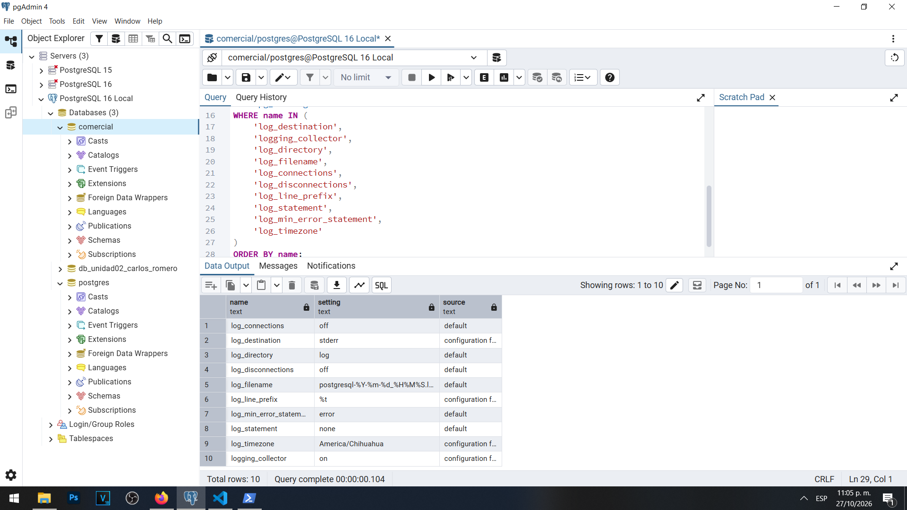

# Actividad 1 — Revisión de la configuración inicial de bitácoras

**Materia:** Gestión de Seguridad y Desempeño de Bases de Datos  
**Unidad:** III — Auditoría, trazabilidad y gobierno práctico de datos  
**Laboratorio:** LAB-01 — Bitácoras y auditoría del dato en PostgreSQL  
**Estudiante:** Carlos Romero  
**Motor:** PostgreSQL 16  
**Sistema operativo:** Windows  
**Herramienta:** pgAdmin 4

## Objetivo

Identificar la configuración inicial de los mecanismos de registro de PostgreSQL, determinar cuáles eventos se almacenan y analizar las limitaciones existentes para reconstruir incidentes relacionados con conexiones, consultas y modificaciones de información.

## Procedimiento

Desde pgAdmin 4, conectado a la base de datos `comercial` como administrador, se consultó la vista `pg_settings` para recuperar los valores y el origen de diez parámetros relacionados con las bitácoras del servidor.

La consulta fue de solo lectura y no modificó ningún parámetro.

## Resultados obtenidos

| Parámetro | Valor observado | Origen |
|---|---|---|
| `log_connections` | `off` | Valor predeterminado |
| `log_destination` | `stderr` | Archivo de configuración |
| `log_directory` | `log` | Valor predeterminado |
| `log_disconnections` | `off` | Valor predeterminado |
| `log_filename` | Patrón de nombre de PostgreSQL; verificar valor completo | Valor predeterminado |
| `log_line_prefix` | `%t` | Archivo de configuración |
| `log_min_error_statement` | `error` | Valor predeterminado |
| `log_statement` | `none` | Valor predeterminado |
| `log_timezone` | `America/Chihuahua` | Archivo de configuración |
| `logging_collector` | `on` | Archivo de configuración |

Se identificó que el colector de bitácoras se encuentra activado y que su destino principal es `stderr`, redirigido por el colector hacia los archivos de registro.

Sin embargo, el registro general de conexiones y desconexiones está desactivado. Asimismo, `log_statement = none` indica que las sentencias SQL ordinarias no se registran de manera general.

## Preguntas y respuestas

### 1. Con esta configuración, ¿se registra quién se conecta?

No se registran de forma general las conexiones exitosas, debido a que el parámetro `log_connections` tiene el valor `off`.

Esto limita la posibilidad de identificar posteriormente el inicio de todas las sesiones y los usuarios que accedieron al servidor.

Sin embargo, algunos errores de conexión o fallos de autenticación pueden generar mensajes en las bitácoras, incluso cuando el registro de conexiones exitosas está desactivado.

Para mejorar la trazabilidad sería necesario habilitar el registro de conexiones y configurar un prefijo que identifique adecuadamente las sesiones.

### 2. ¿Se registran las sentencias UPDATE?

No se registran de manera general las sentencias `UPDATE` ejecutadas correctamente, porque `log_statement` está configurado como `none`.

Esto significa que una modificación realizada por un usuario con permisos puede ejecutarse sin que el registro general de sentencias conserve evidencia del SQL utilizado.

Un `UPDATE` que produzca determinados errores podría aparecer en la bitácora por efecto de los parámetros de registro de errores.

Para investigar modificaciones exitosas sería necesario utilizar mecanismos adicionales de registro y auditoría.

### 3. ¿La línea de bitácora incluye el usuario o la dirección IP del cliente?

El parámetro `log_line_prefix` tiene el valor `%t`, que incorpora una marca de tiempo al inicio de cada entrada.

Esta configuración no incluye explícitamente el nombre del usuario ni la dirección IP del cliente en el prefijo.

Por lo tanto, dificulta relacionar directamente un evento con una identidad y una conexión específica.

Para mejorar la identificación de los eventos se recomienda incorporar información como usuario, base de datos, PID, aplicación y dirección del cliente.

### 4. ¿En qué zona horaria se registran los eventos? ¿Por qué importa al reconstruir una cronología?

El servidor utiliza la zona horaria `America/Chihuahua` para sus bitácoras.

Esta información es importante porque permite interpretar correctamente el momento en que ocurrió cada evento.

Cuando se investigan incidentes que involucran aplicaciones, servidores o usuarios de distintas regiones, las diferencias de zona horaria pueden producir errores al ordenar los acontecimientos.

Para elaborar una cronología confiable es necesario conocer la zona horaria original y convertir las marcas de tiempo a una referencia común cuando corresponda.

### 5. Con logging_collector = off, ¿quién decide dónde termina la bitácora: PostgreSQL o el mecanismo con que se desplegó el servidor?

Cuando `logging_collector` está desactivado, PostgreSQL puede enviar sus mensajes a `stderr`, pero su destino final depende del mecanismo utilizado para ejecutar y administrar el proceso.

Por ejemplo, los mensajes pueden ser capturados por un servicio del sistema operativo, una consola o el mecanismo de registros de un contenedor.

En nuestro laboratorio, sin embargo, `logging_collector` ya está configurado como `on`.

Esto significa que PostgreSQL dispone de un proceso colector encargado de redirigir los mensajes hacia archivos administrados mediante su propia configuración de registros.

Esta diferencia demuestra por qué es necesario consultar los parámetros reales del entorno en lugar de asumir que utiliza todos los valores predeterminados.

## Evidencia

La captura muestra los diez parámetros recuperados mediante `pg_settings`, incluyendo sus valores y el origen de configuración.

## Análisis

El servidor dispone de un mecanismo activo para conservar registros, pero todavía presenta limitaciones importantes para investigar accesos y modificaciones de datos.

Los parámetros de conexiones, desconexiones y registro de sentencias deberán evaluarse en las siguientes actividades.

También será necesario ampliar la información del prefijo de línea para relacionar los eventos con usuarios, sesiones, aplicaciones y direcciones de origen.

## Conclusión

La actividad permitió comprobar que la existencia de un archivo de bitácora no garantiza que todos los eventos relevantes estén registrados.

En particular, contar con un colector activo no significa que sea posible reconstruir cualquier cambio realizado sobre una tabla.

La configuración inicial presenta una oportunidad para demostrar las limitaciones de las bitácoras y posteriormente establecer un mecanismo de auditoría más completo.
