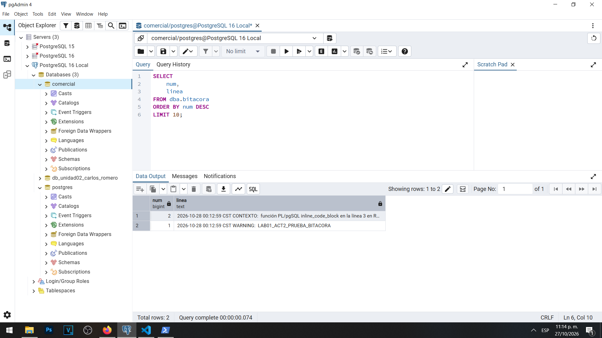

# Actividad 2 — Colector y vista de bitácora

**Materia:** Gestión de Seguridad y Desempeño de Bases de Datos  
**Unidad:** III — Auditoría, trazabilidad y gobierno práctico de datos  
**Laboratorio:** LAB-01 — Bitácoras y auditoría del dato en PostgreSQL  
**Estudiante:** Carlos Romero  
**Motor:** PostgreSQL 16.15  
**Sistema operativo:** Windows  
**Herramientas:** pgAdmin 4 y PostgreSQL

---

## Objetivo

Verificar el funcionamiento del colector de registros de PostgreSQL y crear un mecanismo de consulta SQL para acceder a las bitácoras del servidor, permitiendo identificar eventos relevantes para el análisis de seguridad y la auditoría.

## Procedimiento

La actividad comenzó con la revisión del parámetro `logging_collector`, cuyo valor ya se encontraba configurado como `on` desde los laboratorios anteriores.

Por esta razón no fue necesario habilitar nuevamente el colector ni reiniciar el servicio de PostgreSQL.

Posteriormente se preparó el archivo `01-colector-y-vista.sql`, con consultas para comprobar el estado del colector, identificar la ruta del archivo de registro vigente y crear un esquema administrativo denominado `dba`.

Dentro de dicho esquema se creó la vista `dba.bitacora`, que inicialmente utilizó las funciones `pg_current_logfile()`, `pg_read_file()` y `regexp_split_to_table()` para recuperar y separar las líneas del archivo de bitácora.

También se utilizó `WITH ORDINALITY` para asignar un número a cada línea, facilitando su ordenamiento y consulta.

El acceso público al esquema y a la vista fue restringido para evitar que los usuarios ordinarios consultaran información administrativa sensible.

## Resultados iniciales

Al ejecutar la siguiente consulta:

```sql
SELECT num, linea
FROM dba.bitacora
ORDER BY num DESC
LIMIT 10;
```

La consulta terminó correctamente, pero devolvió cero filas.

Esto indicaba que no existían líneas recuperables en ese momento mediante la vista, por lo que se decidió realizar una prueba controlada.

## Generación de un evento de prueba

Desde pgAdmin 4 se ejecutó el siguiente bloque:

```sql
DO $$
BEGIN
    RAISE WARNING 'LAB01_ACT2_PRUEBA_BITACORA';
END;
$$;
```

El bloque generó intencionalmente una advertencia para verificar que el sistema pudiera registrar un evento y posteriormente recuperarlo mediante SQL.

Después se repitió la consulta sobre `dba.bitacora`.

Esta vez se obtuvieron dos registros.

| Línea | Evento |
|---|---|
| 1 | `WARNING: LAB01_ACT2_PRUEBA_BITACORA` |
| 2 | `CONTEXTO: función PL/pgSQL inline_code_block` |

Ambos eventos se observaron con una marca de tiempo del 28 de octubre de 2026 a las 00:12:59 CST, conforme al reloj de registro del servidor.

El primer registro corresponde a la advertencia generada intencionalmente, mientras que el segundo proporciona información sobre el contexto de ejecución del bloque PL/pgSQL.

Estos resultados confirmaron que PostgreSQL almacenó el evento y que la vista pudo recuperarlo.

## Preguntas y respuestas

### 1. ¿Por qué logging_collector requiere reinicio y log_statement solamente recarga?

El parámetro `logging_collector` controla el proceso interno de PostgreSQL encargado de recolectar los mensajes del servidor y escribirlos en archivos.

Como este proceso se inicia junto con el servidor, cambiar el estado del colector requiere un reinicio para que el nuevo valor entre en funcionamiento.

Por otra parte, `log_statement` determina qué tipos de instrucciones SQL deben registrarse en la bitácora. Este parámetro puede modificarse mediante una recarga de configuración sin detener completamente el servicio.

En nuestro caso no fue necesario reiniciar PostgreSQL porque `logging_collector` ya se encontraba habilitado.

### 2. ¿Qué ventaja tiene leer la bitácora mediante SQL y qué riesgo introduce?

La principal ventaja consiste en consultar los registros mediante instrucciones SQL, permitiendo buscar eventos específicos, filtrar mensajes, ordenar resultados y localizar errores sin abrir manualmente los archivos desde Windows.

También se pueden utilizar condiciones como `LIKE`, `ILIKE` y expresiones regulares para facilitar el análisis de incidentes.

Sin embargo, esta capacidad introduce riesgos porque los archivos de bitácora pueden contener nombres de usuarios, direcciones IP, nombres de aplicaciones, instrucciones SQL y otros datos sensibles.

Además, la lectura de archivos extensos puede consumir memoria y recursos del servidor.

Por esa razón, las consultas administrativas deben utilizarse de forma controlada.

### 3. ¿Quién debería poder consultar dba.bitacora?

La vista `dba.bitacora` debería estar disponible únicamente para los administradores de PostgreSQL y para personal autorizado que tenga responsabilidades de auditoría y seguridad.

Los usuarios ordinarios de la base de datos no necesitan consultar los registros completos del servidor.

En nuestro laboratorio, las cuentas `app_ventas` y `soporte_ana` tienen finalidades específicas relacionadas con la tabla `clientes`, por lo que no deberían disponer de acceso directo a la vista administrativa.

Esta restricción aplica el principio de mínimo privilegio y disminuye el riesgo de divulgar información sensible.

## Evidencias

### Evidencia 02 — Consulta inicial



La primera captura muestra que la vista se consultó correctamente, pero todavía no devolvía filas.

### Evidencia 02B — Evento de prueba registrado


La segunda captura muestra dos líneas recuperadas desde PostgreSQL: la advertencia generada intencionalmente y su contexto PL/pgSQL.

## Observación técnica

La vista inicial funcionó durante la prueba controlada. Posteriormente, en la Actividad 3, una nueva consulta produjo un error relacionado con un byte no válido para UTF-8.

Esto demuestra que la lectura de archivos de registro en Windows también puede requerir atención a la codificación utilizada por los mensajes.

El error posterior no invalida la prueba inicial, pero debe corregirse para garantizar la continuidad de las consultas sobre la bitácora.

## Conclusión

La Actividad 2 permitió comprobar satisfactoriamente que PostgreSQL tiene habilitado su colector de registros y que es posible recuperar eventos mediante una vista SQL.

La primera consulta devolvió cero filas, pero después de generar una advertencia controlada se recuperaron dos registros reales.

Esto confirmó el funcionamiento del mecanismo de registro y permitió comprender la importancia de conservar eventos verificables.

También se identificó la necesidad de restringir el acceso administrativo y considerar los problemas de codificación que pueden surgir al leer los registros desde una instalación de PostgreSQL en Windows.

## Referencia

FIC Academy. *LAB-01 — Bitácoras y auditoría del dato en PostgreSQL*. Unidad III.

https://academy.ficlabs.com.mx/materias/dba/unidad-03/laboratorios/laboratorio-1-bitacoras-y-auditoria-del-dato-postgresql/