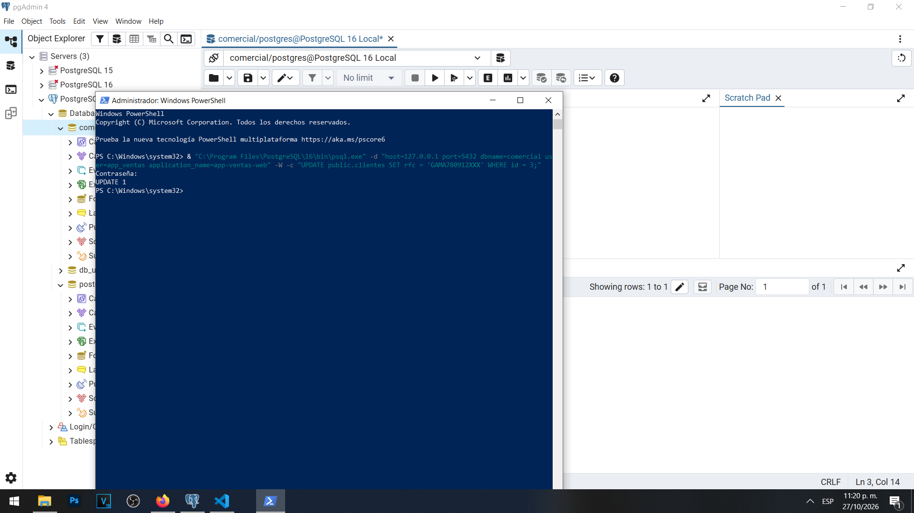
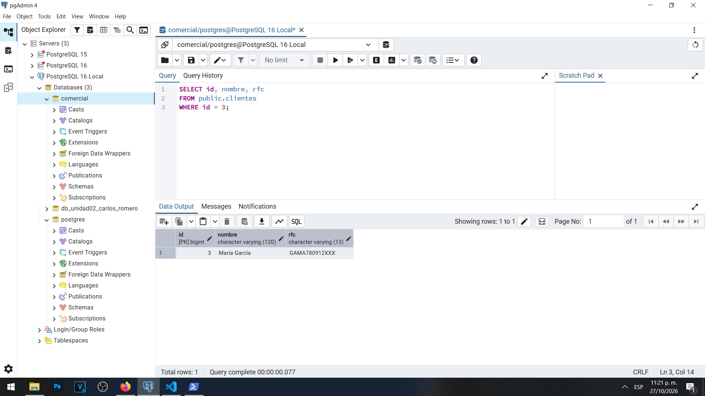
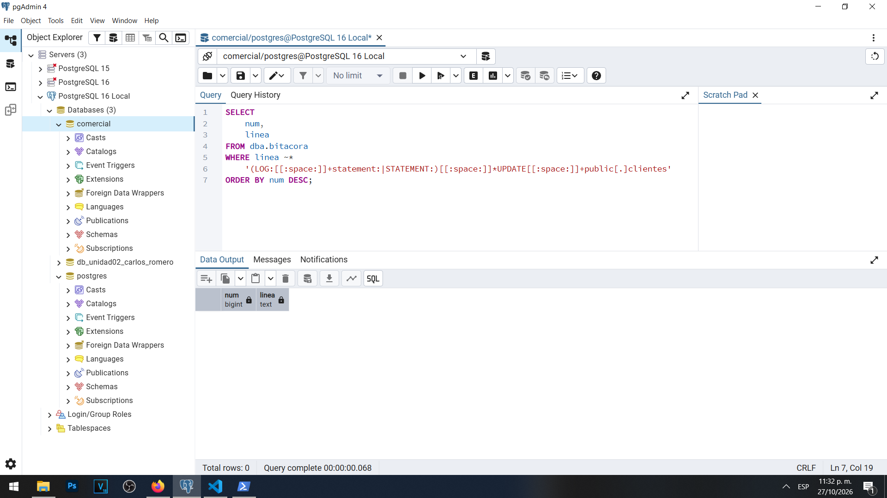

# Actividad 3 — El incidente sin bitácora

**Materia:** Gestión de Seguridad y Desempeño de Bases de Datos  
**Unidad:** III — Auditoría, trazabilidad y gobierno práctico de datos  
**Laboratorio:** LAB-01 — Bitácoras y auditoría del dato en PostgreSQL  
**Estudiante:** Carlos Romero  
**Motor:** PostgreSQL 16  
**Base de datos:** `comercial`

## Objetivo

Simular una modificación de información realizada por un usuario autorizado y comprobar las limitaciones de la configuración inicial de bitácoras de PostgreSQL para reconstruir el incidente.

## 1. Descripción del incidente

En el escenario de Comercializadora Norte S.A. de C.V., el área de facturación reportó que el RFC de una clienta había sido modificado.

Para reproducir el incidente se utilizó la tabla `public.clientes`, que contiene cinco registros ficticios.

La clienta seleccionada fue María García, identificada mediante el ID 3.

Su RFC original era `GAMA780912GHI`.

El objetivo fue modificar el RFC desde la cuenta `app_ventas` y posteriormente investigar si los registros del servidor permitían identificar la operación.

## 2. Ejecución de la modificación

Mediante Windows PowerShell y el cliente `psql` se estableció una conexión a PostgreSQL utilizando la cuenta `app_ventas` y el nombre de aplicación `app-ventas-web`.

Se ejecutó la siguiente instrucción SQL:

```sql
UPDATE public.clientes
SET rfc = 'GAMA780912XXX'
WHERE id = 3;
```

PostgreSQL devolvió el resultado:

```text
UPDATE 1
```

Esto confirmó que se modificó un registro.

### Evidencia 03A — Modificación desde la aplicación



## 3. Comprobación del dato modificado

Posteriormente, desde pgAdmin 4 se consultó la tabla `clientes` para comprobar el nuevo valor del RFC.

```sql
SELECT id, nombre, rfc
FROM public.clientes
WHERE id = 3;
```

El resultado fue:

| ID | Nombre | RFC |
|---|---|---|
| 3 | María García | GAMA780912XXX |

Esto confirmó que la modificación se realizó correctamente.

### Evidencia 03B — RFC modificado



## 4. Investigación de la bitácora

Antes del incidente, la configuración de PostgreSQL presentaba los siguientes valores:

| Parámetro | Valor |
|---|---|
| `log_connections` | `off` |
| `log_disconnections` | `off` |
| `log_statement` | `none` |
| `log_line_prefix` | `%t` |
| `logging_collector` | `on` |

Se utilizó la vista administrativa `dba.bitacora` para investigar si existía una entrada que registrara directamente la modificación.

La búsqueda inicial encontró dificultades relacionadas con la codificación de caracteres del archivo de bitácora.

Para corregirlas se actualizó la vista utilizando `pg_read_binary_file()`, una conversión de lectura `LATIN1` y `COLLATE "default"`.

Una vez resueltos estos problemas, se realizó una búsqueda más específica de sentencias `UPDATE` sobre la tabla `public.clientes`.

```sql
SELECT num, linea
FROM dba.bitacora
WHERE linea ~*
    '(LOG:[[:space:]]+statement:|STATEMENT:)[[:space:]]*UPDATE[[:space:]]+public[.]clientes'
ORDER BY num DESC;
```

La consulta terminó correctamente y devolvió cero filas.

Este resultado indica que no se encontró una entrada correspondiente a la sentencia en el archivo vigente mediante la búsqueda realizada.

Aunque otras consultas recuperaron fragmentos SQL relacionados con búsquedas anteriores, no constituían evidencia directa de la modificación original.

### Evidencia 03C — Búsqueda del incidente



## 5. Preguntas y respuestas

### 1. ¿Puedes demostrar quién modificó el RFC?

En esta práctica sabemos que se utilizó la cuenta `app_ventas`, porque ejecutamos personalmente la instrucción y conservamos la captura de PowerShell.

Sin embargo, utilizando únicamente la bitácora inicial de PostgreSQL no fue posible demostrar de forma independiente qué sesión ejecutó la modificación.

Esto se debe a que el registro general de sentencias estaba desactivado y el prefijo de línea no incorporaba información suficiente para identificar al usuario.

La evidencia de ejecución del laboratorio y una bitácora de auditoría son mecanismos diferentes.

Por lo tanto, la respuesta desde el punto de vista de la investigación de la bitácora es que no contamos con evidencia suficiente para atribuir directamente la operación a una sesión concreta.

### 2. ¿Puedes demostrar que el cambio no lo hizo soporte_ana?

La cuenta `soporte_ana` fue configurada únicamente con permisos `SELECT` sobre la tabla `clientes`.

Por ese motivo, no debería poder ejecutar directamente un `UPDATE` sobre dicha tabla utilizando sus privilegios actuales.

La configuración de permisos permite descartar que esta cuenta realizara normalmente esa operación directa bajo las condiciones verificadas.

Sin embargo, los permisos no sustituyen un registro histórico de eventos.

Sin una bitácora adecuada, no podemos reconstruir exhaustivamente todas las acciones efectuadas durante el periodo del incidente ni atribuir cada una a una sesión.

### 3. Los privilegios de la Unidad II, ¿impidieron el cambio? ¿Debían impedirlo?

Los privilegios no impidieron la modificación porque `app_ventas` tenía autorizado el permiso `UPDATE` sobre `public.clientes`.

Ese comportamiento era correcto, ya que la función de la cuenta de ventas incluye modificar determinados datos de clientes.

El objetivo del control de acceso es permitir operaciones autorizadas y bloquear aquellas que no corresponden a cada usuario.

Por lo tanto, los privilegios funcionaron conforme a su configuración.

El problema principal no fue que PostgreSQL permitiera una operación autorizada, sino que la configuración inicial no proporcionaba suficiente información para investigar posteriormente quién realizó el cambio y cuáles fueron sus circunstancias.

### 4. ¿Qué tendría que haber estado configurado antes del incidente?

Antes del incidente habría sido necesario implementar mecanismos de registro y auditoría adecuados.

Entre los principales controles se encuentran:

- Activar `log_connections` y `log_disconnections` para registrar el inicio y cierre de las sesiones.
- Utilizar un `log_line_prefix` que incluya fecha, hora, PID, usuario, base de datos, aplicación y dirección del cliente.
- Configurar un nivel de registro apropiado para las sentencias que se necesitan auditar, considerando que `log_statement = 'ddl'` no registra los `UPDATE` ordinarios.
- Implementar auditoría a nivel de dato mediante disparadores, para conservar valores anteriores y nuevos.
- Proteger y conservar los archivos de bitácora frente a accesos o modificaciones no autorizadas.

Estas medidas deberían encontrarse activas antes del acontecimiento.

Configurar una bitácora posteriormente no permite recuperar de manera automática información que nunca fue registrada.

## 6. Análisis de los resultados

La actividad permitió demostrar que existe una diferencia entre autorización y auditoría.

El usuario `app_ventas` tenía permisos suficientes para modificar la tabla, mientras que `soporte_ana` tenía permisos limitados a consulta.

Se comprobó que la instrucción ejecutada como `app_ventas` modificó un registro y que el nuevo RFC quedó almacenado correctamente.

No obstante, la búsqueda realizada sobre el archivo de bitácora vigente no encontró una entrada que registrara directamente esa modificación.

Este resultado es coherente con la configuración inicial, que no tenía habilitado el registro general de sentencias SQL.

La prueba no demuestra la inexistencia absoluta de información en archivos históricos ni permite afirmar que se inspeccionaron todos los posibles registros del servidor.

## 7. Conclusión

La Actividad 3 permitió comprender por qué los permisos de acceso no son suficientes para garantizar la trazabilidad de una base de datos.

Aunque PostgreSQL autorizó correctamente la modificación realizada por `app_ventas`, el registro inicial del servidor no proporcionó evidencia suficiente para reconstruir el incidente de manera independiente.

Esto demuestra la importancia de configurar los mecanismos de auditoría antes de que ocurran los eventos.

También permitió identificar la necesidad de registrar información de las sesiones y de implementar mecanismos adicionales para conservar el valor anterior y el nuevo de los datos modificados.

La siguiente actividad estará enfocada en mejorar la configuración de bitácoras del servidor.
