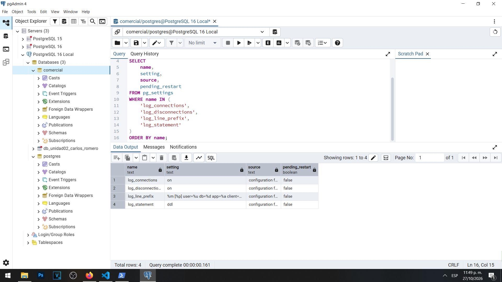
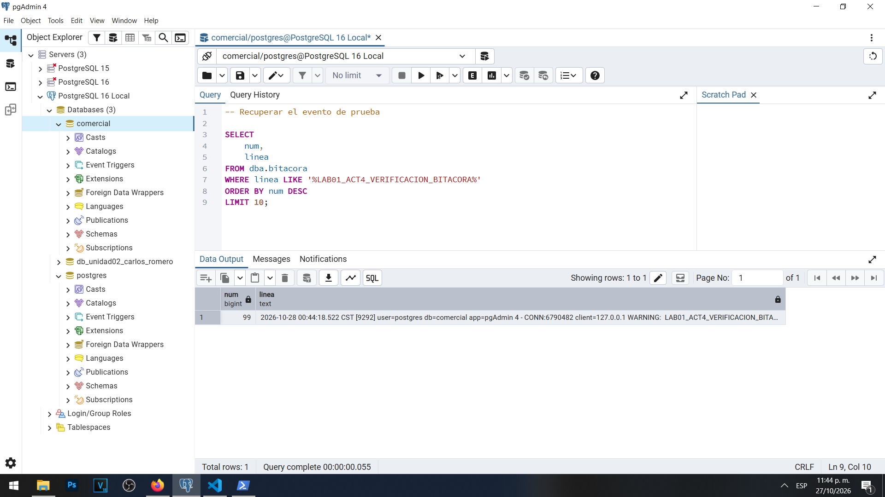

# Actividad 4 — Configuración de la bitácora de PostgreSQL

**Materia:** Gestión de Seguridad y Desempeño de Bases de Datos  
**Unidad:** III — Auditoría, trazabilidad y gobierno práctico de datos  
**Laboratorio:** LAB-01 — Bitácoras y auditoría del dato en PostgreSQL  
**Estudiante:** Carlos Romero  
**Motor:** PostgreSQL 16  
**Base de datos:** `comercial`  
**Herramientas:** pgAdmin 4 y Windows PowerShell

---

## Objetivo

Configurar los parámetros de registro de PostgreSQL para mejorar la identificación de las conexiones, desconexiones, usuarios, aplicaciones y operaciones relacionadas con la estructura de las bases de datos.

## 1. Configuración inicial

Durante la Actividad 1 se identificaron los siguientes valores:

| Parámetro | Valor inicial |
|---|---|
| `log_connections` | `off` |
| `log_disconnections` | `off` |
| `log_line_prefix` | `%t` |
| `log_statement` | `none` |

Esta configuración limitaba la trazabilidad de los accesos y dificultaba relacionar un evento con una sesión determinada.

Aunque el colector de registros ya se encontraba habilitado, no se registraban de forma general las conexiones exitosas ni las sentencias SQL ordinarias.

## 2. Procedimiento

Se utilizó la cuenta administrativa `postgres` para modificar la configuración mediante instrucciones `ALTER SYSTEM`.

Los cambios establecidos fueron:

```sql
ALTER SYSTEM SET log_connections = on;
ALTER SYSTEM SET log_disconnections = on;
ALTER SYSTEM SET log_line_prefix =
'%m [%p] user=%u db=%d app=%a client=%h ';
ALTER SYSTEM SET log_statement = 'ddl';
```

Posteriormente se ejecutó:

```sql
SELECT pg_reload_conf();
```

Esta instrucción solicitó la recarga de la configuración sin reiniciar el servicio completo de PostgreSQL.

Los cambios quedaron almacenados mediante el mecanismo de configuración administrado por `ALTER SYSTEM`.

## 3. Resultados obtenidos

La verificación final desde pgAdmin 4 mostró los siguientes valores:

| Parámetro | Valor final | Estado |
|---|---|---|
| `log_connections` | `on` | Aplicado |
| `log_disconnections` | `on` | Aplicado |
| `log_line_prefix` | `%m [%p] user=%u db=%d app=%a client=%h ` | Aplicado |
| `log_statement` | `ddl` | Aplicado |

Los cuatro parámetros presentaron `pending_restart = false`.

También se observó que su origen correspondía a archivos de configuración.

### Particularidad de las sesiones existentes

Durante la verificación se identificó que una sesión antigua de pgAdmin continuaba mostrando `off` para `log_connections` y `log_disconnections`.

Para comprobar el estado efectivo se inició una nueva conexión mediante `psql` desde PowerShell. Esta conexión mostró ambos parámetros en `on`.

Posteriormente se cerró y volvió a abrir pgAdmin 4. Al establecer una nueva sesión, los cuatro parámetros aparecieron con sus valores actualizados.

Esto permitió comprobar que ciertos parámetros de registro conservan su valor por sesión y que una recarga de configuración no necesariamente modifica inmediatamente las opciones de sesiones ya iniciadas.

### Evidencia 04A — Configuración aplicada



## 4. Verificación del nuevo formato de registro

Después de configurar los parámetros se generó un evento de prueba mediante una advertencia de PostgreSQL.

El identificador utilizado fue:

`LAB01_ACT4_VERIFICACION_BITACORA`

Posteriormente se consultó la vista administrativa `dba.bitacora`.

Se recuperó una línea correspondiente a la advertencia, con una marca de tiempo del 28 de octubre de 2026 a las 00:44:18.522 CST, conforme al archivo de registro.

La entrada incluyó información como:

- PID del proceso.
- Usuario `postgres`.
- Base de datos `comercial`.
- Aplicación `pgAdmin 4`.
- Dirección de cliente `127.0.0.1`.
- Severidad `WARNING`.
- Identificador del evento generado.

Esto confirmó que el nuevo prefijo de registro funciona correctamente y proporciona mayor información para interpretar los acontecimientos.

### Evidencia 04B — Verificación del formato



La evidencia demuestra el nuevo formato mediante una advertencia controlada. No se presenta como una captura directa de los mensajes históricos de recarga de parámetros.

## 5. Preguntas y respuestas

### 1. ¿Por qué el proceso que registra el cambio es el principal y no tu sesión?

Porque la configuración global de PostgreSQL es administrada por procesos internos del servidor.

Cuando se ejecuta `ALTER SYSTEM`, la instrucción modifica los valores almacenados en la configuración administrada por PostgreSQL.

Posteriormente, `pg_reload_conf()` solicita que el servidor procese la nueva configuración.

Los mensajes relacionados con la aplicación de parámetros pueden ser emitidos por el proceso principal porque es el responsable de gestionar la configuración del servidor.

La sesión administrativa solicita la modificación, pero no realiza por sí misma todas las operaciones internas necesarias para aplicar los parámetros.

### 2. ¿Qué pasaría si alguien ejecutara ALTER SYSTEM SET log_statement = 'none'? ¿Quedaría rastro?

Si alguien configurara `log_statement = 'none'`, PostgreSQL dejaría de registrar de forma general las sentencias controladas por ese parámetro una vez aplicada la modificación.

Sin embargo, esto no significa necesariamente que desaparezcan todos los registros del servidor.

Los mensajes relacionados con la recarga y cambios de configuración pueden permanecer en la bitácora mediante mecanismos independientes de `log_statement`.

También pueden seguir registrándose errores, conexiones y desconexiones de acuerdo con sus respectivos parámetros.

Por lo tanto, desactivar el registro de sentencias no equivale a desactivar todos los mecanismos de auditoría, aunque reduciría considerablemente la información disponible para investigar ciertas operaciones.

### 3. ¿Por qué no se recomienda editar postgresql.auto.conf a mano?

Porque `postgresql.auto.conf` es un archivo administrado automáticamente por PostgreSQL mediante `ALTER SYSTEM`.

Editar directamente su contenido puede generar errores de sintaxis, configuraciones inconsistentes o conflictos con futuras modificaciones administrativas.

Además, hacerlo manualmente dificulta identificar qué instrucciones fueron utilizadas para modificar los parámetros.

Por esta razón es recomendable utilizar mecanismos soportados por PostgreSQL, verificar los resultados mediante `pg_settings` y conservar documentación de las modificaciones realizadas.

## 6. Análisis

La configuración aplicada permite registrar conexiones y desconexiones, así como incorporar información más detallada al comienzo de cada entrada.

El parámetro `log_statement = 'ddl'` permite registrar sentencias relacionadas con cambios de estructura, pero no registra automáticamente todas las modificaciones ordinarias de datos realizadas mediante `UPDATE`.

Por ello, el registro del servidor todavía debe complementarse con mecanismos de auditoría específicos cuando sea necesario conservar los valores anteriores y nuevos de un registro.

También se comprobó que los cambios globales deben verificarse utilizando conexiones nuevas cuando los parámetros mantienen valores asociados al inicio de la sesión.

## 7. Conclusión

La Actividad 4 permitió mejorar la configuración de bitácoras de PostgreSQL 16 mediante cuatro parámetros relacionados con conexiones, desconexiones, identificación de sesiones y operaciones DDL.

Se comprobó que los cambios quedaron aplicados y que el nuevo formato de registro permite identificar mejor al usuario, la aplicación, la base de datos y el origen de una conexión.

La actividad también demostró la importancia de diferenciar entre configurar un parámetro y verificar su funcionamiento en una sesión nueva.

Estas medidas proporcionan una base más adecuada para investigar accesos exitosos y fallidos durante las siguientes actividades.

