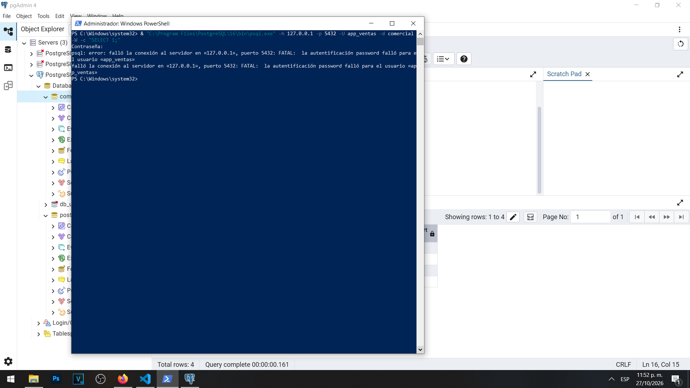
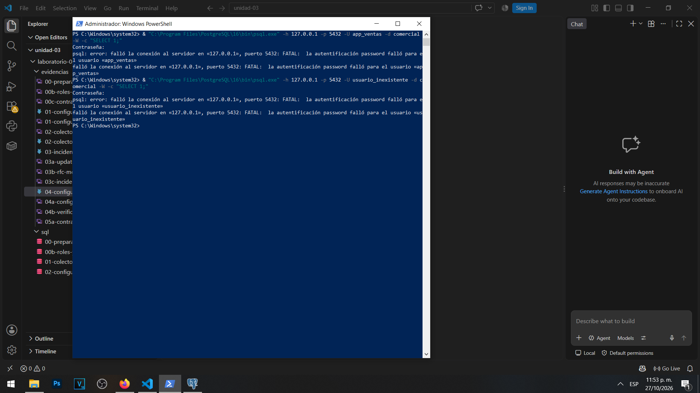
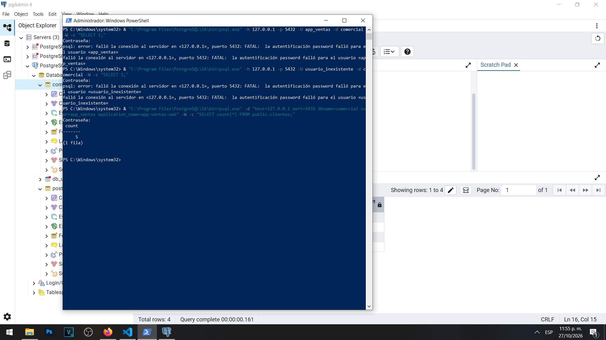
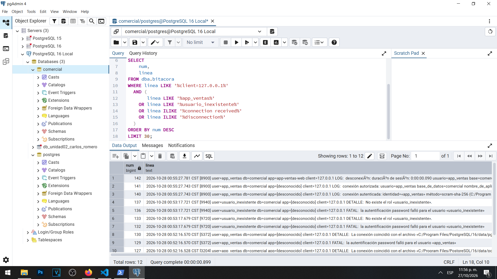

# Actividad 5 — Accesos exitosos y fallidos

**Materia:** Gestión de Seguridad y Desempeño de Bases de Datos  
**Unidad:** III — Auditoría, trazabilidad y gobierno práctico de datos  
**Laboratorio:** LAB-01 — Bitácoras y auditoría del dato en PostgreSQL  
**Estudiante:** Carlos Romero  
**Motor:** PostgreSQL 16  
**Sistema operativo:** Windows  
**Base de datos:** `comercial`

---

## 1. Objetivo

Comprobar el funcionamiento de las bitácoras de PostgreSQL mediante la generación de conexiones exitosas y fallidas, identificando la información registrada por el servidor sobre los usuarios, el método de autenticación, la dirección de origen, la aplicación y los resultados de cada intento.

## 2. Configuración utilizada

Durante la Actividad 4 se habilitaron los siguientes parámetros:

| Parámetro | Valor |
|---|---|
| `log_connections` | `on` |
| `log_disconnections` | `on` |
| `log_statement` | `ddl` |
| `log_line_prefix` | `%m [%p] user=%u db=%d app=%a client=%h ` |

Esta configuración permite conservar eventos relacionados con las conexiones y desconexiones de usuarios.

Las pruebas se realizaron mediante PowerShell y el cliente `psql`, utilizando la dirección local `127.0.0.1` y el puerto 5432.

## 3. Prueba 1 — Contraseña incorrecta

Se intentó establecer una conexión a la base de datos `comercial` utilizando la cuenta `app_ventas` y una contraseña deliberadamente incorrecta.

El servidor rechazó la autenticación y devolvió un mensaje `FATAL` indicando que la contraseña no era válida para el usuario.

Este resultado confirmó que PostgreSQL exige credenciales correctas para permitir el acceso y que el intento rechazado genera evidencia en el registro.

### Evidencia 05A — Autenticación fallida



## 4. Prueba 2 — Usuario inexistente

Se realizó un segundo intento de conexión utilizando el nombre `usuario_inexistente`, que no corresponde a ninguna cuenta creada en el servidor.

La conexión fue rechazada.

El mensaje entregado al cliente indicó un fallo de autenticación. Sin embargo, la bitácora administrativa incorporó un detalle adicional que señala que el rol solicitado no existe.

Esto demuestra que PostgreSQL conserva información interna útil para los administradores sin exponer necesariamente todos los detalles al cliente que intenta conectarse.

### Evidencia 05B — Cuenta inexistente



## 5. Prueba 3 — Conexión exitosa

En la tercera prueba se utilizaron las credenciales correctas de `app_ventas` y se identificó la aplicación con el nombre `app-ventas-web`.

Se ejecutó una consulta para contar los registros de la tabla `public.clientes`.

El resultado fue:

```text
count
-----
5
```

La consulta se ejecutó correctamente y confirmó que el usuario podía acceder a los datos autorizados.

Posteriormente se identificaron eventos de autenticación, autorización de la conexión y desconexión en la bitácora.

### Evidencia 05C — Conexión exitosa



## 6. Investigación de la bitácora

Desde pgAdmin 4 se consultó la vista administrativa `dba.bitacora`.

Se utilizaron filtros por dirección de origen, usuarios y mensajes de conexión.

La consulta produjo 12 filas, entre las cuales se identificaron registros relacionados con los intentos fallidos y con la conexión exitosa.

Entre los eventos observados se encuentran:

- Fallos de autenticación para `app_ventas`.
- Fallos de autenticación para `usuario_inexistente`.
- Mensajes administrativos indicando que el rol solicitado no existe.
- Autenticación correcta de `app_ventas` mediante SCRAM-SHA-256.
- Autorización de conexión a la base `comercial`.
- Identificación de la aplicación `app-ventas-web`.
- Desconexión y duración de la sesión.

En los resultados también se observaron identificadores de proceso que permiten relacionar mensajes pertenecientes a una misma conexión.

### Evidencia 05D — Registros de conexiones



## 7. Interpretación de una entrada de bitácora

En una de las líneas de desconexión se identificaron los siguientes elementos:

| Campo | Valor observado | Significado |
|---|---|---|
| Fecha y hora | 2026-10-28 00:55:27.781 CST | Momento registrado por el servidor |
| PID | 8900 | Proceso asociado con la sesión |
| Usuario | `app_ventas` | Identidad autenticada |
| Base de datos | `comercial` | Base utilizada |
| Aplicación | `app-ventas-web` | Nombre declarado por el cliente |
| Cliente | `127.0.0.1` | Dirección de origen |
| Severidad | `LOG` | Evento informativo |
| Tipo de evento | Desconexión | Finalización de sesión |

Esta información facilita la identificación de sesiones y la reconstrucción de acontecimientos.

El PID es especialmente útil para relacionar mensajes generados durante una misma conexión.

Debe considerarse que el nombre de aplicación es proporcionado por el cliente y no demuestra por sí solo qué programa físico realizó la conexión.

## 8. Preguntas y respuestas

### 1. ¿El registro de app_ventas en un intento fallido demuestra que fue la aplicación de ventas?

No necesariamente.

El registro demuestra que un cliente intentó autenticarse utilizando el nombre de usuario `app_ventas`, pero no permite afirmar automáticamente que el intento provino de la aplicación legítima.

Un tercero también podría intentar establecer una conexión utilizando ese nombre de usuario.

La bitácora proporciona información sobre la identidad solicitada, el origen de la conexión y el momento del intento.

Para atribuir el evento a una aplicación específica sería necesario correlacionar esta información con registros de aplicación, dispositivos, redes y otros mecanismos de monitoreo.

### 2. ¿Qué información adicional se registra cuando el rol no existe y por qué no se entrega toda al cliente?

Cuando se intentó acceder utilizando `usuario_inexistente`, PostgreSQL registró un mensaje adicional indicando que el rol no existe.

Este detalle permite al administrador diferenciar un intento con credenciales incorrectas de uno realizado utilizando una identidad que no está registrada.

El cliente recibió un mensaje general de error de autenticación.

Esta separación resulta importante porque revelar directamente si una cuenta existe puede facilitar intentos de enumeración de usuarios.

Por lo tanto, los registros administrativos contienen información más detallada para la investigación, mientras que las respuestas externas limitan la divulgación de ciertos datos internos.

### 3. ¿Por qué aparece una aplicación desconocida durante el intento fallido y app-ventas-web en la desconexión exitosa?

Durante las primeras etapas de una conexión, PostgreSQL todavía puede no disponer de toda la información de la sesión.

Por esa razón, ciertos registros de autenticación muestran la aplicación como desconocida.

Cuando la conexión se establece correctamente y el cliente proporciona su identificación, PostgreSQL puede registrar el nombre `app-ventas-web`.

Posteriormente, al finalizar la sesión, la información de la aplicación ya se encuentra disponible y aparece en el registro de desconexión.

Esto demuestra que una misma conexión puede generar varias entradas, cada una con información diferente según la etapa en que se produjo el evento.

### 4. ¿Qué patrón indicaría un posible ataque de fuerza bruta y cómo contar los intentos fallidos?

Un posible ataque de fuerza bruta podría identificarse mediante una cantidad elevada de errores consecutivos de autenticación durante un periodo corto.

Entre los indicadores se encuentran múltiples mensajes `FATAL`, repetición de nombres de usuario, reiteración de direcciones IP y aparición de numerosos intentos con intervalos pequeños.

Para contar las líneas de fallo de autenticación por usuario se puede utilizar la siguiente consulta:

```sql
SELECT
    substring(
        linea FROM 'user=([^[:space:]]+)'
    ) AS usuario,
    COUNT(*) AS fallos_registrados
FROM dba.bitacora
WHERE linea LIKE '%FATAL:%'
  AND linea ILIKE '%password%'
GROUP BY
    substring(
        linea FROM 'user=([^[:space:]]+)'
    )
ORDER BY fallos_registrados DESC;
```

Esta consulta cuenta mensajes de fallo en el archivo vigente, no necesariamente todos los intentos históricos del servidor.

Para una investigación más completa sería necesario analizar también otros archivos de bitácora, las direcciones de origen, los PID y los periodos de tiempo.

Los intentos realizados en este laboratorio fueron pruebas controladas y no constituyen evidencia de un ataque real.

## 9. Observación sobre la codificación

Durante la consulta de la bitácora se observaron algunos caracteres acentuados representados incorrectamente.

Esta situación está relacionada con la conversión de codificación utilizada para consultar archivos de PostgreSQL en Windows.

Aunque los mensajes contienen caracteres alterados, los datos principales necesarios para la auditoría, como usuarios, direcciones, PID, nombres de aplicación y resultados de autenticación, pudieron identificarse.

La conversión utilizada permite analizar los eventos, pero no debe considerarse una solución definitiva para preservar fielmente todos los caracteres del archivo original.

## 10. Conclusión

La Actividad 5 permitió comprobar que PostgreSQL registra correctamente los eventos de autenticación fallida, conexiones autorizadas y desconexiones cuando los parámetros correspondientes se encuentran habilitados.

Las pruebas demostraron que la bitácora permite distinguir un intento de conexión con contraseña incorrecta, un usuario inexistente y una conexión autenticada correctamente.

También se identificó que los registros administrativos ofrecen información más detallada que los mensajes recibidos por los clientes.

Finalmente, se concluye que las bitácoras representan una herramienta fundamental para investigar incidentes y detectar patrones sospechosos, aunque requieren mecanismos adicionales para atribuir eventos con mayor precisión y conservar un historial suficiente.
