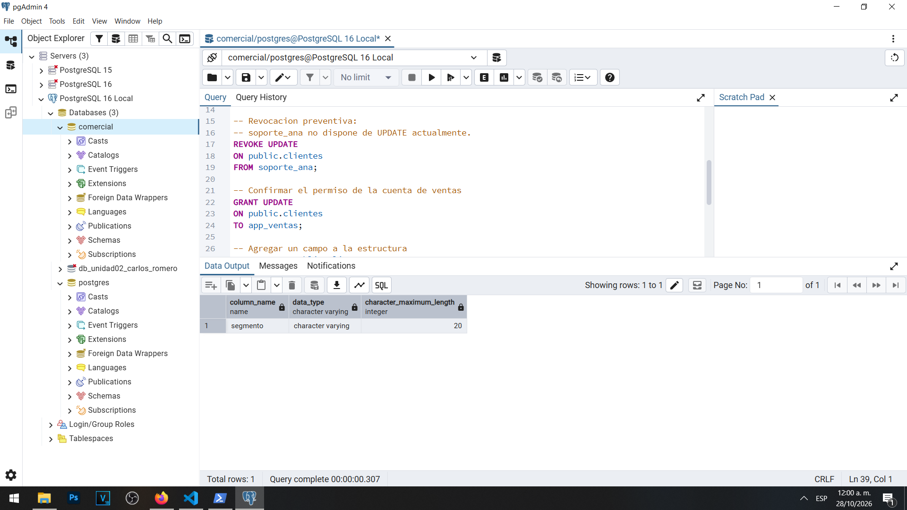
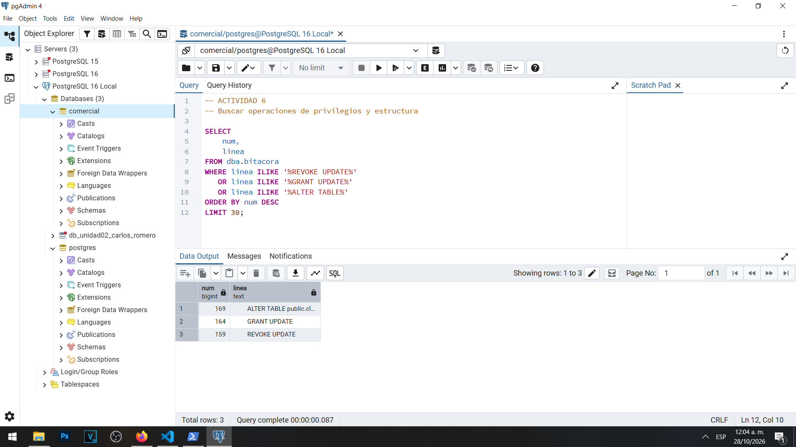
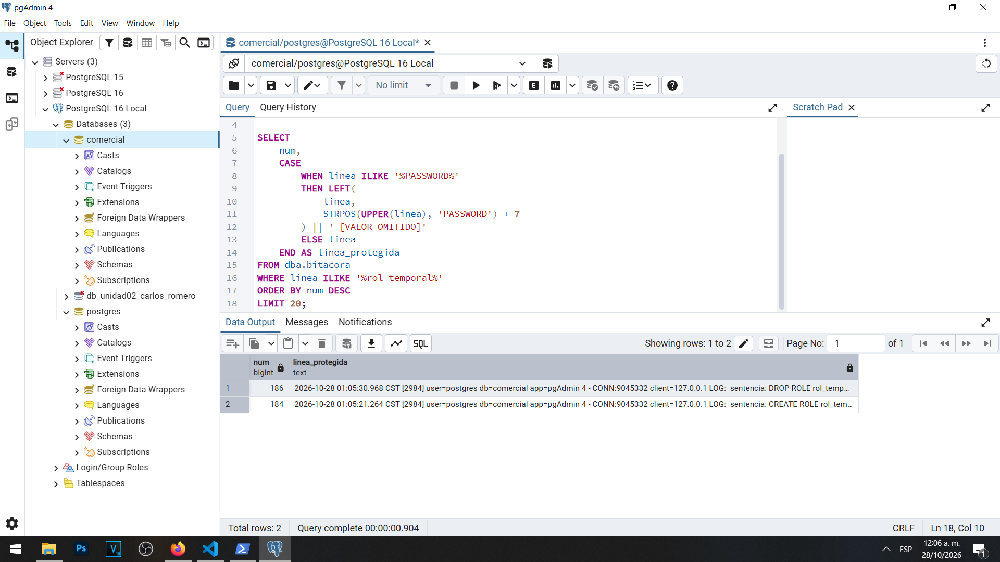

# Actividad 6 — Cambios de privilegios y de estructura

**Materia:** Gestión de Seguridad y Desempeño de Bases de Datos  
**Unidad:** III — Auditoría, trazabilidad y gobierno práctico de datos  
**Laboratorio:** LAB-01 — Bitácoras y auditoría del dato en PostgreSQL  
**Estudiante:** Carlos Romero  
**Motor:** PostgreSQL 16  
**Sistema operativo:** Windows  
**Base de datos:** `comercial`  
**Herramienta:** pgAdmin 4

---

## 1. Objetivo

Comprobar que PostgreSQL registra los cambios de privilegios y de estructura cuando se encuentra habilitado `log_statement = 'ddl'`, así como identificar los riesgos que representa almacenar instrucciones SQL que contienen contraseñas u otra información sensible.

## 2. Configuración utilizada

Durante la Actividad 4 se configuró el parámetro `log_statement` con el valor `ddl`.

Este nivel permite registrar operaciones de definición y administración, incluyendo instrucciones como `GRANT`, `REVOKE`, `CREATE`, `ALTER` y `DROP`.

También se mantuvo activo el prefijo de bitácora que incorpora fecha, hora, PID, usuario, base de datos, aplicación y dirección del cliente.

Las operaciones de la actividad se ejecutaron como administrador `postgres` en la base `comercial`.

## 3. Cambios de privilegios

Se ejecutaron las siguientes instrucciones:

```sql
REVOKE UPDATE
ON public.clientes
FROM soporte_ana;

GRANT UPDATE
ON public.clientes
TO app_ventas;
```

La primera instrucción constituye una revocación preventiva de permisos. La cuenta `soporte_ana` ya estaba configurada únicamente para consultar datos, por lo que revocar un permiso de actualización que no tenía no provocó un error.

La segunda instrucción reafirmó el permiso `UPDATE` de la cuenta `app_ventas`, que necesita modificar determinados datos de clientes.

Ambas operaciones son relevantes desde el punto de vista de auditoría, porque permiten documentar las decisiones administrativas relacionadas con la autorización de usuarios.

## 4. Cambio de estructura

Posteriormente se ejecutó:

```sql
ALTER TABLE public.clientes
ADD COLUMN segmento VARCHAR(20);
```

La operación agregó la columna `segmento` a la tabla `clientes`.

Se verificó mediante `information_schema.columns` que la columna existe, que su tipo de dato es `character varying` y que su longitud máxima es de 20 caracteres.

### Evidencia 06A — Nueva columna



## 5. Verificación de la bitácora

Se utilizó la vista administrativa `dba.bitacora` para buscar las operaciones realizadas.

La consulta recuperó tres coincidencias principales:

| Línea | Operación | Clasificación |
|---|---|---|
| 159 | `REVOKE UPDATE` | Cambio de privilegios |
| 164 | `GRANT UPDATE` | Cambio de privilegios |
| 169 | `ALTER TABLE` | Cambio de estructura |

Los resultados confirmaron que las tres instrucciones quedaron representadas en el archivo de bitácora consultado.

Fue necesario ajustar la búsqueda porque las instrucciones SQL se habían ejecutado utilizando varias líneas y la vista separa los mensajes del archivo según sus saltos de línea.

### Evidencia 06B — Privilegios y estructura



## 6. Demostración del riesgo de exposición de contraseñas

Para comprobar que las bitácoras pueden registrar información sensible se utilizó una cuenta temporal denominada `rol_temporal`.

La cuenta se creó mediante una instrucción `CREATE ROLE` que incluía una contraseña ficticia dentro del texto SQL.

Posteriormente se ejecutó `DROP ROLE` para eliminarla.

Al consultar la bitácora se identificaron dos eventos:

| Línea | Operación |
|---|---|
| 184 | `CREATE ROLE rol_temporal` |
| 186 | `DROP ROLE rol_temporal` |

Estos resultados demostraron que PostgreSQL conserva las instrucciones administrativas registradas, incluso después de eliminar la cuenta temporal.

La sentencia original de creación contenía una contraseña ficticia. Por seguridad, su valor no se reproduce en este documento.

Para mostrar la evidencia se utilizó una consulta que presenta una versión protegida de las líneas y omite el valor posterior a la palabra `PASSWORD`.

### Evidencia 06C — Registro protegido



La protección se aplicó a los resultados de la consulta. El archivo original de bitácora no fue modificado.

## 7. Preguntas y respuestas

### 1. ¿Qué tipo de evento es cada una de las tres primeras sentencias: privilegio o estructura?

La instrucción `REVOKE UPDATE ON public.clientes FROM soporte_ana` corresponde a un cambio de privilegios, porque tiene como finalidad retirar una autorización de modificación sobre una tabla.

La instrucción `GRANT UPDATE ON public.clientes TO app_ventas` también corresponde a un cambio de privilegios, ya que concede o reafirma una autorización sobre un objeto de la base de datos.

Por último, `ALTER TABLE public.clientes ADD COLUMN segmento VARCHAR(20)` corresponde a un cambio de estructura, porque modifica la definición de una tabla al agregar una nueva columna.

Las tres operaciones son importantes para una auditoría administrativa, aunque no todas modifiquen directamente los valores almacenados en los registros.

### 2. ¿Por qué GRANT y REVOKE quedan registrados con log_statement = 'ddl'?

Porque PostgreSQL incluye estas instrucciones dentro de las operaciones administrativas que registra el nivel `ddl`.

Aunque `GRANT` y `REVOKE` no modifican la estructura física de una tabla, sí afectan las autorizaciones asociadas con los objetos y roles del sistema.

Registrar estas operaciones permite reconstruir cómo se administraron los accesos y detectar posibles concesiones o revocaciones indebidas.

La prueba también demostró que una revocación preventiva puede quedar registrada aunque el usuario no dispusiera previamente del permiso retirado.

### 3. Si la bitácora contiene contraseñas, ¿quién debería poder leerla? Relaciónalo con la gestión de secretos de la Unidad II.

Las bitácoras deberían ser consultadas únicamente por administradores y personal autorizado para realizar funciones de seguridad, auditoría e investigación.

Esto se debe a que pueden contener datos sensibles, como nombres de usuarios, direcciones IP, sentencias SQL y contraseñas escritas incorrectamente dentro de instrucciones administrativas.

Durante la Unidad II se estudió la importancia de proteger las credenciales, utilizar mecanismos de autenticación seguros y aplicar el principio de mínimo privilegio.

Estos principios también deben aplicarse a los archivos de registro.

La práctica demuestra que una contraseña no debe escribirse directamente en un comando SQL cuando existen alternativas más seguras.

Por ejemplo, el metacomando `\password` de `psql` permite gestionar el cambio de contraseña sin incorporar el secreto original en texto claro dentro de la instrucción enviada al servidor.

Además, las bitácoras deben almacenarse en ubicaciones protegidas, tener controles de acceso, políticas de retención y procedimientos de eliminación segura.

Antes de compartir o exportar registros, es indispensable revisar y retirar cualquier información confidencial.

## 8. Relación con la seguridad de PostgreSQL

La actividad permitió distinguir entre registrar una operación administrativa y conservar información suficiente para analizar su impacto.

La bitácora puede demostrar que se ejecutó una instrucción de cambio de privilegios o de estructura, pero no constituye por sí sola un historial completo de los valores modificados en las tablas.

También se identificó que aumentar la cantidad de eventos registrados puede generar nuevos riesgos si los archivos contienen información sensible y no están adecuadamente protegidos.

Por lo tanto, la auditoría debe acompañarse de medidas de seguridad que controlen quién puede consultar, exportar y conservar los registros.

## 9. Conclusión

La Actividad 6 permitió comprobar que PostgreSQL registra los cambios administrativos cuando `log_statement` se encuentra configurado como `ddl`.

Se verificó el registro de operaciones `REVOKE`, `GRANT` y `ALTER TABLE`, además de comprobar la creación de una columna en la tabla `clientes`.

También se demostró que una sentencia de creación de usuarios puede exponer información sensible cuando incorpora contraseñas directamente en el SQL.

La principal conclusión es que una bitácora mejora la trazabilidad, pero también debe protegerse como un recurso sensible.

Los mecanismos de registro y la gestión segura de credenciales deben aplicarse conjuntamente para evitar que las propias herramientas de auditoría introduzcan nuevos riesgos.

