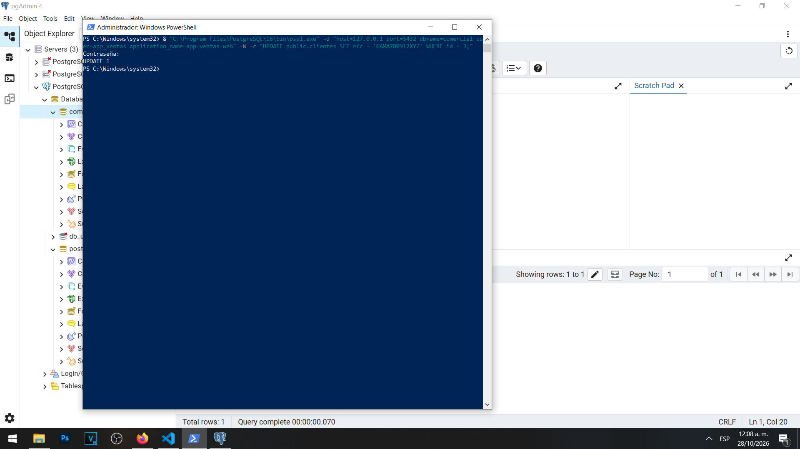
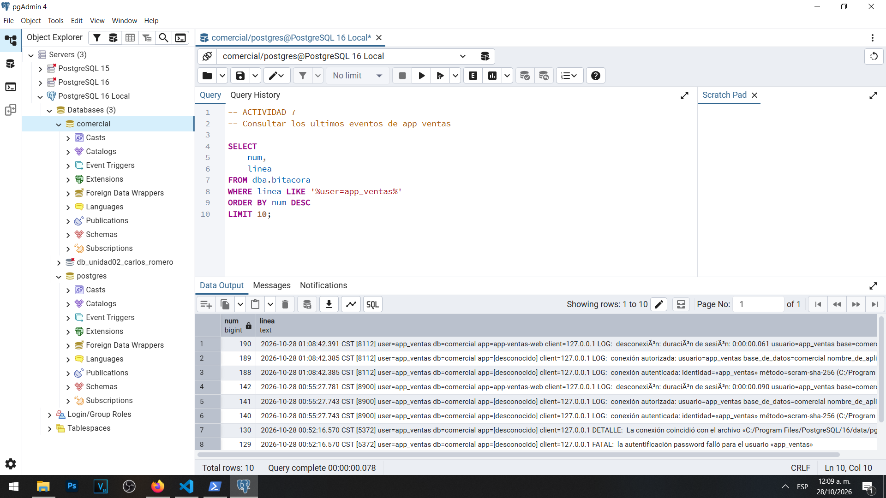
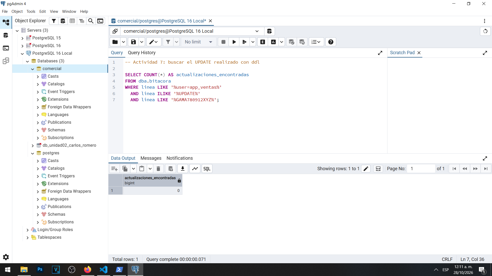
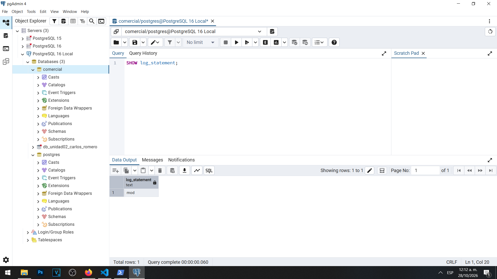
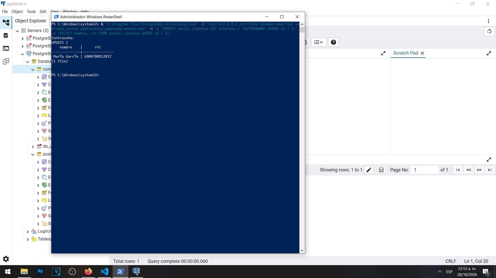
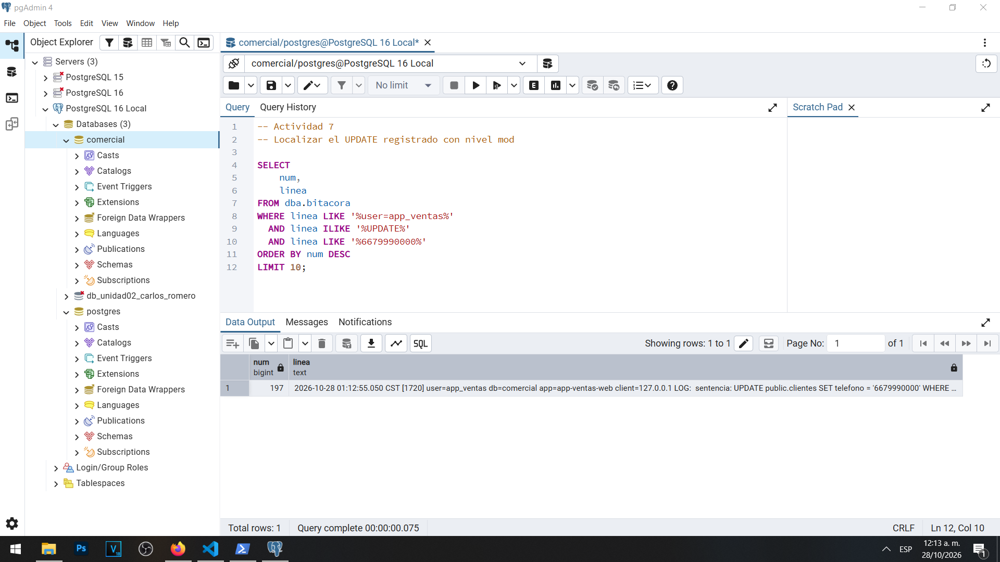

# Actividad 7 — Modificaciones de datos: ddl frente a mod

**Materia:** Gestión de Seguridad y Desempeño de Bases de Datos  
**Unidad:** III — Auditoría, trazabilidad y gobierno práctico de datos  
**Laboratorio:** LAB-01 — Bitácoras y auditoría del dato en PostgreSQL  
**Estudiante:** Carlos Romero  
**Motor:** PostgreSQL 16  
**Sistema operativo:** Windows  
**Base de datos:** `comercial`

---

## 1. Objetivo

Comparar el comportamiento de los niveles de registro `ddl` y `mod` de PostgreSQL, identificando cuáles operaciones SQL se conservan en la bitácora y cuáles son las limitaciones de estos mecanismos para reconstruir modificaciones de información.

## 2. Primera prueba — Registro con ddl

Inicialmente se comprobó que PostgreSQL tenía configurado:

```sql
SHOW log_statement;
```

El valor utilizado fue `ddl`.

Posteriormente, utilizando la cuenta `app_ventas` y el cliente `psql`, se ejecutó la siguiente modificación:

```sql
UPDATE public.clientes
SET rfc = 'GAMA780912XYZ'
WHERE id = 3;
```

PostgreSQL devolvió:

`UPDATE 1`

Esto confirmó que se modificó correctamente un registro de la tabla `clientes`.

### Evidencia 07A — Actualización con ddl



## 3. Verificación de la bitácora con ddl

Se consultaron los últimos eventos asociados con `app_ventas`.

Los registros mostraron conexiones autenticadas, conexiones autorizadas y desconexiones.

Sin embargo, no se encontró la instrucción `UPDATE` entre estos eventos.

### Evidencia 07B — Eventos registrados con ddl



Para comprobar el resultado se efectuó una búsqueda específica del RFC modificado.

La consulta recuperó cero coincidencias.

Este resultado fue coherente con el comportamiento de `log_statement = 'ddl'`, ya que este nivel no registra de forma general los cambios ordinarios de datos mediante `UPDATE`.

La búsqueda se realizó sobre el archivo de bitácora vigente. Por tanto, el resultado no representa una inspección de todos los archivos históricos del servidor.

### Evidencia 07C — Actualización no encontrada



## 4. Segunda prueba — Configuración mod

Después de completar la primera prueba se modificó el nivel de registro mediante:

```sql
ALTER SYSTEM SET log_statement = 'mod';
```

Posteriormente se solicitó la recarga:

```sql
SELECT pg_reload_conf();
```

Finalmente, se comprobó el valor activo:

```sql
SHOW log_statement;
```

El resultado fue:

`mod`

Este nivel permite registrar sentencias que modifican datos, incluyendo operaciones `INSERT`, `UPDATE`, `DELETE` y otras instrucciones contempladas por PostgreSQL.

### Evidencia 07D — Configuración mod



## 5. Modificación del teléfono

Se utilizó nuevamente la cuenta `app_ventas`, identificando la aplicación mediante el nombre `app-ventas-web`.

Se ejecutó:

```sql
UPDATE public.clientes
SET telefono = '6679990000'
WHERE id = 3;
```

El servidor devolvió:

`UPDATE 1`

Posteriormente se ejecutó una consulta para recuperar el nombre y RFC de María García.

La consulta mostró que el RFC permanecía con el valor `GAMA780912XYZ`.

Ambas instrucciones se ejecutaron correctamente.

### Evidencia 07E — Actualización y consulta



## 6. Verificación del registro con mod

Se consultó la vista administrativa `dba.bitacora` para buscar la sentencia de actualización del teléfono.

A diferencia de la primera prueba, esta consulta devolvió una coincidencia.

El registro observado incluyó:

| Elemento | Valor |
|---|---|
| Número de línea | 197 |
| Fecha y hora | 2026-10-28 01:12:55.050 CST |
| PID | 1720 |
| Usuario | `app_ventas` |
| Base de datos | `comercial` |
| Aplicación | `app-ventas-web` |
| Dirección IP | `127.0.0.1` |
| Operación | `UPDATE` |
| Nuevo teléfono | `6679990000` |

La entrada permitió identificar la sentencia que se ejecutó y relacionarla con una sesión.

### Evidencia 07F — Actualización registrada



## 7. Comparación de los niveles de registro

| Nivel | Cambios de estructura y privilegios | Modificaciones ordinarias | Lecturas SELECT |
|---|---|---|---|
| `ddl` | Sí | No, de forma general | No |
| `mod` | Sí | Sí | No |
| `all` | Sí | Sí | Sí |

La comparación demuestra que la selección del nivel de registro depende de las necesidades de auditoría del sistema.

Un nivel más detallado conserva mayor información, pero también puede incrementar el volumen de almacenamiento, la actividad de escritura y la exposición de datos sensibles dentro de las bitácoras.

## 8. Preguntas y respuestas

### 1. ¿Qué nivel habría registrado la lectura del RFC? ¿Qué costo tendría en un servidor con miles de consultas por minuto?

El nivel `all` de `log_statement` habría permitido registrar la sentencia `SELECT` utilizada para consultar el RFC.

Este nivel registra las sentencias SQL ejecutadas, incluyendo las operaciones de lectura.

Sin embargo, utilizarlo en un servidor con miles de consultas por minuto puede generar un volumen considerable de registros.

Esto incrementa el consumo de almacenamiento y las operaciones de escritura, además de dificultar el análisis de eventos relevantes entre una gran cantidad de información.

También puede aumentar el riesgo de exposición de datos sensibles incluidos en instrucciones SQL o en sus parámetros, según el mecanismo de registro utilizado.

Por estas razones, el nivel de auditoría debe seleccionarse considerando el volumen de operaciones, los requisitos de seguridad, el rendimiento y las políticas de retención.

Para nuestro laboratorio fue suficiente utilizar `mod` al comprobar las modificaciones de datos.

### 2. ¿Qué le falta a esta bitácora para revertir el cambio con certeza?

La bitácora registra la sentencia utilizada para modificar el teléfono y permite identificar al usuario, la aplicación, la dirección de origen y el momento del evento.

Sin embargo, no conserva automáticamente el valor anterior del teléfono.

Por lo tanto, aunque sabemos que se estableció el número `6679990000`, no contamos en esta evidencia con el número que existía inmediatamente antes del cambio.

Para revertir una modificación con certeza se necesita conservar el valor anterior, el valor nuevo, el identificador del registro y los datos de contexto de la operación.

Esta necesidad se resolverá en la Parte B mediante una tabla de auditoría y un disparador.

El mecanismo permitirá registrar los estados anteriores y posteriores de cada modificación relevante y facilitará la reconstrucción de incidentes.

## 9. Análisis de los resultados

Los resultados demostraron que habilitar el registro de conexiones no significa que PostgreSQL registre automáticamente todas las operaciones realizadas durante cada sesión.

Durante la primera prueba, con el nivel `ddl`, la modificación del RFC se ejecutó correctamente, pero la búsqueda específica no encontró evidencia de la sentencia en el archivo vigente.

Posteriormente, al configurar `log_statement = 'mod'`, la modificación del teléfono sí apareció en la bitácora, acompañada de información que permitió relacionarla con el usuario y la aplicación.

Esto demuestra que una bitácora de sentencias puede proporcionar información importante para investigar operaciones, aunque no reemplaza la auditoría de los valores anteriores y nuevos.

## 10. Conclusión

La Actividad 7 permitió comprender las diferencias entre los niveles `ddl` y `mod` de PostgreSQL.

Se comprobó que el nivel `ddl` resulta útil para registrar cambios administrativos y de estructura, mientras que `mod` amplía el registro para incluir modificaciones ordinarias de datos.

También se identificó que las operaciones `SELECT` no se registran mediante `mod` y que habilitar un nivel más detallado implica costos y riesgos adicionales.

Finalmente, la práctica permitió reconocer la limitación principal de una bitácora de sentencias: registra la operación ejecutada, pero no conserva necesariamente el estado anterior de los datos.

Por ello, la auditoría del servidor debe complementarse con mecanismos de auditoría a nivel de registro.

