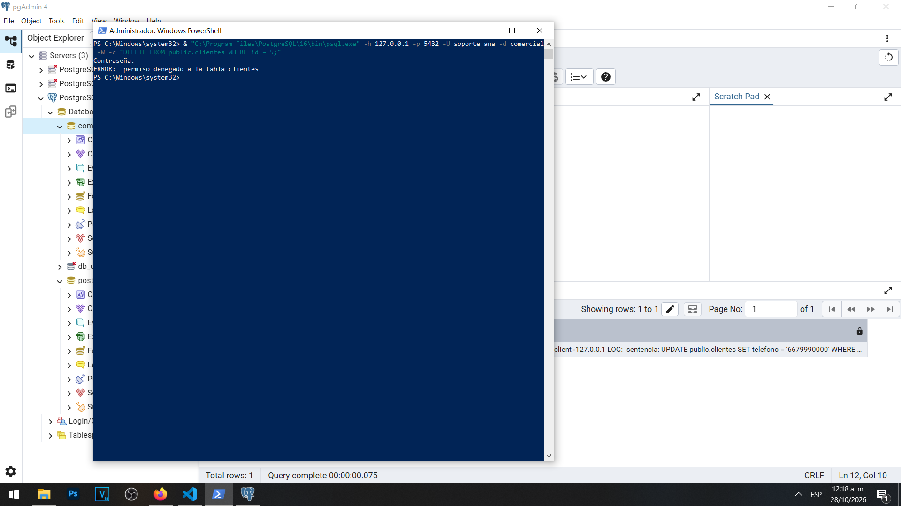
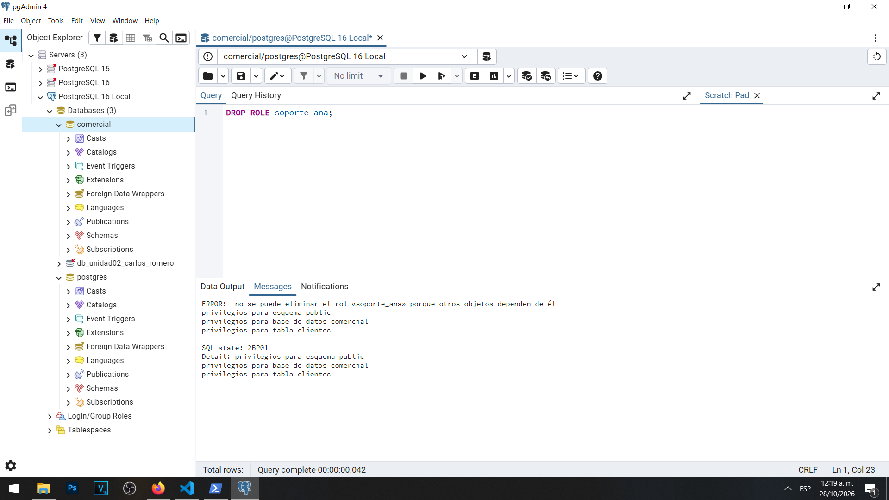
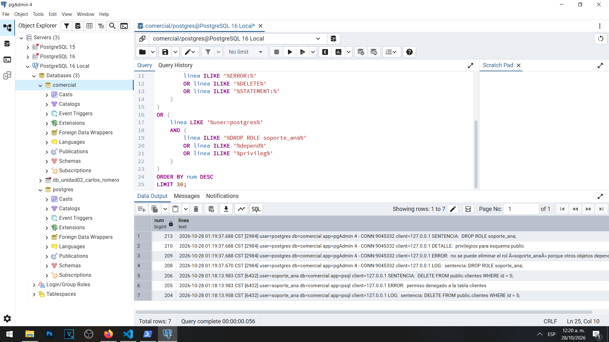

# Actividad 8 — Errores y operaciones rechazadas

**Materia:** Gestión de Seguridad y Desempeño de Bases de Datos  
**Unidad:** III — Auditoría, trazabilidad y gobierno práctico de datos  
**Laboratorio:** LAB-01 — Bitácoras y auditoría del dato en PostgreSQL  
**Estudiante:** Carlos Romero  
**Motor:** PostgreSQL 16  
**Sistema operativo:** Windows  
**Base de datos:** `comercial`  
**Herramientas:** pgAdmin 4, PowerShell y psql

---

## 1. Objetivo

Comprobar cómo PostgreSQL responde ante operaciones no autorizadas y ante intentos de eliminar usuarios que todavía mantienen dependencias sobre objetos de la base de datos.

También se busca verificar que las operaciones rechazadas generen evidencia suficiente para investigar lo ocurrido, relacionando los errores con las sentencias ejecutadas y sus sesiones correspondientes.

## 2. Configuración de auditoría utilizada

Durante las actividades anteriores se configuraron los siguientes parámetros:

| Parámetro | Valor |
|---|---|
| `log_connections` | `on` |
| `log_disconnections` | `on` |
| `log_statement` | `mod` |
| `log_min_error_statement` | `error` |
| `logging_collector` | `on` |

El prefijo de bitácora incluye fecha, PID, usuario, base de datos, aplicación y dirección IP del cliente.

Esta configuración permite identificar operaciones ejecutadas y registrar sentencias que producen errores.

## 3. Primera prueba — DELETE sin autorización

Se realizó un intento de eliminación desde PowerShell, utilizando el cliente `psql` y la cuenta `soporte_ana`.

Se ejecutó la siguiente instrucción:

```sql
DELETE FROM public.clientes
WHERE id = 5;
```

PostgreSQL rechazó la operación y mostró el mensaje:

```text
ERROR: permiso denegado a la tabla clientes
```

El resultado fue el esperado porque `soporte_ana` dispone de permisos de consulta, pero no de eliminación de registros.

Por lo tanto, la operación no consiguió borrar al cliente identificado mediante el ID 5.

### Evidencia 08A — Operación DELETE rechazada



## 4. Segunda prueba — Intento de eliminar un rol con dependencias

Posteriormente, desde pgAdmin 4 y utilizando la cuenta administrativa `postgres`, se intentó ejecutar:

```sql
DROP ROLE soporte_ana;
```

El servidor rechazó la operación porque el rol todavía conserva dependencias relacionadas con objetos y privilegios.

El mensaje identificó dependencias asociadas con:

- El esquema `public`.
- La base de datos `comercial`.
- La tabla `clientes`.

También se identificó el código SQLSTATE `2BP01`, correspondiente a objetos dependientes.

La eliminación no se completó.

### Evidencia 08B — Eliminación de rol rechazada



## 5. Consulta de la bitácora

Se consultó la vista administrativa `dba.bitacora` para localizar los eventos relacionados con ambos intentos.

La consulta devolvió siete líneas relevantes.

Entre los resultados observados se encontraron:

| Línea | Usuario | Evento |
|---|---|---|
| 204 | `soporte_ana` | Sentencia `DELETE FROM public.clientes` |
| 205 | `soporte_ana` | Error de permiso denegado |
| 206 | `soporte_ana` | Sentencia asociada al error |
| 208 | `postgres` | Sentencia `DROP ROLE soporte_ana` |
| 209 | `postgres` | Error por dependencias del rol |
| 210 | `postgres` | Detalle de privilegios asociados |
| 213 | `postgres` | Sentencia relacionada con el error |

Los eventos de la operación `DELETE` se identificaron con el PID `6432`, mientras que los del intento de eliminar el rol se asociaron con el PID `2984`.

Esta información permite agrupar mensajes correspondientes a una misma sesión y facilita la reconstrucción de los acontecimientos.

### Evidencia 08C — Registro de errores



## 6. Preguntas y respuestas

### 1. ¿El intento de soporte_ana causó algún daño? ¿Por qué debe auditarse de todos modos?

No se produjo la eliminación solicitada, porque PostgreSQL rechazó el `DELETE` antes de modificar los registros.

Esto demuestra que el control de autorización funcionó correctamente.

Sin embargo, el intento debe registrarse porque constituye una operación que no corresponde a los privilegios de la cuenta.

Registrar este tipo de eventos permite identificar errores de programación, acciones accidentales, uso indebido de credenciales y posibles intentos de acceso no autorizado.

Si se observaran numerosos intentos semejantes durante un periodo corto, podrían representar un patrón que requiere investigación.

Por lo tanto, la ausencia de una modificación exitosa no significa que el evento carezca de importancia para la seguridad.

### 2. ¿Qué diferencia hay entre un error de autorización y uno de autenticación?

La autenticación comprueba la identidad de una persona, cuenta o aplicación que intenta conectarse.

Un error de autenticación ocurre cuando PostgreSQL rechaza la conexión debido a credenciales incorrectas, un usuario inexistente u otra condición relacionada con la validación de identidad.

Durante la Actividad 5 se observaron fallos de autenticación de `app_ventas` y `usuario_inexistente`.

La autorización, en cambio, determina qué operaciones puede ejecutar una cuenta después de identificarse correctamente.

En esta actividad, `soporte_ana` logró autenticarse y conectarse a la base de datos, pero PostgreSQL rechazó la sentencia `DELETE` porque la cuenta no tenía ese privilegio.

Por lo tanto, una cuenta puede estar autenticada correctamente y aun así carecer de autorización para realizar determinadas operaciones.

### 3. ¿Qué indica el error de DROP ROLE sobre el orden correcto para dar de baja a un usuario?

El error demuestra que no siempre es posible eliminar inmediatamente una cuenta mientras conserva privilegios o dependencias sobre objetos de PostgreSQL.

Antes de eliminar un usuario se deben revisar sus funciones, los objetos que posee, los permisos concedidos y las aplicaciones que todavía utilizan sus credenciales.

Cuando corresponda, se deben revocar permisos, transferir la propiedad de objetos o eliminar dependencias de manera controlada.

Después de verificar que la cuenta ya no es necesaria y que se resolvieron sus dependencias, puede realizarse su eliminación.

Este procedimiento evita afectar objetos o servicios que dependen de la cuenta y mantiene una administración ordenada de las identidades.

En el laboratorio no se completó la eliminación de `soporte_ana`, porque la finalidad era demostrar el mecanismo de protección y registrar el error.

## 7. Importancia del registro de errores

La actividad demostró que PostgreSQL no solamente registra determinadas operaciones exitosas, sino también eventos que no pudieron completarse.

El parámetro `log_min_error_statement = error` permite registrar las instrucciones que producen errores de la severidad correspondiente.

De esta manera, los administradores pueden investigar qué intentó hacer una cuenta, incluso cuando el sistema impidió la operación.

La información del usuario, PID, base de datos, aplicación y dirección de origen ofrece contexto adicional para interpretar los acontecimientos.

Sin embargo, los registros deben protegerse porque también pueden contener instrucciones SQL y datos sensibles.

## 8. Conclusión

La Actividad 8 permitió comprobar que PostgreSQL aplica correctamente los controles de autorización y mantiene mecanismos de protección frente a eliminaciones de roles con dependencias.

Se verificó que `soporte_ana` no podía eliminar registros de clientes y que el administrador no podía eliminar directamente una cuenta que conservaba privilegios asociados.

También se comprobó que ambas operaciones generaron registros que permiten identificar la sentencia ejecutada, la identidad utilizada, el momento y el motivo del rechazo.

La principal conclusión es que la auditoría debe conservar evidencia tanto de las operaciones exitosas como de aquellas que fueron rechazadas, debido a que ambas proporcionan información relevante para la seguridad.
