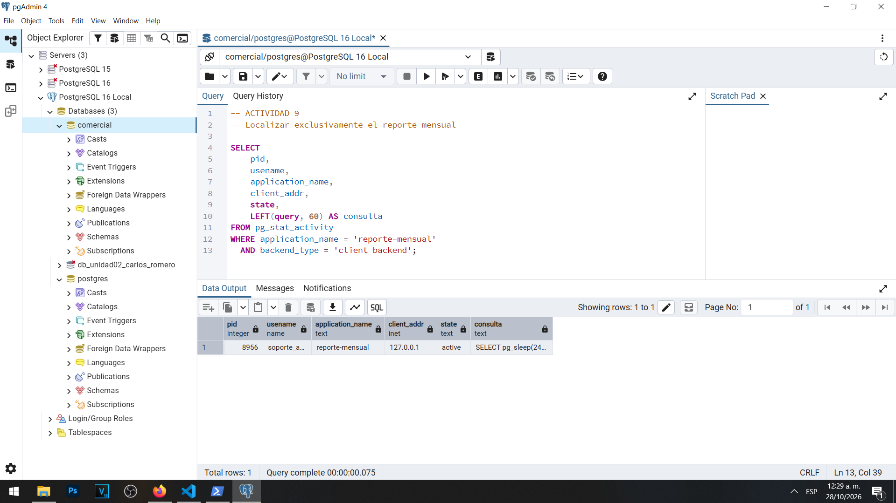
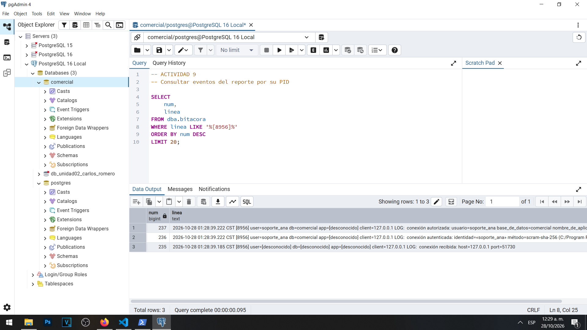
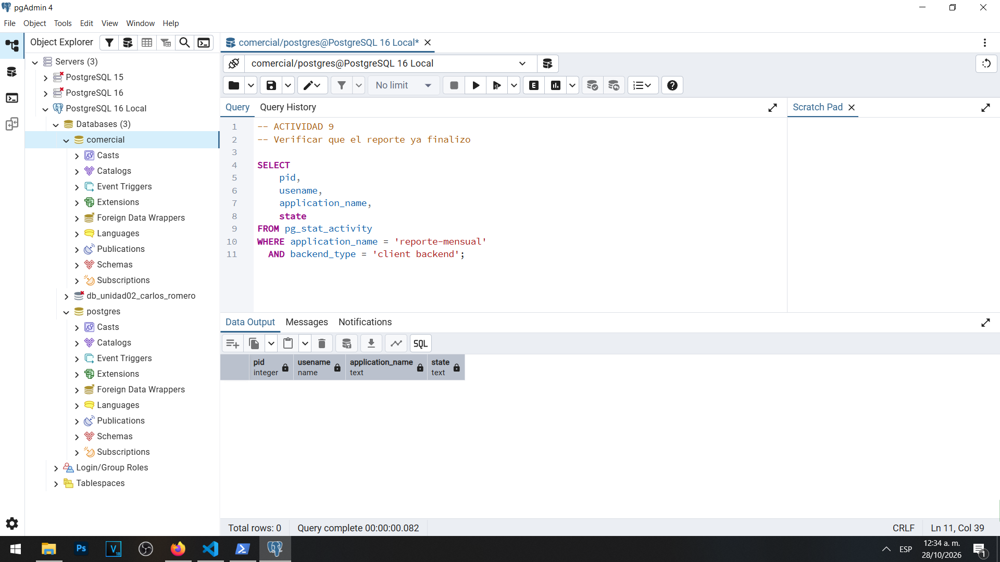

# Actividad 9 — Sesiones activas con pg_stat_activity

**Materia:** Gestión de Seguridad y Desempeño de Bases de Datos  
**Unidad:** III — Auditoría, trazabilidad y gobierno práctico de datos  
**Laboratorio:** LAB-01 — Bitácoras y auditoría del dato en PostgreSQL  
**Estudiante:** Carlos Romero  
**Motor:** PostgreSQL 16  
**Sistema operativo:** Windows  
**Base de datos:** `comercial`  
**Herramientas:** pgAdmin 4, PowerShell y psql

---

## 1. Objetivo

Identificar las sesiones activas de PostgreSQL mediante la vista `pg_stat_activity`, relacionarlas con las entradas del archivo de bitácora mediante su PID y comprobar qué sucede con la información de una sesión una vez que finaliza.

## 2. Procedimiento

Se abrió una conexión desde PowerShell utilizando el cliente `psql`, la cuenta `soporte_ana` y el nombre de aplicación `reporte-mensual`.

Para simular una consulta de larga duración se ejecutó:

```sql
SELECT pg_sleep(240);
```

Mientras la consulta permanecía activa, desde otra sesión administrativa en pgAdmin 4 se consultó `pg_stat_activity`.

Posteriormente se utilizó el PID identificado para localizar los registros de conexión correspondientes en la vista `dba.bitacora`.

Finalmente, una vez terminada la ejecución en PowerShell, se repitió la consulta de monitoreo para comprobar si la sesión continuaba presente.

## 3. Resultados de la sesión activa

La consulta a `pg_stat_activity` permitió identificar una sesión con los siguientes datos:

| Campo | Valor observado |
|---|---|
| `pid` | `8956` |
| `usename` | `soporte_ana` |
| `application_name` | `reporte-mensual` |
| `client_addr` | `127.0.0.1` |
| `state` | `active` |
| `query` | `SELECT pg_sleep(240);` |

El estado `active` confirmó que la sesión estaba ejecutando una consulta en ese momento.

El PID `8956` permitió distinguirla de las conexiones administrativas de pgAdmin 4.

### Evidencia 09A — Sesión activa



## 4. Búsqueda del PID en la bitácora

Posteriormente se ejecutó la consulta:

```sql
SELECT
    num,
    linea
FROM dba.bitacora
WHERE linea LIKE '%[8956]%'
ORDER BY num DESC
LIMIT 20;
```

Se recuperaron tres líneas correspondientes al PID investigado.

| Línea | Evento |
|---|---|
| 235 | Recepción de conexión |
| 236 | Autenticación correcta de `soporte_ana` |
| 237 | Autorización de conexión a `comercial` |

Los eventos fueron registrados el 28 de octubre de 2026 aproximadamente a las 01:28:39 CST, conforme al reloj de la bitácora.

También se identificó que la autenticación se realizó mediante `scram-sha-256`.

El resultado permitió relacionar la sesión que estaba ejecutando el reporte con los mensajes generados durante el establecimiento de su conexión.

### Evidencia 09B — Bitácora del PID 8956



## 5. Comprobación después de finalizar

Una vez terminado el reporte, se ejecutó nuevamente la consulta:

```sql
SELECT
    pid,
    usename,
    application_name,
    state
FROM pg_stat_activity
WHERE application_name = 'reporte-mensual'
  AND backend_type = 'client backend';
```

El resultado fue de cero filas.

Esto significa que la sesión `reporte-mensual` ya no estaba conectada al servidor en el momento de realizar la verificación.

### Evidencia 09C — Sesión finalizada



## 6. Preguntas y respuestas

### 1. ¿Qué columna permite relacionar una sesión con sus líneas de bitácora?

La columna `pid` permite relacionar una sesión activa con sus eventos registrados.

Cada proceso de conexión dispone de un identificador que puede consultarse mediante `pg_stat_activity`.

Cuando el prefijo de bitácora incorpora `%p`, ese mismo identificador aparece en las entradas del registro del servidor.

En nuestro laboratorio utilizamos el PID `8956` para relacionar la sesión `reporte-mensual` con sus mensajes de conexión y autenticación.

Es importante considerar también las marcas de tiempo, porque los identificadores de proceso pueden reutilizarse después de que un proceso termina.

### 2. Después de que termina el reporte, ¿qué fuente conserva evidencia de que existió?

La bitácora del servidor conserva evidencia histórica de la conexión.

La vista `pg_stat_activity` solamente presenta información de los procesos y sesiones que existen en el momento de consultar el sistema.

Por esa razón, después de finalizar el reporte, la consulta a `pg_stat_activity` devolvió cero filas.

En cambio, las entradas del PID `8956` ya habían quedado registradas en el archivo de bitácora.

Esto demuestra que la bitácora permite investigar acontecimientos anteriores, mientras que `pg_stat_activity` sirve principalmente para observar el estado actual del servidor.

La conservación histórica depende también de las políticas de retención y rotación de los archivos de registro.

### 3. ¿Por qué client_addr aparece vacío en la sesión del administrador?

Una dirección `client_addr` nula puede indicar que una conexión se estableció mediante un socket Unix local, sin utilizar una dirección IP. También puede observarse en ciertos procesos internos de PostgreSQL.

En el ejemplo general de la guía, una conexión administrativa local puede presentar este comportamiento.

Sin embargo, en nuestra instalación de PostgreSQL 16 sobre Windows se observó una diferencia: las sesiones administrativas de pgAdmin 4 mostraron la dirección `127.0.0.1`.

Esto se debe a que pgAdmin se conectó al servidor mediante TCP/IP utilizando la interfaz de retorno local.

Por lo tanto, no debe afirmarse que el campo estaba vacío en nuestras capturas.

La diferencia demuestra que el valor de `client_addr` depende del mecanismo de conexión utilizado y del entorno donde se ejecuta PostgreSQL.

## 7. Análisis

La actividad permitió observar el comportamiento de PostgreSQL durante la ejecución de una consulta prolongada.

Mientras se ejecutaba `pg_sleep(240)`, la sesión apareció con estado `active`, identificada mediante su usuario, aplicación, dirección IP y PID.

El mismo PID permitió localizar mensajes relacionados con el establecimiento de la conexión en la bitácora.

Una vez finalizada la consulta y cerrada la conexión de `psql`, la sesión dejó de aparecer en `pg_stat_activity`.

Estos resultados demuestran que las herramientas de monitoreo y los archivos de registro ofrecen información complementaria.

## 8. Conclusión

La Actividad 9 permitió comprobar que `pg_stat_activity` es una herramienta útil para observar procesos y consultas activas, mientras que la bitácora permite conservar evidencia de eventos anteriores.

Se identificó correctamente la sesión `reporte-mensual` con PID `8956` y se relacionó con tres eventos registrados durante su conexión.

Posteriormente se verificó que la sesión había finalizado y ya no aparecía en la vista de actividad.

Con esta práctica se concluye la Parte A del laboratorio, dedicada a la configuración, lectura e interpretación de las bitácoras del servidor.
