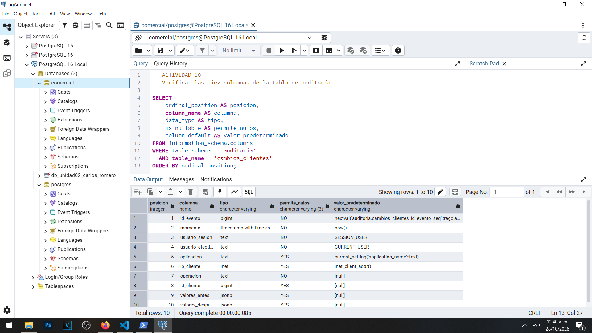
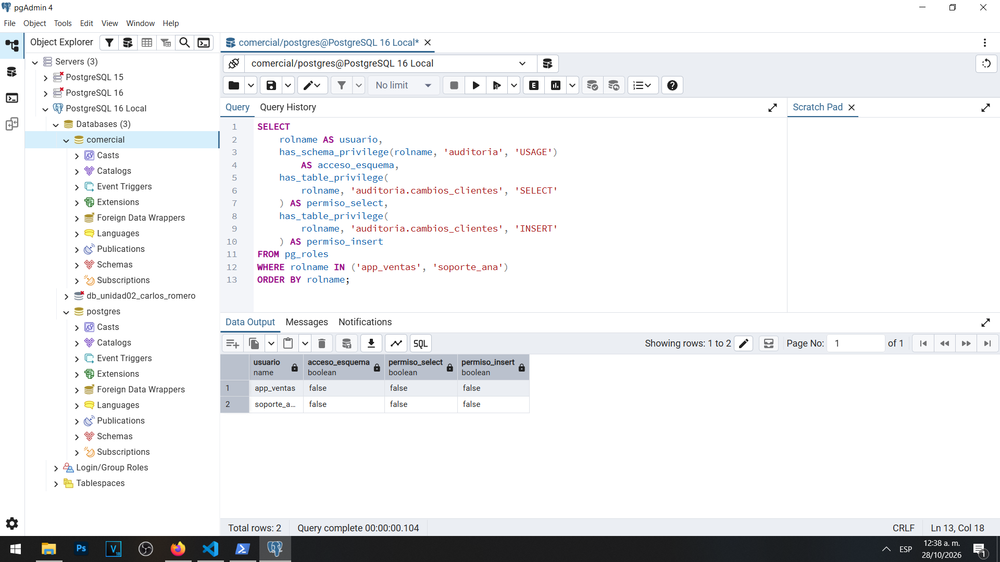

# Actividad 10 — Diseño y creación del registro de auditoría

**Materia:** Gestión de Seguridad y Desempeño de Bases de Datos  
**Unidad:** III — Auditoría, trazabilidad y gobierno práctico de datos  
**Laboratorio:** LAB-01 — Bitácoras y auditoría del dato en PostgreSQL  
**Estudiante:** Carlos Romero  
**Motor:** PostgreSQL 16  
**Sistema operativo:** Windows  
**Base de datos:** `comercial`

## 1. Objetivo

Diseñar una estructura de auditoría que permita conservar evidencia de las modificaciones realizadas sobre la tabla `clientes`, incluyendo el momento, el usuario responsable, la aplicación utilizada, la dirección de origen y los valores anteriores y nuevos de cada registro.

## 2. Diseño de la tabla

Para satisfacer los requerimientos de la Dirección de Comercializadora Norte S.A. de C.V. se diseñó la tabla `auditoria.cambios_clientes`.

| Campo | Tipo de dato | Pregunta que responde | ¿Puede ser nulo? |
|---|---|---|---|
| `id_evento` | BIGSERIAL | ¿Qué identificador tiene el evento? | No, es clave primaria |
| `momento` | TIMESTAMPTZ | ¿Cuándo ocurrió? | No, utiliza `now()` |
| `usuario_sesion` | TEXT | ¿Qué usuario inició la sesión? | No |
| `usuario_efectivo` | TEXT | ¿Con qué identidad efectiva se ejecutó la inserción de auditoría? | No |
| `aplicacion` | TEXT | ¿Qué aplicación declaró el cliente? | Sí, puede no identificarse |
| `ip_cliente` | INET | ¿Desde qué dirección IP se conectó? | Sí, puede ser nula |
| `operacion` | TEXT | ¿Fue INSERT, UPDATE o DELETE? | No |
| `id_cliente` | BIGINT | ¿Qué cliente fue afectado? | Sí, aunque los eventos normales de clientes tendrán un identificador |
| `valores_antes` | JSONB | ¿Qué información existía antes? | Sí, para INSERT |
| `valores_despues` | JSONB | ¿Qué información quedó después? | Sí, para DELETE |

Esta estructura conserva tanto información del contexto como los estados de los datos afectados.

## 3. Creación del esquema y la tabla

Se utilizó el archivo `sql/04-esquema-auditoria.sql` para crear un esquema independiente denominado `auditoria`.

Se restringió el acceso público mediante:

```sql
REVOKE ALL ON SCHEMA auditoria FROM PUBLIC;
```

Posteriormente se creó la tabla `auditoria.cambios_clientes`, que contiene los diez campos definidos.

La separación de esquemas permite distinguir los datos operativos de los registros utilizados para investigar modificaciones.

### Evidencia 10A — Estructura de auditoría



La evidencia de esta sección debe mostrar la verificación de las diez columnas mediante `information_schema.columns`.

## 4. Verificación de permisos

Se consultaron los privilegios de `app_ventas` y `soporte_ana` sobre el esquema y la tabla de auditoría.

Los resultados fueron:

| Usuario | USAGE en esquema | SELECT en auditoría | INSERT en auditoría |
|---|---|---|---|
| `app_ventas` | false | false | false |
| `soporte_ana` | false | false | false |

Ambas cuentas carecen de acceso directo a los registros de auditoría.

Esto constituye una medida de protección, porque los usuarios de aplicación no necesitan consultar ni modificar el historial.

### Evidencia 10B — Permisos restringidos



## 5. Preguntas y respuestas

### 1. ¿Por qué momento utiliza TIMESTAMPTZ y no TIMESTAMP?

Se utiliza `TIMESTAMPTZ` porque permite representar instantes de tiempo considerando las diferencias de zona horaria.

PostgreSQL normaliza internamente estos valores y permite presentarlos conforme a la zona horaria de la sesión.

Esto resulta especialmente importante cuando distintos sistemas, aplicaciones o administradores operan desde regiones diferentes.

Un `TIMESTAMP` sin zona horaria no representa por sí mismo un instante absoluto, lo que podría dificultar la correlación de eventos.

Por esa razón, `TIMESTAMPTZ` es más adecuado para reconstruir cronologías de auditoría.

### 2. ¿Por qué se guarda el registro completo en JSONB y no solamente la columna que cambió?

Porque una investigación puede necesitar recuperar el estado completo del registro antes y después de una operación.

Guardar únicamente la columna modificada podría dificultar la interpretación de otros datos relacionados con el incidente.

El tipo `JSONB` permite almacenar estructuras de información con diferentes campos y facilita realizar consultas específicas sobre su contenido.

Además, ofrece flexibilidad cuando la tabla operativa cambia de estructura.

El mecanismo de auditoría puede almacenar una representación completa del registro utilizando `to_jsonb(OLD)` y `to_jsonb(NEW)`.

Esto facilita la comparación de estados y la reconstrucción de modificaciones, aunque también incrementa el volumen de información almacenada.

### 3. La tabla de auditoría también contendrá RFC. ¿Qué implica eso para su clasificación y su control de acceso?

El RFC es un dato de identificación que puede estar relacionado con una persona física o una entidad.

Por ello, la tabla de auditoría deberá clasificarse como información de acceso restringido cuando contenga datos personales o sensibles para la organización.

Los registros pueden incorporar RFC, nombres, correos, teléfonos y otros datos utilizados en la tabla `clientes`.

En consecuencia, la auditoría necesita controles de acceso equivalentes o más estrictos que los aplicados a los datos originales.

También requiere políticas de conservación, respaldos protegidos, revisión de accesos y procedimientos de eliminación cuando corresponda.

Los usuarios operativos no deberían poder consultar, modificar ni borrar directamente los registros de auditoría.

## 6. Seguridad del diseño

Los permisos verificados demuestran que `app_ventas` y `soporte_ana` no tienen acceso directo al esquema `auditoria` ni a la tabla `cambios_clientes`.

En la siguiente actividad se implementará una función `SECURITY DEFINER` para que las operaciones sobre `clientes` puedan generar registros de auditoría sin conceder permisos directos sobre la tabla de historial.

Este diseño ayuda a separar las responsabilidades de los usuarios operativos y las funciones administrativas.

Sin embargo, debe considerarse que un superusuario o un administrador con control total sobre la instancia puede alterar el mecanismo; por ello, este diseño no representa una protección absoluta frente a administradores privilegiados.

## 7. Conclusión

La Actividad 10 permitió diseñar y crear la estructura necesaria para conservar información de auditoría a nivel de dato.

Se separó el historial de los datos operativos y se comprobaron las restricciones de acceso aplicadas a los usuarios del laboratorio.

El diseño incorpora campos de contexto y dos columnas JSONB para conservar los valores anteriores y posteriores de cada modificación.

Con ello se estableció la base para implementar un disparador que registre automáticamente las operaciones de inserción, actualización y eliminación sobre la tabla `clientes`.

