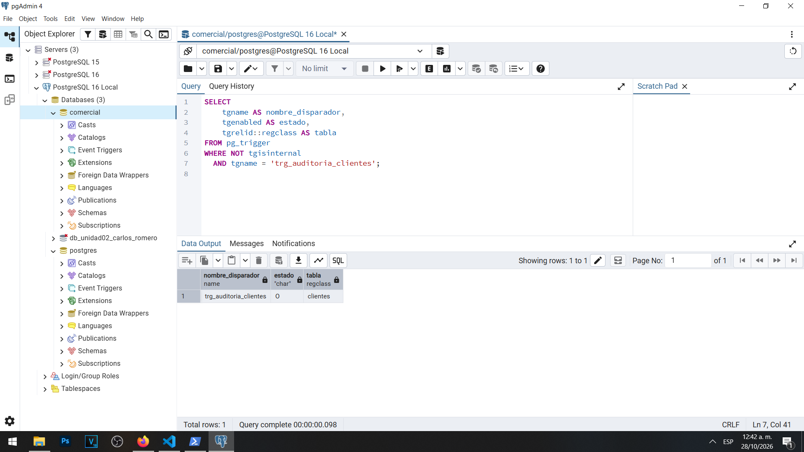
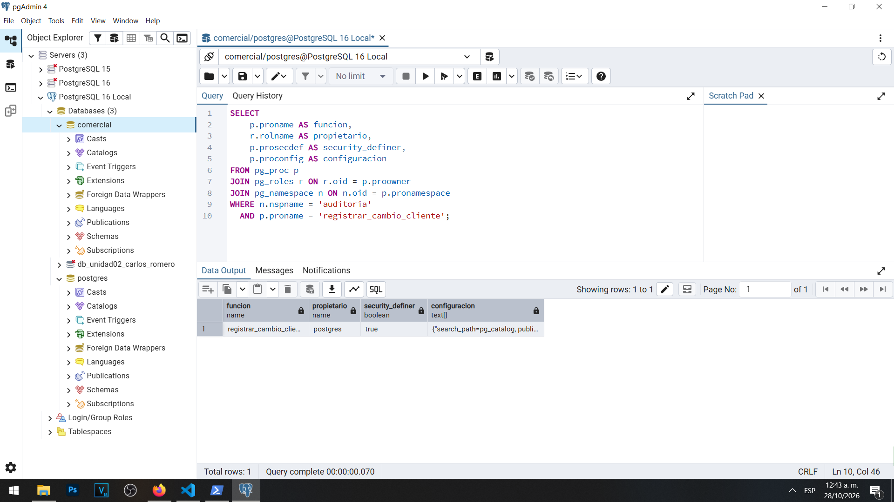
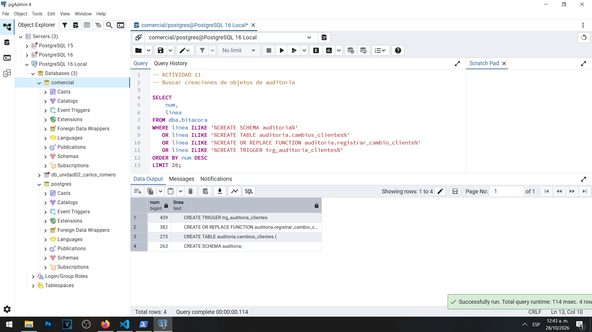

# Actividad 11 — Función y disparador de auditoría

**Materia:** Gestión de Seguridad y Desempeño de Bases de Datos  
**Unidad:** III — Auditoría, trazabilidad y gobierno práctico de datos  
**Laboratorio:** LAB-01 — Bitácoras y auditoría del dato en PostgreSQL  
**Estudiante:** Carlos Romero  
**Motor:** PostgreSQL 16  
**Sistema operativo:** Windows  
**Base de datos:** `comercial`  
**Herramienta:** pgAdmin 4

---

## 1. Objetivo

Implementar una función y un disparador que permitan registrar automáticamente las operaciones de inserción, actualización y eliminación realizadas sobre la tabla `public.clientes`, conservando el contexto de la sesión y los valores anteriores y posteriores de cada registro.

Asimismo, se busca aplicar el principio de mínimo privilegio para que los usuarios de la aplicación puedan modificar los datos autorizados sin obtener acceso directo a la tabla de auditoría.

## 2. Antecedentes

Durante la Actividad 10 se creó el esquema `auditoria` y la tabla `auditoria.cambios_clientes`, integrada por diez columnas.

La estructura incluye el identificador del evento, la fecha, los usuarios de sesión y efectivo, la aplicación, la dirección IP, la operación realizada, el cliente afectado y dos columnas JSONB para conservar los valores anteriores y posteriores.

También se verificó que `app_ventas` y `soporte_ana` no disponen de permisos de acceso directo al esquema ni a la tabla de auditoría.

La Actividad 11 complementa esa estructura mediante un mecanismo automático de registro.

## 3. Creación de la función

Se utilizó el archivo `sql/05-funcion-disparador.sql` para implementar la función:

`auditoria.registrar_cambio_cliente()`

La función fue desarrollada mediante PL/pgSQL y configurada como `SECURITY DEFINER`.

Esto permite que, durante su ejecución, se utilicen los privilegios del propietario de la función.

También se configuró:

```sql
SET search_path = pg_catalog, public
```

Esta configuración establece explícitamente los esquemas utilizados para resolver nombres dentro de la función y reduce determinados riesgos derivados de rutas de búsqueda no controladas.

La tabla de destino se referencia mediante su nombre completo, `auditoria.cambios_clientes`.

## 4. Funcionamiento del disparador

El mecanismo utiliza las variables especiales `TG_OP`, `OLD` y `NEW`.

Cuando se realiza un `INSERT`, la función conserva el nuevo registro mediante `to_jsonb(NEW)`.

Cuando se realiza un `UPDATE`, conserva tanto el estado anterior, mediante `to_jsonb(OLD)`, como el estado posterior, mediante `to_jsonb(NEW)`.

Cuando se realiza un `DELETE`, registra el estado anterior utilizando `to_jsonb(OLD)`.

La inserción del evento en la tabla de auditoría forma parte de la misma transacción que la operación original.

Esto significa que, si la transacción se revierte, también se revierte el registro de auditoría correspondiente.

## 5. Creación y verificación del disparador

Se creó el disparador:

`trg_auditoria_clientes`

El disparador se configuró sobre la tabla `public.clientes` para ejecutar la función después de las operaciones `INSERT`, `UPDATE` y `DELETE`, utilizando `FOR EACH ROW`.

Posteriormente se consultó el catálogo `pg_trigger`.

El resultado fue:

| Elemento | Valor |
|---|---|
| Disparador | `trg_auditoria_clientes` |
| Estado | `O` |
| Tabla | `clientes` |

El estado `O` indica que el disparador está habilitado para su ejecución normal.

### Evidencia 11A — Disparador habilitado



## 6. Verificación de la seguridad

Se consultaron los catálogos `pg_proc`, `pg_roles` y `pg_namespace` para comprobar las propiedades de la función.

Los resultados mostraron:

| Propiedad | Resultado |
|---|---|
| Función | `registrar_cambio_cliente` |
| Propietario | `postgres` |
| `security_definer` | `true` |
| Ruta configurada | `pg_catalog, public` |

Estos resultados confirman que la función pertenece a la cuenta administrativa y que se ejecutará con los privilegios de su propietario.

### Evidencia 11B — Seguridad de la función



## 7. Verificación de las creaciones en la bitácora

Se consultó la vista `dba.bitacora` para comprobar que las operaciones de creación de los objetos administrativos quedaron registradas.

La consulta recuperó cuatro coincidencias:

| Línea | Objeto registrado |
|---|---|
| 263 | `CREATE SCHEMA auditoria` |
| 273 | `CREATE TABLE auditoria.cambios_clientes` |
| 382 | `CREATE OR REPLACE FUNCTION auditoria.registrar_cambio_cliente` |
| 439 | `CREATE TRIGGER trg_auditoria_clientes` |

Este resultado es coherente con la configuración `log_statement = 'mod'`, que también incluye el registro de sentencias DDL.

La bitácora permite identificar la ejecución de las instrucciones de creación, mientras que los catálogos del sistema permiten verificar la existencia y las propiedades actuales de los objetos.

### Evidencia 11C — Objetos registrados en la bitácora



## 8. Preguntas y respuestas

### 1. ¿Por qué se ejecuta REVOKE ALL ON FUNCTION ... FROM PUBLIC si el disparador seguirá funcionando para app_ventas?

Porque la finalidad de la instrucción es impedir que cualquier usuario disponga automáticamente del privilegio de ejecución directa sobre la función.

La función está destinada a ser utilizada por el disparador, no como una operación administrativa que los usuarios ordinarios puedan invocar libremente.

PostgreSQL comprueba los privilegios necesarios para crear el disparador, pero su ejecución posterior no exige que el usuario que modifica la tabla tenga permiso `EXECUTE` directo sobre la función.

Por esta razón, el disparador puede ejecutarse cuando `app_ventas` realiza una modificación autorizada sobre `clientes`, aunque se haya revocado el acceso público a la función.

La restricción ayuda a reducir la exposición de funciones administrativas con privilegios elevados.

### 2. ¿Qué pasaría si la función no fuera SECURITY DEFINER?

La hipótesis es que el mecanismo de auditoría no podría registrar correctamente las modificaciones realizadas por `app_ventas`.

Sin `SECURITY DEFINER`, la función se ejecutaría con los privilegios del usuario que realizó la operación.

Como durante la Actividad 10 comprobamos que `app_ventas` no tiene acceso directo al esquema ni permisos de inserción sobre `auditoria.cambios_clientes`, la función probablemente produciría un error de permisos al intentar escribir el registro.

Dado que el disparador forma parte de la misma transacción que la modificación original, este error provocaría el fallo de la operación completa.

Al utilizar `SECURITY DEFINER`, la función podrá registrar los eventos mediante los privilegios del propietario `postgres`, sin conceder acceso directo a la aplicación.

Esta hipótesis se comprobará mediante la modificación controlada de la Actividad 12.

### 3. ¿Quedó registrada la creación del esquema, la tabla, la función y el disparador? ¿Por qué?

Sí. La consulta sobre `dba.bitacora` recuperó cuatro entradas relacionadas con la creación de estos objetos.

Los registros correspondieron al esquema `auditoria`, la tabla `cambios_clientes`, la función `registrar_cambio_cliente` y el disparador `trg_auditoria_clientes`.

Esto ocurrió porque PostgreSQL tenía configurado `log_statement = 'mod'`, nivel que incluye las operaciones de definición de objetos.

La bitácora registra las instrucciones administrativas ejecutadas, mientras que las consultas a los catálogos permiten comprobar cómo quedaron configurados los objetos.

Por ello, ambas fuentes de información son complementarias.

## 9. Consideraciones de seguridad

La función permite separar los privilegios operativos de los privilegios administrativos utilizados para registrar eventos.

La cuenta `app_ventas` conserva sus permisos sobre `clientes`, pero no necesita consultar ni insertar directamente en la tabla de historial.

Es importante distinguir los campos `usuario_sesion` y `usuario_efectivo`.

El primero conservará la identidad utilizada para iniciar la sesión, mientras que el segundo reflejará el propietario de la función durante su ejecución con `SECURITY DEFINER`.

También debe considerarse que los valores almacenados en JSONB pueden contener información personal, por lo que la tabla de auditoría requiere controles de acceso y políticas de conservación.

## 10. Conclusión

La Actividad 11 permitió implementar la función y el disparador necesarios para iniciar la auditoría automática de la tabla `clientes`.

Se comprobó que el disparador está habilitado, que la función tiene como propietario a `postgres` y que utiliza `SECURITY DEFINER`.

Asimismo, se identificaron en la bitácora las operaciones de creación de los objetos administrativos.

La siguiente actividad permitirá comprobar el funcionamiento del mecanismo durante una modificación real, conservando el RFC anterior y el nuevo sin conceder acceso directo a los registros de auditoría.
