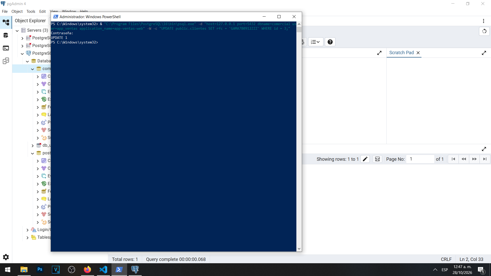
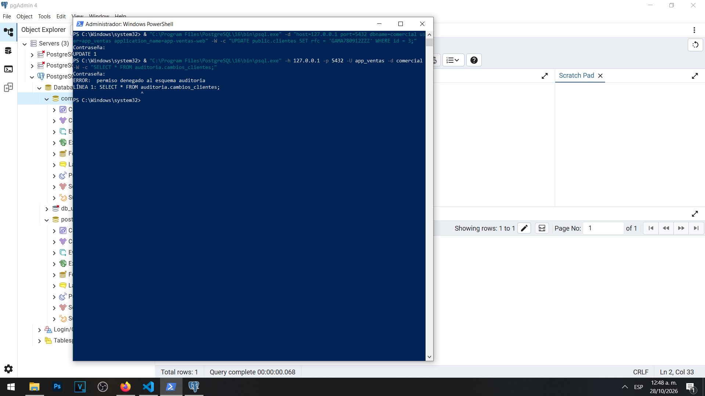
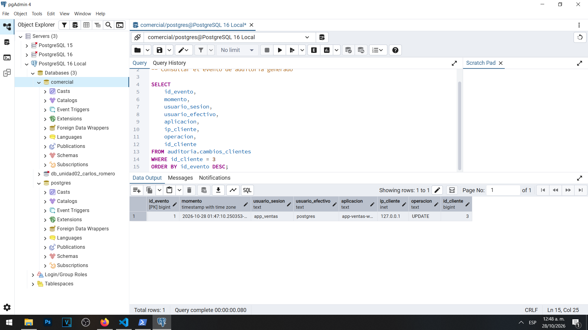
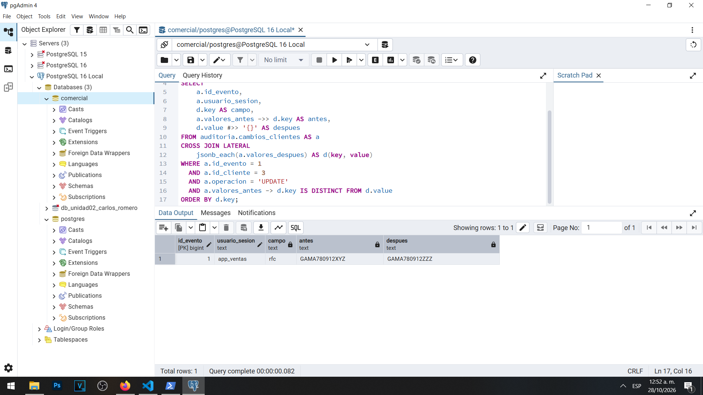

# Actividad 12 — El incidente auditado

**Materia:** Gestión de Seguridad y Desempeño de Bases de Datos  
**Unidad:** III — Auditoría, trazabilidad y gobierno práctico de datos  
**Laboratorio:** LAB-01 — Bitácoras y auditoría del dato en PostgreSQL  
**Estudiante:** Carlos Romero  
**Motor:** PostgreSQL 16  
**Sistema operativo:** Windows  
**Base de datos:** `comercial`  
**Herramientas:** pgAdmin 4, PowerShell y psql

---

## 1. Objetivo

Comprobar el funcionamiento del sistema de auditoría implementado en las actividades anteriores, mediante una modificación controlada del RFC de un cliente. Se busca identificar al usuario que realizó la operación, comprobar la restricción de acceso al historial y recuperar los valores anteriores y posteriores del dato modificado.

## 2. Descripción del incidente

Se simuló un incidente relacionado con el RFC de María García, identificada mediante el ID 3 en la tabla `public.clientes`.

Antes de comenzar la prueba, el RFC tenía el valor `GAMA780912XYZ`.

Para simular la modificación se utilizó la cuenta `app_ventas`, que dispone de permisos para actualizar información de clientes.

La operación se realizó desde Windows PowerShell, utilizando `psql` y el nombre de aplicación `app-ventas-web`.

## 3. Modificación del RFC

Se ejecutó la instrucción:

```sql
UPDATE public.clientes
SET rfc = 'GAMA780912ZZZ'
WHERE id = 3;
```

PostgreSQL devolvió el resultado:

`UPDATE 1`

Esto confirmó que la operación afectó correctamente un registro.

Debido a que ya se encontraba habilitado el disparador `trg_auditoria_clientes`, la modificación también generó automáticamente un evento en `auditoria.cambios_clientes`.

### Evidencia 12A — Modificación realizada



## 4. Restricción de acceso al historial

Posteriormente se intentó consultar directamente la tabla de auditoría utilizando la cuenta `app_ventas`.

Se ejecutó:

```sql
SELECT *
FROM auditoria.cambios_clientes;
```

PostgreSQL rechazó la consulta con el mensaje:

`ERROR: permiso denegado al esquema auditoria`

El resultado confirmó que `app_ventas` puede realizar modificaciones autorizadas sobre `clientes` sin disponer de acceso directo al historial de auditoría.

### Evidencia 12B — Acceso rechazado



## 5. Consulta administrativa del evento

Desde pgAdmin 4, utilizando la cuenta `postgres`, se consultó la tabla `auditoria.cambios_clientes`.

El resultado permitió identificar el primer evento de auditoría:

| Elemento | Valor observado |
|---|---|
| `id_evento` | 1 |
| `usuario_sesion` | `app_ventas` |
| `usuario_efectivo` | `postgres` |
| `aplicacion` | `app-ventas-web` |
| `ip_cliente` | `127.0.0.1` |
| `operacion` | `UPDATE` |
| `id_cliente` | 3 |

La evidencia fue registrada el 28 de octubre de 2026, según la marca de tiempo mostrada por PostgreSQL.

La diferencia entre `usuario_sesion` y `usuario_efectivo` tiene una explicación importante.

El usuario de sesión es `app_ventas`, porque esa cuenta inició la conexión y realizó la modificación. En cambio, el usuario efectivo es `postgres`, debido a que el disparador utiliza una función `SECURITY DEFINER` perteneciente a esa cuenta.

### Evidencia 12C — Evento generado



## 6. Comparación del valor anterior y posterior

Se utilizó el archivo `sql/06-campos-modificados.sql` para comparar los documentos JSONB almacenados en las columnas `valores_antes` y `valores_despues`.

La consulta utilizó `jsonb_each` y `CROSS JOIN LATERAL` para comparar cada campo del registro.

También utilizó `IS DISTINCT FROM` para identificar diferencias, considerando adecuadamente los valores nulos.

El resultado fue:

| Evento | Usuario | Campo | Antes | Después |
|---|---|---|---|---|
| 1 | `app_ventas` | `rfc` | `GAMA780912XYZ` | `GAMA780912ZZZ` |

La auditoría permitió identificar exactamente el campo modificado y conservar ambos valores.

### Evidencia 12D — Valores anteriores y nuevos



## 7. Preguntas y respuestas

### 1. Compara tu hipótesis de la Actividad 11 con este resultado.

En la Actividad 11 se planteó que, sin `SECURITY DEFINER`, la función de auditoría probablemente produciría un error al intentar insertar en `auditoria.cambios_clientes`.

La hipótesis se fundamentó en que la cuenta `app_ventas` no tiene permisos directos sobre el esquema ni sobre la tabla de historial.

Los resultados de la Actividad 12 fueron coherentes con esa hipótesis.

La cuenta `app_ventas` realizó correctamente una modificación y el disparador registró el evento utilizando los privilegios de `postgres`.

Al mismo tiempo, la aplicación recibió un error cuando intentó consultar directamente la tabla de auditoría.

Por lo tanto, se comprobó que el mecanismo `SECURITY DEFINER` permite registrar automáticamente los cambios sin conceder acceso directo al historial.

La prueba confirmó el funcionamiento de la configuración actual. No se ejecutó una segunda prueba eliminando `SECURITY DEFINER`, por lo que esa parte de la hipótesis permanece sustentada por el diseño de permisos y el funcionamiento documentado de PostgreSQL.

### 2. Escribe la sentencia UPDATE que restauraría el valor anterior.

Para restaurar el RFC original de María García se utilizaría:

```sql
UPDATE public.clientes
SET rfc = 'GAMA780912XYZ'
WHERE id = 3;
```

Esta sentencia establecería nuevamente el RFC almacenado antes del incidente.

**La instrucción se presenta únicamente como propuesta de restauración. No se ejecutó durante esta actividad.**

Si se ejecutara con el disparador habilitado, también se generaría un nuevo evento de auditoría para registrar la restauración.

### 3. ¿Qué columna conserva más valor para una investigación: aplicacion o ip_cliente? ¿Cuál puede falsificar el cliente con más facilidad?

Ambas columnas son útiles, pero ofrecen información diferente.

La columna `aplicacion` permite identificar el nombre que el cliente declaró durante la conexión, en este caso `app-ventas-web`.

Sin embargo, este valor puede ser modificado fácilmente por el propio cliente mediante el parámetro `application_name`.

Por lo tanto, no constituye una prueba definitiva de que la conexión provino de una aplicación legítima.

La columna `ip_cliente` identifica la dirección de red observada por PostgreSQL. En nuestra práctica apareció `127.0.0.1`, correspondiente a una conexión local.

Este dato permite conocer el origen de la conexión desde la perspectiva del servidor, aunque no identifica necesariamente a una persona o aplicación específica.

Además, su interpretación puede verse afectada por redes compartidas, intermediarios o mecanismos de traducción de direcciones.

Para una investigación, la dirección IP suele proporcionar una referencia de red más sólida que el nombre de aplicación declarado, pero ninguna de las dos columnas es suficiente por sí sola para atribuir la responsabilidad de una acción.

La evidencia debe relacionarse con el usuario autenticado, las marcas de tiempo, el PID, las bitácoras de aplicación y otros registros disponibles.

## 8. Análisis de seguridad

La actividad permitió comprobar la separación entre las funciones operativas y la custodia de la auditoría.

La cuenta `app_ventas` puede modificar la información autorizada, pero no puede leer directamente los registros de auditoría.

El administrador `postgres` sí dispone de acceso al historial para investigar las modificaciones.

También se comprobó que los campos `valores_antes` y `valores_despues` permiten reconstruir información que las bitácoras de sentencias no conservan automáticamente.

Debe considerarse que los documentos JSONB pueden incluir datos personales, por lo que es necesario mantener controles de acceso y políticas de retención.

## 9. Conclusión

La Actividad 12 permitió demostrar el funcionamiento del sistema de auditoría a nivel de dato implementado en PostgreSQL 16.

Se verificó que una modificación autorizada realizada por `app_ventas` generó automáticamente un evento de auditoría.

La consulta administrativa permitió identificar el usuario de sesión, el usuario efectivo, la aplicación, la dirección de origen y la operación realizada.

También fue posible recuperar el RFC anterior y el nuevo, demostrando que el mecanismo conserva información suficiente para investigar y proponer la restauración de cambios.

La práctica confirma la importancia de combinar el control de acceso, las bitácoras del servidor y los disparadores de auditoría para obtener mayor trazabilidad sobre los datos.
