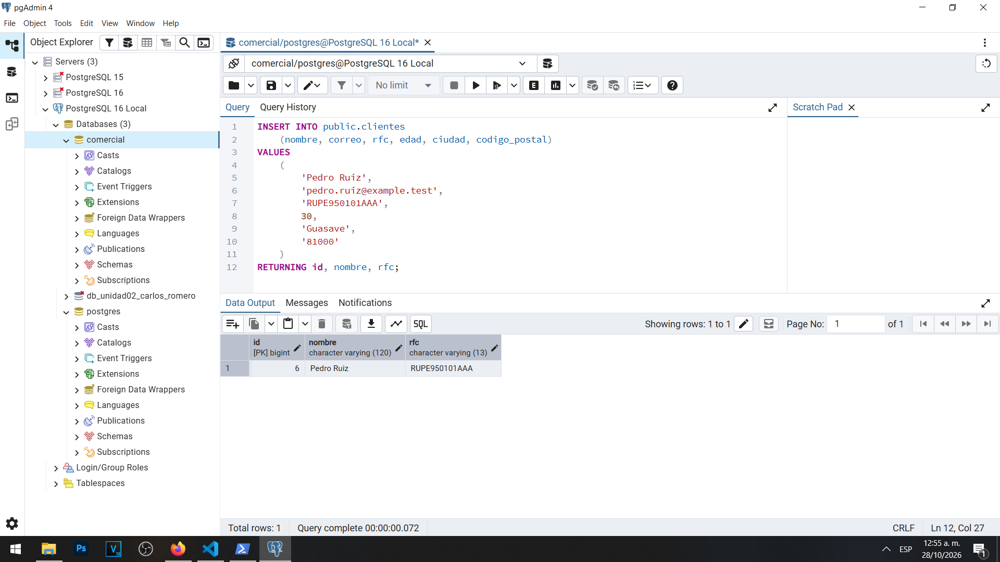
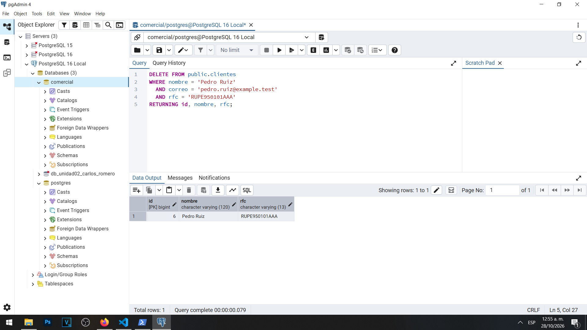
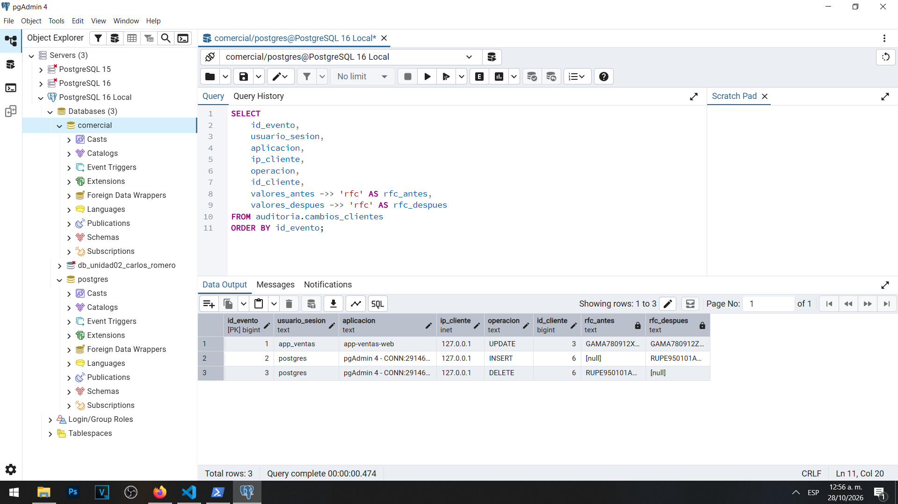

# Actividad 13 — Altas y bajas de clientes

**Materia:** Gestión de Seguridad y Desempeño de Bases de Datos  
**Unidad:** III — Auditoría, trazabilidad y gobierno práctico de datos  
**Laboratorio:** LAB-01 — Bitácoras y auditoría del dato en PostgreSQL  
**Estudiante:** Carlos Romero  
**Motor:** PostgreSQL 16  
**Sistema operativo:** Windows  
**Base de datos:** `comercial`  
**Herramienta:** pgAdmin 4

---

## 1. Objetivo

Comprobar que el disparador de auditoría registra automáticamente las operaciones de inserción y eliminación de clientes, conservando información histórica incluso después de que un registro desaparece de la tabla original.

Asimismo, analizar las implicaciones de almacenar datos personales en el historial de auditoría y su relación con las políticas de retención de información.

## 2. Preparación de la actividad

Durante las actividades anteriores se creó la tabla `auditoria.cambios_clientes` y se implementó el disparador `trg_auditoria_clientes`.

El disparador registra automáticamente las operaciones `INSERT`, `UPDATE` y `DELETE` realizadas sobre `public.clientes`.

Antes de comenzar esta actividad existía un evento de auditoría correspondiente a la modificación del RFC de María García, realizada por la cuenta `app_ventas`.

Para esta prueba se utilizó una cuenta administrativa `postgres` y se trabajó con un cliente ficticio llamado Pedro Ruiz.

## 3. Inserción del cliente

Se ejecutó la instrucción:

```sql
INSERT INTO public.clientes
    (nombre, correo, rfc, edad, ciudad, codigo_postal)
VALUES
    (
        'Pedro Ruiz',
        'pedro.ruiz@example.test',
        'RUPE950101AAA',
        30,
        'Guasave',
        '81000'
    )
RETURNING id, nombre, rfc;
```

PostgreSQL devolvió una fila con los siguientes datos:

| Campo | Valor |
|---|---|
| ID | 6 |
| Nombre | Pedro Ruiz |
| RFC | RUPE950101AAA |

La operación se realizó correctamente y generó automáticamente un evento de auditoría de tipo `INSERT`.

### Evidencia 13A — Cliente insertado



## 4. Eliminación del cliente

Posteriormente se ejecutó:

```sql
DELETE FROM public.clientes
WHERE nombre = 'Pedro Ruiz'
  AND correo = 'pedro.ruiz@example.test'
  AND rfc = 'RUPE950101AAA'
RETURNING id, nombre, rfc;
```

El resultado devolvió una fila correspondiente a Pedro Ruiz, con el ID 6.

Esto confirmó que la operación eliminó el registro que acababa de crearse.

El disparador también generó un evento de tipo `DELETE`, conservando los valores anteriores mediante `to_jsonb(OLD)`.

### Evidencia 13B — Cliente eliminado



## 5. Consulta del historial de auditoría

Después de completar las operaciones se consultó `auditoria.cambios_clientes`.

La consulta mostró tres eventos:

| Evento | Usuario de sesión | Operación | ID del cliente | RFC anterior | RFC posterior |
|---|---|---|---|---|---|
| 1 | app_ventas | UPDATE | 3 | GAMA780912XYZ | GAMA780912ZZZ |
| 2 | postgres | INSERT | 6 | NULL | RUPE950101AAA |
| 3 | postgres | DELETE | 6 | RUPE950101AAA | NULL |

El evento 1 corresponde a la modificación investigada en la Actividad 12.

Los eventos 2 y 3 corresponden al alta y la baja de Pedro Ruiz.

En la captura también se comprobó que las tres operaciones conservaron información sobre el usuario de sesión y la aplicación utilizada.

### Evidencia 13C — Historial de operaciones



## 6. Análisis de la auditoría

El evento `INSERT` conserva el registro nuevo en `valores_despues`, mientras que `valores_antes` permanece nulo.

En el evento `DELETE` ocurre lo contrario: `valores_antes` contiene la información del registro eliminado y `valores_despues` permanece nulo.

Este comportamiento permite investigar qué información se registró originalmente y qué datos fueron eliminados.

Aunque el cliente dejó de existir en la tabla operativa, su historial permanece disponible en la tabla de auditoría.

Debe distinguirse entre la eliminación de un registro de negocio y la eliminación de sus evidencias históricas, ya que ambas operaciones pueden estar sujetas a requisitos de conservación diferentes.

## 7. Preguntas y respuestas

### 1. El cliente Pedro Ruiz ya no existe en clientes. ¿Dónde queda evidencia de que existió y de sus datos?

La evidencia permanece en la tabla `auditoria.cambios_clientes`.

Durante la prueba se generaron dos eventos correspondientes al ID 6.

El primer evento, de tipo `INSERT`, contiene los datos registrados al momento de crear al cliente.

El segundo evento, de tipo `DELETE`, conserva los valores que tenía el registro inmediatamente antes de su eliminación.

Ambos eventos permiten comprobar que Pedro Ruiz fue registrado y posteriormente eliminado.

También permiten identificar la cuenta que realizó las operaciones y sus marcas de tiempo.

Por lo tanto, aunque el cliente ya no aparezca en `public.clientes`, el historial conserva información suficiente para reconstruir esas acciones.

### 2. ¿Por qué ip_cliente está vacía en los eventos 2 y 3?

En el ejemplo de la guía, las operaciones administrativas se realizan mediante una conexión local que no utiliza TCP/IP, por lo que `inet_client_addr()` puede devolver un valor nulo.

Sin embargo, en nuestro laboratorio ocurrió algo diferente.

Las operaciones de inserción y eliminación se realizaron mediante pgAdmin 4 en Windows, conectado a PostgreSQL utilizando la dirección `127.0.0.1`.

Por ese motivo, la columna `ip_cliente` contiene `127.0.0.1` en los eventos 2 y 3.

Esto no representa un error. La dirección registrada depende del mecanismo de conexión utilizado.

Las conexiones TCP/IP locales suelen mostrar una dirección de retorno como `127.0.0.1`, mientras que algunas conexiones locales mediante sockets Unix pueden producir un valor nulo.

La diferencia demuestra que las evidencias deben interpretarse considerando el entorno real y no solamente el resultado ilustrativo de la guía.

### 3. La política de retención de la Unidad II pedía eliminar datos cuando ya no fueran necesarios. ¿Qué conflicto aparece? ¿Quién debe resolverlo?

Existe un conflicto entre la necesidad de eliminar datos personales cuando dejan de ser necesarios y la necesidad de conservar evidencias para auditorías, investigaciones y cumplimiento de obligaciones.

En esta actividad, Pedro Ruiz fue eliminado de la tabla operativa, pero sus datos permanecieron en la tabla de auditoría.

Esto puede ser necesario para demostrar que una operación ocurrió correctamente; sin embargo, también significa que los datos personales siguen almacenados.

Por ello, la organización necesita establecer plazos específicos de conservación para los registros de auditoría.

La decisión debe tomarse mediante una política institucional que considere los requisitos legales, la finalidad del tratamiento, la necesidad de investigación y la minimización de datos.

La responsabilidad corresponde a la organización, particularmente a las áreas responsables de la información, seguridad, cumplimiento y privacidad, con apoyo de los administradores de bases de datos.

El DBA implementa los controles técnicos de conservación y eliminación, pero no debería decidir individualmente cuánto tiempo conservar datos personales.

## 8. Consideraciones de seguridad

El historial de auditoría debe tratarse como información restringida porque contiene datos que originalmente se almacenaban en la tabla `clientes`.

Los registros JSONB pueden incluir nombres, correos, RFC, teléfonos y otros atributos.

Por lo tanto, se deben mantener permisos limitados, respaldos seguros, políticas de retención y procedimientos de eliminación controlada.

También debe evitarse que los usuarios de aplicación modifiquen o eliminen directamente el historial, porque eso comprometería su confiabilidad.

## 9. Conclusión

La Actividad 13 permitió comprobar que el disparador de auditoría funciona correctamente durante las operaciones de inserción y eliminación.

Se creó al cliente ficticio Pedro Ruiz, identificado mediante el ID 6, y posteriormente se eliminó su registro.

La consulta final demostró que el historial conserva tres eventos: una actualización anterior de María García y los eventos de inserción y eliminación de Pedro Ruiz.

Esta práctica confirmó que la auditoría permite reconstruir operaciones incluso cuando los registros originales ya no existen.

También permitió reconocer la importancia de equilibrar la conservación de evidencias con las políticas de privacidad y retención de datos personales.
