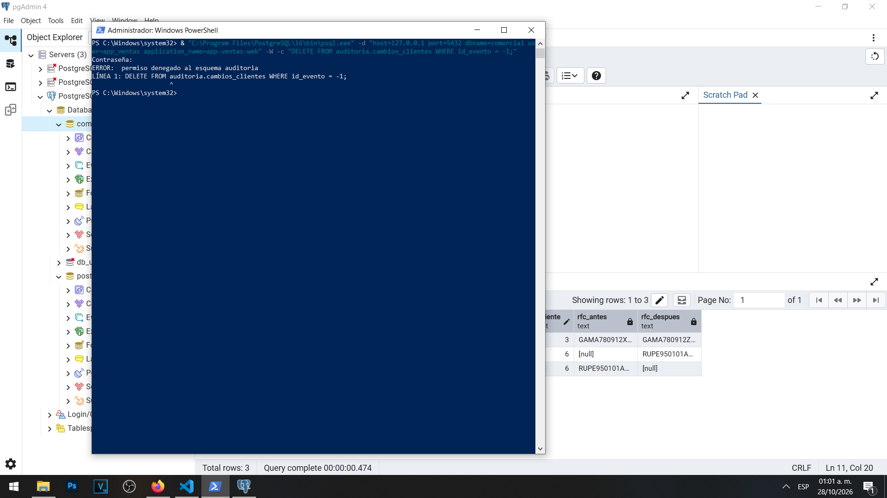
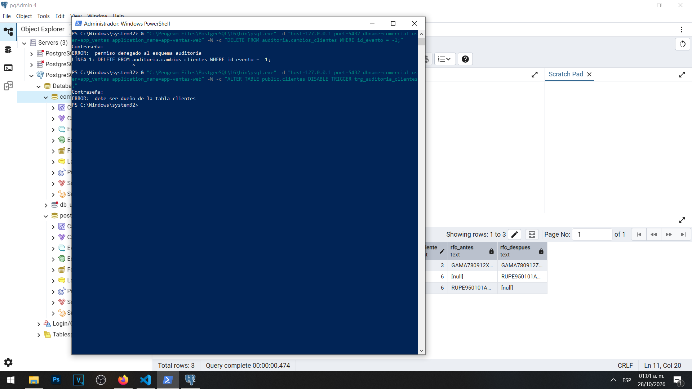
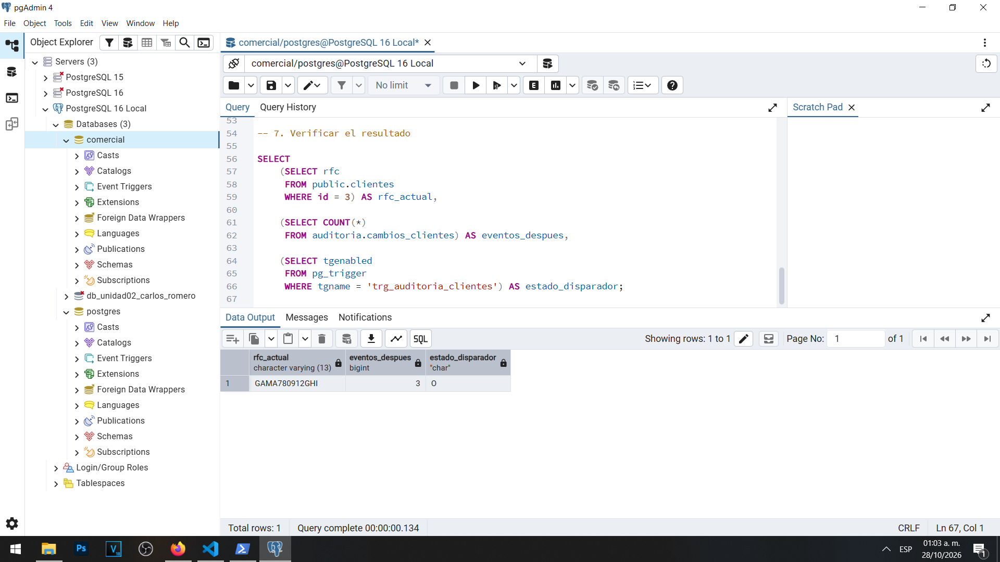
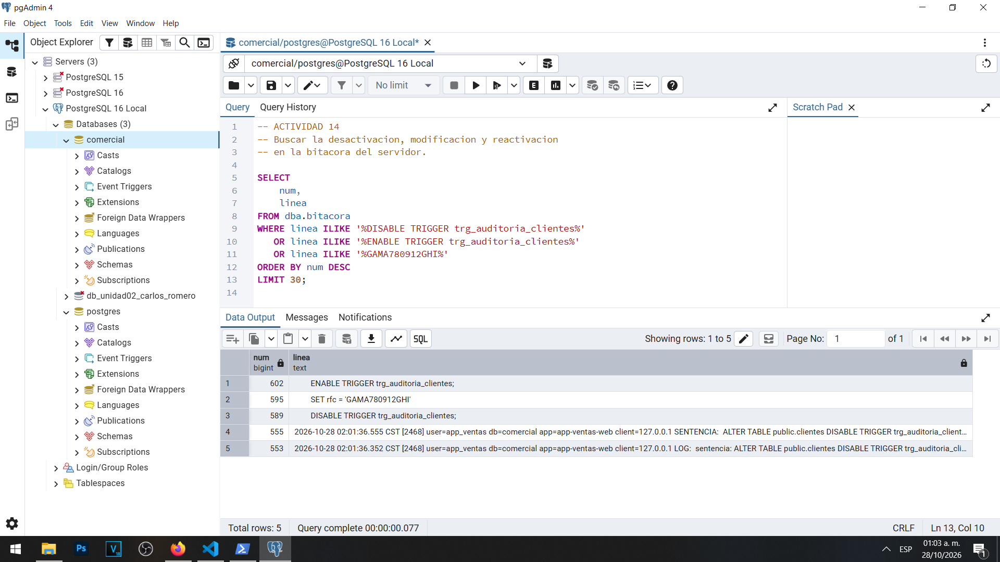

# Actividad 14 — Manipulación y protección de la auditoría

**Materia:** Gestión de Seguridad y Desempeño de Bases de Datos  
**Unidad:** III — Auditoría, trazabilidad y gobierno práctico de datos  
**Laboratorio:** 01 — Bitácoras y auditoría del dato en PostgreSQL  
**Estudiante:** Carlos Romero  
**Motor:** PostgreSQL 16  
**Sistema operativo:** Windows  
**Base de datos:** `comercial`  
**Herramientas:** pgAdmin 4, PowerShell y Visual Studio Code  
**Fecha:** 28 de octubre de 2026

---

## 1. Objetivo

Comprobar la protección de los registros de auditoría frente a intentos de manipulación no autorizados, identificar las limitaciones del mecanismo de auditoría basado en disparadores y analizar cómo la bitácora del servidor puede utilizarse para detectar modificaciones realizadas mientras dicho mecanismo se encuentra desactivado.

La actividad también permite evaluar la importancia de los privilegios administrativos, la separación de funciones y los controles complementarios para proteger la integridad y trazabilidad de la información.

## 2. Intento de eliminación de registros de auditoría

Se utilizó la cuenta `app_ventas` para intentar eliminar información de la tabla `auditoria.cambios_clientes`.

La operación se ejecutó desde Windows PowerShell mediante una conexión a PostgreSQL utilizando la herramienta `psql`.

La sentencia utilizada fue:

```sql
DELETE FROM auditoria.cambios_clientes
WHERE id_evento = -1;
```

Se utilizó el identificador `-1` para evitar afectar registros existentes en caso de que la cuenta tuviera permisos inesperados.

**Resultado obtenido:**

```text
ERROR: permiso denegado al esquema auditoria
```

PostgreSQL rechazó la operación debido a que la cuenta `app_ventas` no dispone de los privilegios necesarios para acceder al esquema `auditoria`.

Este resultado demuestra que los usuarios operativos no pueden eliminar directamente las evidencias almacenadas en el historial de auditoría.

La restricción contribuye a preservar la integridad de los registros y evita que una cuenta de aplicación modifique información destinada a la supervisión y reconstrucción de operaciones.

### Evidencia 14A — Eliminación de auditoría denegada



## 3. Intento de desactivación del disparador

Posteriormente, utilizando la misma cuenta `app_ventas`, se intentó desactivar el disparador encargado de registrar automáticamente las modificaciones realizadas sobre la tabla `public.clientes`.

Se ejecutó la siguiente instrucción:

```sql
ALTER TABLE public.clientes
DISABLE TRIGGER trg_auditoria_clientes;
```

**Resultado obtenido:**

```text
ERROR: debe ser dueño de la tabla clientes
```

PostgreSQL rechazó la operación porque `app_ventas` no es propietario de la tabla `clientes` ni dispone de los privilegios administrativos necesarios para efectuar esa modificación.

Este comportamiento demuestra que contar con permisos para consultar o actualizar información no significa tener autorización para alterar los mecanismos de seguridad asociados a una tabla.

La restricción permite separar las operaciones habituales de los usuarios de aplicación de las tareas administrativas que podrían afectar la auditoría.

### Evidencia 14B — Desactivación del disparador denegada



## 4. Manipulación controlada mediante una cuenta administrativa

Para demostrar una de las limitaciones de la auditoría basada en disparadores, se realizó una prueba controlada utilizando la cuenta administrativa `postgres`.

Inicialmente, la tabla `auditoria.cambios_clientes` contenía tres registros correspondientes a las actividades anteriores.

La prueba consistió en desactivar temporalmente el disparador, modificar un dato de un cliente y reactivar el mecanismo antes de finalizar la operación.

### 4.1. Desactivación temporal del disparador

Se ejecutó:

```sql
ALTER TABLE public.clientes
DISABLE TRIGGER trg_auditoria_clientes;
```

Esta instrucción permitió suspender temporalmente la ejecución automática del disparador.

### 4.2. Modificación de información

Mientras el disparador se encontraba desactivado, se modificó el RFC del cliente con identificador 3.

```sql
UPDATE public.clientes
SET rfc = 'GAMA780912GHI'
WHERE id = 3;
```

La actualización se completó correctamente y el valor del RFC fue reemplazado.

Sin embargo, debido a que el disparador estaba desactivado, esta modificación no produjo un nuevo registro en `auditoria.cambios_clientes`.

### 4.3. Reactivación del disparador

Después de realizar la modificación se ejecutó:

```sql
ALTER TABLE public.clientes
ENABLE TRIGGER trg_auditoria_clientes;
```

La instrucción permitió restablecer el mecanismo de auditoría para las operaciones posteriores.

La desactivación, modificación y reactivación se realizaron dentro de una transacción controlada, de manera que el disparador quedó habilitado al finalizar la prueba.

## 5. Verificación del resultado

Después de ejecutar la prueba se realizó una consulta para comprobar el valor actual del RFC, el número de eventos de auditoría y el estado del disparador.

```sql
SELECT
    (SELECT rfc
     FROM public.clientes
     WHERE id = 3) AS rfc_actual,

    (SELECT COUNT(*)
     FROM auditoria.cambios_clientes) AS eventos_despues,

    (SELECT tgenabled
     FROM pg_trigger
     WHERE tgname = 'trg_auditoria_clientes') AS estado_disparador;
```

**Resultados obtenidos:**

| Elemento verificado | Resultado |
|---|---|
| RFC actual del cliente 3 | GAMA780912GHI |
| Total de registros de auditoría | 3 |
| Estado del disparador | O |
| Registro nuevo por la modificación | No generado |

El valor `O` en la columna `estado_disparador` indica que el disparador se encuentra habilitado para ejecutarse normalmente.

El resultado confirmó que el RFC fue modificado correctamente y que la tabla de auditoría conservó solamente los tres eventos anteriores.

Por lo tanto, se comprobó que una modificación efectuada mientras el disparador se encuentra desactivado no queda registrada mediante ese mecanismo.

### Evidencia 14C — Cambio realizado sin generar auditoría del dato



## 6. Identificación de la manipulación mediante la bitácora del servidor

Aunque la modificación no generó un nuevo evento en la tabla de auditoría, se realizó una consulta sobre la vista `dba.bitacora` para identificar las sentencias relacionadas con la prueba.

Se utilizó la siguiente consulta:

```sql
SELECT
    num,
    linea
FROM dba.bitacora
WHERE linea ILIKE '%DISABLE TRIGGER trg_auditoria_clientes%'
   OR linea ILIKE '%ENABLE TRIGGER trg_auditoria_clientes%'
   OR linea ILIKE '%GAMA780912GHI%'
ORDER BY num DESC
LIMIT 30;
```

**Resultado obtenido:**

La consulta devolvió cinco líneas relacionadas con las operaciones investigadas.

Entre los resultados se identificaron:

- La instrucción utilizada para desactivar el disparador.
- La modificación del RFC a `GAMA780912GHI`.
- La instrucción utilizada para reactivar el disparador.
- Registros relacionados con el intento de desactivación no autorizado de `app_ventas`.

Algunas instrucciones aparecieron como fragmentos independientes debido al formato de varias líneas utilizado en el registro del servidor.

Este resultado demostró que la bitácora del servidor conserva una segunda fuente de información sobre las operaciones administrativas.

Aunque el mecanismo de auditoría basado en disparadores no registró la actualización, las instrucciones relacionadas con la manipulación pudieron localizarse en los registros del servidor.

### Evidencia 14D — Manipulación identificada en la bitácora



## 7. Análisis de resultados

La actividad permitió identificar dos situaciones relacionadas con la seguridad de PostgreSQL.

En primer lugar, los usuarios sin suficientes privilegios no pueden eliminar libremente las evidencias ni modificar los mecanismos de auditoría. Esto se comprobó mediante los errores de permisos obtenidos con `app_ventas`.

En segundo lugar, un administrador con privilegios suficientes puede modificar temporalmente el funcionamiento del sistema de auditoría.

Durante la prueba, el registro del cliente fue actualizado sin que se generara un nuevo evento en la tabla `auditoria.cambios_clientes`.

Sin embargo, la bitácora del servidor permitió localizar las sentencias relacionadas con esa modificación.

Esto demuestra que los mecanismos de auditoría del dato y de registro de actividades del servidor cumplen funciones complementarias.

La auditoría mediante disparadores permite conservar los valores anteriores y posteriores de los registros modificados, mientras que la bitácora del servidor proporciona información sobre las sentencias ejecutadas, los usuarios y las operaciones administrativas.

No obstante, ambos mecanismos pueden estar expuestos a riesgos cuando una misma cuenta posee privilegios excesivos sobre la base de datos y su infraestructura.

## 8. Preguntas de análisis

### 8.1. ¿Qué evidencia permite detectar que hubo un cambio sin auditar?

La principal evidencia es la diferencia entre el estado actual de los datos y el historial registrado en la tabla de auditoría.

Durante la prueba se modificó el RFC del cliente con identificador 3, pero la cantidad de eventos registrados permaneció en tres.

Esto permitió identificar que existió una modificación sin su correspondiente evento en la auditoría del dato.

Adicionalmente, la bitácora del servidor conservó las instrucciones utilizadas para desactivar el disparador, modificar el RFC y reactivar el mecanismo.

La combinación de ambas fuentes permitió demostrar que el cambio ocurrió durante un periodo en el que el disparador no estaba funcionando.

Por lo tanto, la comparación entre los datos actuales, la auditoría y las bitácoras del servidor representa un mecanismo útil para detectar posibles manipulaciones.

### 8.2. ¿Qué control administrativo reduciría este riesgo?

Un control administrativo adecuado consiste en establecer un procedimiento formal para autorizar y supervisar cualquier modificación relacionada con los mecanismos de auditoría.

La desactivación de disparadores, los cambios en permisos críticos y las modificaciones de configuración deberían requerir autorización previa, documentación y una revisión posterior.

También es recomendable implementar un sistema externo de conservación de bitácoras, con permisos restringidos y mecanismos de protección contra modificaciones no autorizadas.

De esta manera, aunque un administrador tenga la capacidad técnica de alterar los mecanismos de auditoría internos, existiría una fuente independiente para investigar sus actividades.

Otros controles recomendables son la revisión periódica de privilegios, la supervisión de cuentas administrativas y la generación de alertas cuando se detecten operaciones como `DISABLE TRIGGER`.

Estos mecanismos permitirían reducir el riesgo de manipulación y fortalecer la confiabilidad de las evidencias.

### 8.3. ¿Cómo se relaciona esta actividad con el principio de separación de funciones de la Unidad II?

La separación de funciones establece que las responsabilidades críticas de un sistema deben distribuirse entre diferentes usuarios o áreas, evitando que una sola cuenta concentre todos los privilegios.

En esta actividad se comprobó que la cuenta `app_ventas` puede ejecutar operaciones autorizadas sobre los datos, pero no puede eliminar registros de auditoría ni desactivar el disparador.

Por otra parte, la cuenta administrativa `postgres` sí dispone de los privilegios necesarios para realizar estas modificaciones.

Esto demuestra la importancia de separar las responsabilidades relacionadas con la operación de aplicaciones, administración de bases de datos y supervisión de la seguridad.

En un entorno organizacional, el administrador de bases de datos podría encargarse del mantenimiento del servidor, mientras que un responsable de seguridad o auditoría supervisaría los cambios críticos y custodiaría las evidencias.

La aplicación de este principio contribuye a prevenir el uso indebido de privilegios y reduce las posibilidades de que una modificación no autorizada pase inadvertida.

## 9. Consideraciones de seguridad

La práctica permitió reconocer que los mecanismos de auditoría deben protegerse mediante diferentes niveles de seguridad.

Entre las medidas recomendadas se encuentran:

- Limitar los privilegios de los usuarios de aplicación.
- Evitar que las cuentas operativas sean propietarias de las tablas críticas.
- Restringir la modificación y eliminación de los registros de auditoría.
- Supervisar las operaciones realizadas por usuarios administrativos.
- Proteger las bitácoras mediante almacenamiento externo y controles de acceso.
- Implementar procedimientos formales para autorizar modificaciones críticas.
- Verificar periódicamente que los disparadores permanezcan habilitados.
- Aplicar el principio de separación de funciones.

Estas medidas contribuyen a mejorar la integridad, disponibilidad y confiabilidad de las evidencias generadas por los sistemas de bases de datos.

## 10. Conclusión

La Actividad 14 permitió comprobar el funcionamiento de los mecanismos de protección de la auditoría y analizar sus principales limitaciones.

Los intentos de eliminar registros y desactivar el disparador mediante la cuenta `app_ventas` fueron rechazados debido a restricciones de privilegios, demostrando que PostgreSQL protege estos mecanismos frente a usuarios sin autorización.

Posteriormente se realizó una prueba controlada utilizando la cuenta administrativa `postgres`, en la que se desactivó temporalmente el disparador, se modificó el RFC de un cliente y se reactivó el mecanismo.

La verificación final confirmó que el RFC había cambiado, mientras que la tabla de auditoría conservaba solamente sus tres registros anteriores.

Sin embargo, la bitácora del servidor permitió localizar las instrucciones relacionadas con la desactivación, modificación y reactivación del disparador.

Por lo tanto, se concluye que una auditoría confiable no debe depender exclusivamente de un único mecanismo técnico. Es necesario implementar controles complementarios, políticas administrativas, separación de funciones y procedimientos de conservación de evidencias.

Esta actividad permitió comprender la importancia de combinar la auditoría del dato con la supervisión de actividades del servidor para fortalecer la seguridad y trazabilidad de PostgreSQL.
