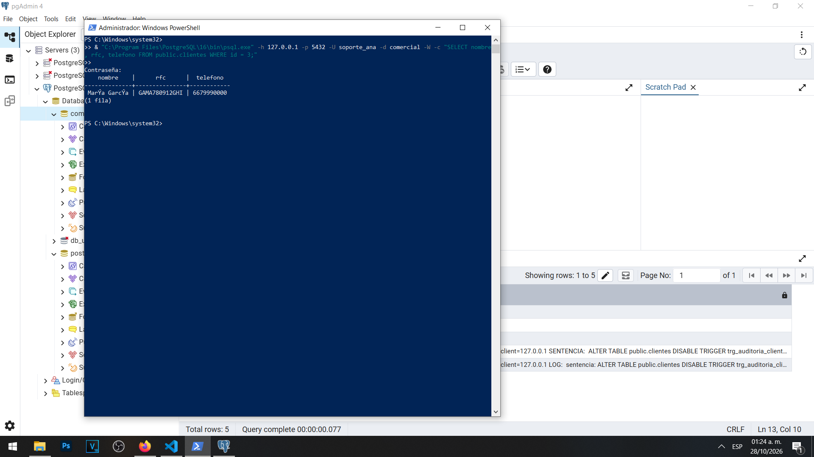
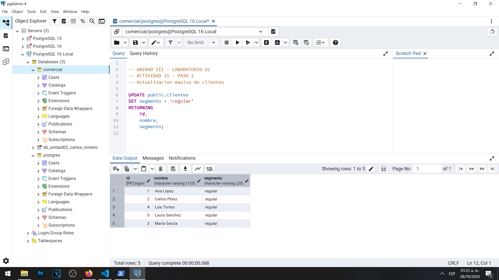
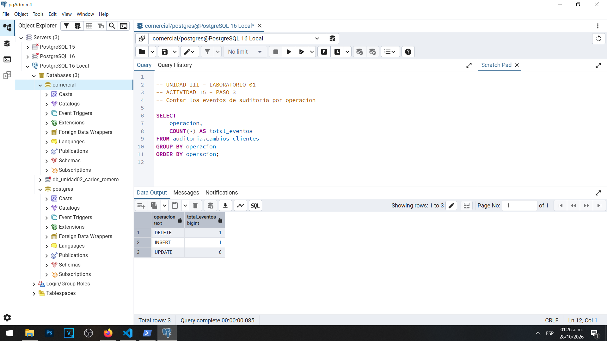
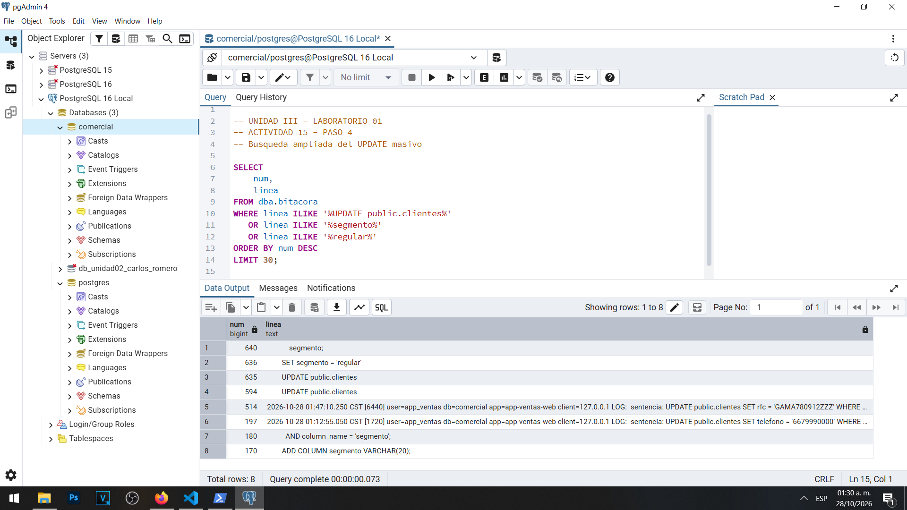
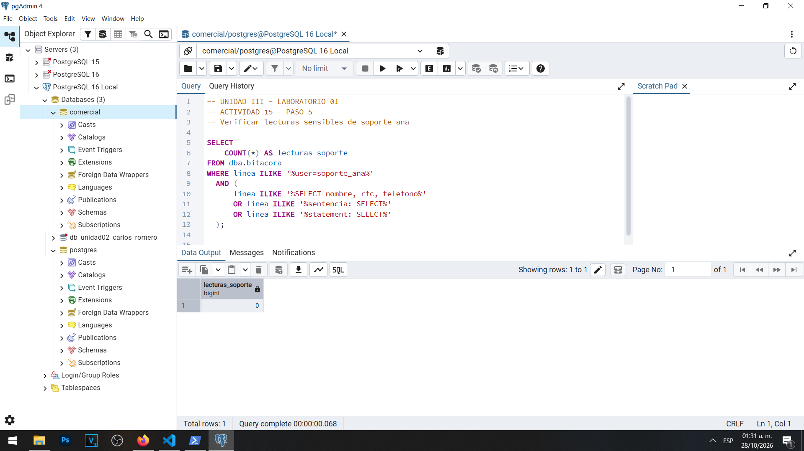

# Actividad 15 — Límites de la auditoría: lecturas y volumen

**Materia:** Gestión de Seguridad y Desempeño de Bases de Datos  
**Unidad:** III — Auditoría, trazabilidad y gobierno práctico de datos  
**Laboratorio:** 01 — Bitácoras y auditoría del dato en PostgreSQL  
**Estudiante:** Carlos Romero  
**Motor:** PostgreSQL 16  
**Sistema operativo:** Windows  
**Base de datos:** `comercial`  
**Herramientas:** pgAdmin 4, PowerShell y Visual Studio Code  
**Fecha:** 28 de octubre de 2026

---

## 1. Objetivo

Analizar las limitaciones de los mecanismos de auditoría de PostgreSQL mediante la ejecución de consultas sobre información sensible y operaciones de actualización masiva.

Se busca identificar las diferencias entre el registro de sentencias SQL en la bitácora del servidor y la auditoría detallada de modificaciones mediante disparadores, considerando sus implicaciones para la trazabilidad, el almacenamiento y la protección de datos.

## 2. Lectura de información sensible

Se realizó una conexión a la base de datos `comercial` utilizando el usuario `soporte_ana`, con el objetivo de consultar información sensible de un cliente.

La operación se ejecutó desde PowerShell utilizando `psql` y la siguiente sentencia:

```sql
SELECT nombre, rfc, telefono
FROM public.clientes
WHERE id = 3;
```

**Resultado obtenido:**

| Campo | Valor |
|---|---|
| Nombre | María García |
| RFC | GAMA780912GHI |
| Teléfono | 6679990000 |
| Filas devueltas | 1 |

La consulta fue ejecutada correctamente, lo que permitió comprobar que el usuario disponía de permisos para consultar esos campos.

Sin embargo, la operación no modifica información almacenada y, por lo tanto, no genera eventos mediante el disparador de auditoría configurado para registrar operaciones `INSERT`, `UPDATE` y `DELETE`.

### Evidencia 15A — Lectura de información sensible



## 3. Actualización masiva de clientes

Para comprobar el volumen de eventos generado por una actualización masiva, se ejecutó la siguiente instrucción:

```sql
UPDATE public.clientes
SET segmento = 'regular'
RETURNING id, nombre, segmento;
```

La instrucción modificó cinco registros existentes en la tabla `public.clientes`.

**Resultado obtenido:**

| ID | Cliente | Segmento |
|---|---|---|
| 1 | Ana López | regular |
| 2 | Carlos Pérez | regular |
| 4 | Luis Torres | regular |
| 5 | Laura Sánchez | regular |
| 3 | María García | regular |

La operación se completó satisfactoriamente, sin errores.

Este resultado demuestra que una sola sentencia `UPDATE`, cuando no contiene una condición `WHERE`, puede modificar múltiples filas.

Debido a que el disparador de auditoría trabaja a nivel de fila, cada registro actualizado genera un evento independiente.

### Evidencia 15B — Actualización masiva de clientes



## 4. Volumen de registros generados

Posteriormente se consultó la tabla `auditoria.cambios_clientes` para identificar la cantidad de operaciones registradas.

Se ejecutó:

```sql
SELECT
    operacion,
    COUNT(*) AS total_eventos
FROM auditoria.cambios_clientes
GROUP BY operacion
ORDER BY operacion;
```

**Resultado obtenido:**

| Operación | Eventos |
|---|---:|
| DELETE | 1 |
| INSERT | 1 |
| UPDATE | 6 |
| **Total** | **8** |

Antes de realizar la actualización masiva, la tabla de auditoría contenía tres eventos.

Después de modificar los cinco clientes, el total aumentó a ocho.

Los seis eventos de tipo `UPDATE` corresponden a una modificación anterior y a las cinco actualizaciones generadas durante esta actividad.

Esto confirma que el disparador se ejecutó individualmente para cada fila afectada.

### Evidencia 15C — Volumen de auditoría



## 5. Verificación de la bitácora del servidor

Se consultó la vista `dba.bitacora` para identificar las instrucciones relacionadas con la actualización masiva.

Debido a que la sentencia SQL estaba distribuida en varias líneas, se utilizó una búsqueda ampliada:

```sql
SELECT
    num,
    linea
FROM dba.bitacora
WHERE linea ILIKE '%UPDATE public.clientes%'
   OR linea ILIKE '%segmento%'
   OR linea ILIKE '%regular%'
ORDER BY num DESC
LIMIT 30;
```

La consulta devolvió ocho líneas coincidentes, incluyendo registros de actividades anteriores.

Entre los resultados se identificaron las líneas directamente relacionadas con la actualización masiva:

| Número de línea | Contenido |
|---|---|
| 635 | UPDATE public.clientes |
| 636 | SET segmento = 'regular' |

Ambas líneas forman parte de una misma sentencia SQL.

Esto permitió comprobar la diferencia entre los mecanismos de registro.

La bitácora del servidor conserva información sobre la sentencia ejecutada, mientras que el disparador almacena un evento independiente por cada fila modificada.

Por lo tanto, una sola instrucción SQL puede generar múltiples registros en la auditoría del dato.

### Evidencia 15D — Actualización masiva en la bitácora



## 6. Verificación de lecturas no registradas

Para comprobar las limitaciones del registro de lecturas, se buscó la consulta realizada anteriormente mediante `soporte_ana`.

Se ejecutó:

```sql
SELECT
    COUNT(*) AS lecturas_soporte
FROM dba.bitacora
WHERE linea ILIKE '%user=soporte_ana%'
  AND (
      linea ILIKE '%SELECT nombre, rfc, telefono%'
      OR linea ILIKE '%sentencia: SELECT%'
      OR linea ILIKE '%statement: SELECT%'
  );
```

**Resultado obtenido:**

| Indicador | Resultado |
|---|---:|
| lecturas_soporte | 0 |

No se encontraron entradas que coincidieran con los criterios de búsqueda.

Este resultado es coherente con la configuración `log_statement = 'mod'`, debido a que este nivel registra las sentencias de modificación y definición de datos, pero no las consultas `SELECT` ordinarias.

La ausencia de coincidencias no significa que el usuario no haya consultado información. La lectura se ejecutó correctamente, como se demuestra en la Evidencia 15A.

Esta situación representa una limitación importante cuando se necesita investigar accesos a información sensible.

### Evidencia 15E — Lecturas no registradas



## 7. Comparación de mecanismos de auditoría

| Característica | Bitácora del servidor | Auditoría con disparador |
|---|---|---|
| Registro de sentencias SQL | Sí, según configuración | No directamente |
| Registro de valores anteriores y posteriores | No de forma estructurada | Sí |
| Operaciones UPDATE | Según nivel configurado | Sí |
| Operaciones SELECT | No con nivel mod | No |
| Actualización masiva de cinco filas | Una sentencia SQL | Cinco eventos |
| Principal limitación | Cobertura y exposición de información | Volumen y falta de auditoría de lecturas |

Ambos mecanismos son complementarios.

La bitácora permite identificar instrucciones ejecutadas por los usuarios, mientras que los disparadores permiten reconstruir las modificaciones realizadas sobre los datos.

Sin embargo, ninguno de estos mecanismos, con la configuración utilizada durante esta práctica, proporciona una auditoría detallada de las consultas de lectura.

## 8. Alternativas para auditar lecturas

Una primera alternativa consiste en configurar `log_statement = 'all'`, lo que permite registrar las sentencias SQL ejecutadas, incluyendo consultas `SELECT`. Su principal desventaja es el incremento del volumen de registros y la posible exposición de información sensible.

Otra alternativa consiste en utilizar funciones controladas para acceder a información confidencial. Estas funciones pueden registrar quién consulta determinados datos, aunque requieren modificar la aplicación y restringir los accesos directos.

Finalmente, PostgreSQL permite complementar la auditoría mediante la extensión `pgaudit`, que ofrece mecanismos más específicos de registro de actividades, incluyendo auditoría de objetos. Esta alternativa requiere instalación y configuración adicional.

## 9. Preguntas de reflexión

### 9.1. Si clientes tuviera un millón de registros, ¿qué ocurriría con la auditoría tras un UPDATE sin WHERE?

Si la tabla `clientes` contuviera un millón de registros y se ejecutara una instrucción `UPDATE` sin una condición `WHERE`, PostgreSQL intentaría actualizar todas las filas de la tabla.

Debido a que el disparador de auditoría está configurado a nivel de fila, se generarían aproximadamente un millón de nuevos eventos, siempre que todas las filas fueran procesadas correctamente y la transacción se confirmara.

Este comportamiento podría incrementar considerablemente el almacenamiento utilizado por la tabla de auditoría, aumentar el tiempo de ejecución y generar una mayor carga de operaciones de escritura.

Por lo tanto, es importante diseñar políticas de auditoría y conservación adecuadas, especialmente para bases de datos con grandes volúmenes de información.

### 9.2. Propón quién podría autorizar la depuración de auditoria.cambios_clientes.

La depuración de la tabla `auditoria.cambios_clientes` debería ser autorizada por el responsable de seguridad de la información o por un comité de gobierno de datos.

El administrador de bases de datos podría ejecutar técnicamente la depuración, pero no debería tener la responsabilidad exclusiva de autorizarla.

Antes de eliminar registros sería necesario comprobar que se haya cumplido el periodo de conservación establecido por la organización y que los eventos no sean necesarios para investigaciones o auditorías pendientes.

También deberían generarse respaldos protegidos y conservar evidencias de la autorización, la fecha y los registros eliminados.

Esta separación de responsabilidades reduce el riesgo de eliminación indebida de información.

### 9.3. ¿Por qué log_statement = 'all' puede convertir la bitácora en un nuevo depósito de datos sensibles?

La configuración `log_statement = 'all'` provoca que PostgreSQL registre todas las sentencias SQL ejecutadas, incluyendo consultas de lectura y operaciones que pueden incorporar datos confidenciales.

Por ejemplo, determinadas instrucciones pueden contener nombres, RFC, correos electrónicos, números telefónicos, identificadores personales e incluso contraseñas escritas directamente en las sentencias.

Esto significa que la bitácora podría convertirse en un repositorio adicional de información sensible.

Si los archivos de registro no cuentan con controles de acceso, conservación y eliminación adecuados, podrían representar un riesgo de privacidad y seguridad.

Por esta razón, habilitar registros detallados requiere evaluar los riesgos, limitar el acceso a las bitácoras y evitar almacenar información confidencial innecesaria.

## 10. Conclusión

La Actividad 15 permitió identificar las limitaciones de los mecanismos de auditoría implementados en PostgreSQL 16.

Inicialmente, se comprobó que el usuario `soporte_ana` podía consultar información sensible de un cliente sin que la lectura generara un registro identificable mediante el filtro aplicado a la bitácora del servidor.

Posteriormente, se realizó una actualización masiva de cinco clientes. Aunque se ejecutó una sola sentencia SQL, el disparador generó cinco eventos de auditoría independientes, incrementando el total de registros de tres a ocho.

La consulta de la bitácora permitió localizar la sentencia de actualización, demostrando que ambos mecanismos registran información con diferentes niveles de detalle.

Los resultados muestran que la auditoría basada en disparadores resulta útil para conservar valores anteriores y posteriores, pero puede producir un volumen considerable de registros ante operaciones masivas.

Asimismo, el nivel `log_statement = 'mod'` no proporciona una auditoría completa de las consultas de lectura.

En conclusión, para implementar un sistema de auditoría confiable es necesario combinar distintos mecanismos de registro, establecer políticas de conservación y definir controles específicos para la información sensible.
