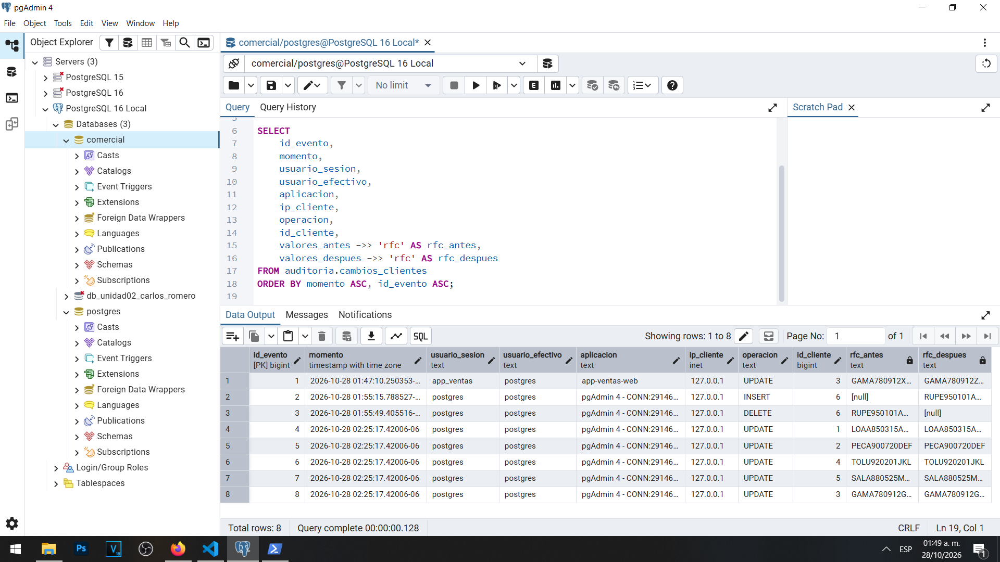
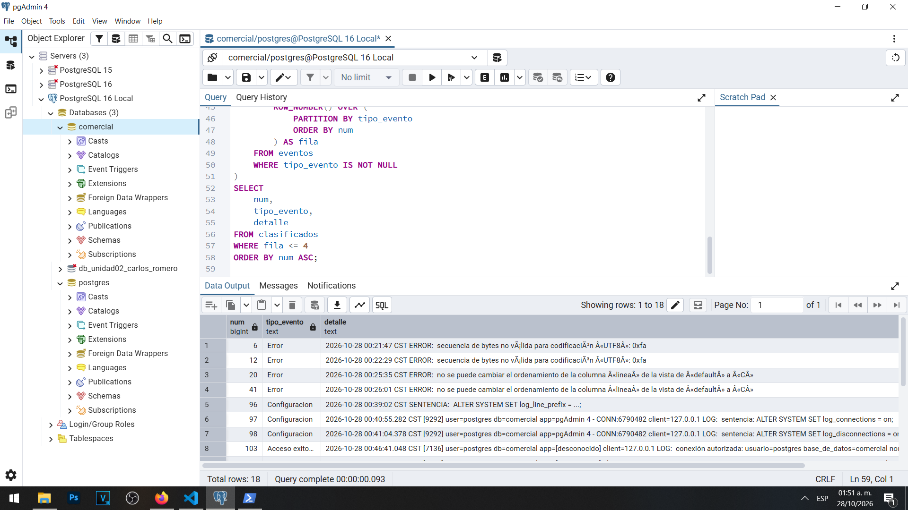
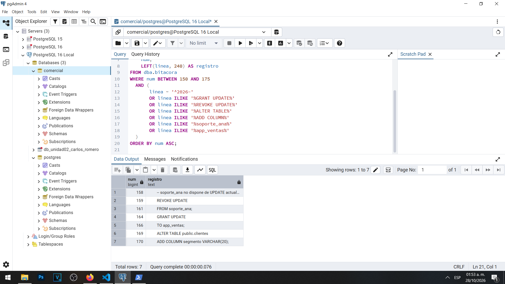

# Actividad 17 — Reconstrucción de la cronología de auditoría

**Materia:** Gestión de Seguridad y Desempeño de Bases de Datos  
**Unidad:** III — Auditoría, trazabilidad y gobierno práctico de datos  
**Laboratorio:** 01 — Bitácoras y auditoría del dato en PostgreSQL  
**Estudiante:** Carlos Romero  
**Motor:** PostgreSQL 16  
**Sistema operativo:** Windows  
**Fecha:** 28 de octubre de 2026

---

## 1. Objetivo

Reconstruir cronológicamente los acontecimientos registrados durante el laboratorio mediante el análisis de la bitácora del servidor PostgreSQL y de la tabla `auditoria.cambios_clientes`.

Se busca identificar las operaciones realizadas, sus responsables, resultados y fuentes de evidencia, así como reconocer las limitaciones de auditoría cuando determinadas actividades no quedaron registradas.

## 2. Fuentes consultadas

Se utilizaron dos mecanismos principales:

**Bitácora del servidor:** vista `dba.bitacora`, que permite consultar registros de conexiones, errores, configuración, privilegios y sentencias ejecutadas.

**Auditoría del dato:** tabla `auditoria.cambios_clientes`, que conserva las operaciones `INSERT`, `UPDATE` y `DELETE`, junto con los valores anteriores y posteriores de los registros.

También se emplearon los resultados de las consultas de pgAdmin 4 y las evidencias conservadas durante las actividades anteriores.

## 3. Cronología de eventos

Las fechas corresponden al 28 de octubre de 2026 y se muestran de acuerdo con los valores observados en PostgreSQL. Algunas horas se presentan con precisión de segundos para facilitar la lectura.

| # | Fecha y hora | Usuario | Cliente / origen | Tipo de evento | Qué ocurrió | ¿Exitoso? | Fuente |
|---|---|---|---|---|---|---|---|
| 1 | 00:21:47 | No identificado en la línea mostrada | Servidor | Error | Se detectó un problema de codificación UTF-8 al consultar la bitácora. | No | Línea 6 |
| 2 | 00:25:35 | No identificado en la línea mostrada | Servidor | Error | Falló la sustitución de la vista por incompatibilidad de ordenamiento de columna. | No | Línea 20 |
| 3 | 00:40:55 | postgres | Servidor | Configuración | Se registró la instrucción para activar `log_connections`. | Sí, confirmado posteriormente | Línea 97 |
| 4 | 00:41:04 | postgres | Servidor | Configuración | Se registró la instrucción para activar `log_disconnections`. | Sí, confirmado posteriormente | Línea 98 |
| 5 | 00:46:41 | postgres | 127.0.0.1 | Acceso | Se autorizó una conexión a la base `comercial`. | Sí | Línea 103 |
| 6 | 00:52:16 | app_ventas | 127.0.0.1 | Acceso fallido | PostgreSQL rechazó una autenticación por contraseña incorrecta. | No | Línea 129 |
| 7 | 00:53:17 | usuario_inexistente | 127.0.0.1 | Acceso fallido | Se rechazó un intento de conexión con un usuario inexistente. | No | Línea 136 |
| 8 | 01:12:55 | app_ventas | Cliente 3 | Datos | Se registró la sentencia que actualizó el teléfono a `6679990000`. | Sí, verificado | Línea 197 |
| 9 | 01:47:10 | app_ventas | Cliente 3 | Datos | Se modificó el RFC y se conservaron los valores anterior y posterior. | Sí | id_evento 1 |
| 10 | 01:55:15 | postgres | Cliente 6 | Datos | Se insertó un nuevo cliente de prueba. | Sí | id_evento 2 |
| 11 | 01:55:49 | postgres | Cliente 6 | Datos | Se eliminó el cliente de prueba anteriormente insertado. | Sí | id_evento 3 |
| 12 | 02:25:17 | postgres | Clientes 1, 2, 3, 4 y 5 | Datos | Una actualización masiva asignó el segmento `regular` a cinco clientes. | Sí | id_evento 4–8 |

La tabla contiene doce acontecimientos ordenados temporalmente. El último corresponde a una sentencia que produjo cinco registros individuales de auditoría.

## 4. Eventos adicionales de privilegios y estructura

Se identificaron las siguientes operaciones en la bitácora:

| Línea | Tipo | Operación | Interpretación |
|---|---|---|---|
| 159–161 | Privilegio | `REVOKE UPDATE ON public.clientes FROM soporte_ana` | Revocación preventiva del permiso de actualización |
| 164–166 | Privilegio | `GRANT UPDATE ON public.clientes TO app_ventas` | Concesión del permiso de actualización al rol de ventas |
| 169–170 | Estructura | `ALTER TABLE public.clientes ADD COLUMN segmento VARCHAR(20)` | Incorporación del campo `segmento` |

Estas instrucciones fueron identificadas en el registro del laboratorio. Sin embargo, las líneas consultadas son fragmentos de sentencias SQL y no presentan directamente el encabezado con la hora de ejecución.

Por esta razón, no se les asignó una hora exacta en la tabla cronológica principal. Los registros constituyen evidencia de las instrucciones realizadas, pero para establecer su momento preciso sería necesario recuperar el encabezado completo de cada evento.

## 5. Resultados de la auditoría del dato

La tabla `auditoria.cambios_clientes` presentó ocho registros:

| Operación | Total |
|---|---:|
| INSERT | 1 |
| UPDATE | 6 |
| DELETE | 1 |
| **Total** | **8** |

El primer `UPDATE` corresponde a una modificación del RFC del cliente 3 realizada por `app_ventas`.

En dicho evento se observó:

- Usuario de sesión: `app_ventas`.
- Usuario efectivo: `postgres`.
- Aplicación: `app-ventas-web`.
- Dirección IP: `127.0.0.1`.
- RFC anterior: `GAMA780912XYZ`.
- RFC posterior: `GAMA780912ZZZ`.

La diferencia entre usuario de sesión y usuario efectivo se explica por la función de auditoría ejecutada con `SECURITY DEFINER`.

Los otros cinco registros `UPDATE` corresponden a la modificación masiva del campo `segmento`.

## 6. Respuestas a las preguntas de Dirección

### 6.1. ¿Quién hizo los cambios del RFC?

**Actividad 3 — Primer incidente:** No hay evidencia suficiente en la bitácora para atribuir de manera independiente el cambio original. El incidente se realizó cuando el registro de sentencias no estaba configurado para conservar esa información.

**Actividad 7 — Modificación posterior:** Se identificaron operaciones ejecutadas por la cuenta `app_ventas`. La bitácora de sentencias permite relacionar la operación con ese usuario, pero todavía no existía una auditoría de fila que conservara automáticamente el RFC anterior.

**Actividad 12 — Incidente auditado:** El registro `id_evento = 1` identifica al usuario de sesión `app_ventas`, utilizando la aplicación `app-ventas-web` desde `127.0.0.1`. En este caso sí se conservan ambos valores del RFC.

**Actividad 14 — Manipulación de la auditoría:** Se comprobaron intentos de desactivar el disparador y un cambio de RFC que no produjo un nuevo registro de auditoría. La operación quedó asociada a la demostración de manipulación administrativa, pero la tabla de auditoría no permite atribuir independientemente el cambio de fila.

Por tanto, la posibilidad de identificar al responsable depende de los registros disponibles y de que los mecanismos de auditoría estuvieran activos durante la operación.

### 6.2. ¿Cuándo ocurrieron los cambios?

El cambio auditado de la Actividad 12 ocurrió el 28 de octubre de 2026 aproximadamente a las 01:47:10, según el campo `momento` del evento 1.

También se observaron modificaciones anteriores a la instalación de la auditoría, cuya fecha exacta o valores anteriores no pueden reconstruirse mediante esa tabla.

Una operación no registrada debe documentarse como una limitación de evidencia y no recibir una fecha estimada presentada como si estuviera comprobada.

### 6.3. ¿Desde qué aplicación o equipo se realizó el cambio?

El evento auditado del cliente 3 identifica la aplicación `app-ventas-web` y la dirección `127.0.0.1`.

Esto indica que la conexión se realizó mediante la interfaz de red local del equipo donde funcionaba PostgreSQL.

Además, el campo `usuario_sesion` identifica a `app_ventas`, mientras que `usuario_efectivo` muestra a `postgres` debido a la ejecución del disparador con privilegios de su propietario.

### 6.4. ¿Hubo intentos de acceso fallidos antes de los cambios?

Sí. Se identificaron intentos fallidos de autenticación en los registros del servidor.

Uno correspondió a `app_ventas`, cuya contraseña fue rechazada por PostgreSQL.

Otro correspondió a `usuario_inexistente`, nombre que no tenía un rol válido en el servidor.

Ambos intentos se originaron desde `127.0.0.1`.

Los registros permiten demostrar que existieron intentos fallidos previos al incidente auditado de la Actividad 12, aunque no prueban por sí solos que esos intentos estuvieran relacionados causalmente con el cambio de RFC.

### 6.5. ¿Qué valor tenía el RFC antes del cambio?

En el evento auditado de la Actividad 12 se conservaron los siguientes valores:

**Valor anterior:** `GAMA780912XYZ`

**Valor posterior:** `GAMA780912ZZZ`

Por lo tanto, en este caso PostgreSQL permitió demostrar qué valor tenía el RFC inmediatamente antes de la modificación.

En cambio, el primer incidente no cuenta con un registro equivalente del valor anterior.

Durante la Actividad 14 también se observó una modificación que no generó una fila de auditoría debido a la desactivación temporal del disparador. Esto demuestra que el registro del servidor y la auditoría del dato son mecanismos complementarios.

## 7. Análisis de las limitaciones

La práctica permitió identificar cuatro limitaciones principales.

Primero, la auditoría no puede reconstruir automáticamente cambios ocurridos antes de su activación.

Segundo, el registro de sentencias permite identificar la instrucción SQL, pero no siempre conserva el valor anterior de cada fila modificada.

Tercero, una cuenta administrativa con privilegios suficientes puede modificar la configuración del servidor y desactivar mecanismos de auditoría.

Finalmente, las operaciones `SELECT` no quedan registradas de forma general cuando `log_statement` está configurado en `mod`.

Estas limitaciones justifican la necesidad de aplicar controles de acceso, protección independiente de los registros y mecanismos adicionales de auditoría para operaciones especialmente sensibles.

## 8. Evidencias

### Evidencia 17A — Eventos cronológicos

### Evidencia 17B — Clasificación de eventos del servidor

### Evidencia 17C — Privilegios y estructura

## 9. Conclusión

La reconstrucción cronológica permitió comprender cómo PostgreSQL registra las actividades del servidor y los cambios realizados sobre los datos.

Las consultas realizadas demostraron la existencia de accesos exitosos y fallidos, errores, cambios de configuración, modificaciones de privilegios, alteraciones de estructura y operaciones sobre la tabla `clientes`.

La auditoría del dato permitió identificar ocho eventos individuales y conservar información fundamental, como el usuario responsable, la aplicación utilizada, la dirección IP y los valores anteriores y posteriores.

Sin embargo, también se comprobó que un cambio realizado sin auditoría activa puede dejar vacíos de información que no es posible reconstruir posteriormente.

Se concluye que una estrategia de auditoría confiable debe combinar el registro de sentencias del servidor con una auditoría de datos protegida, mecanismos de conservación e integridad, y supervisión independiente de las cuentas administrativas.
