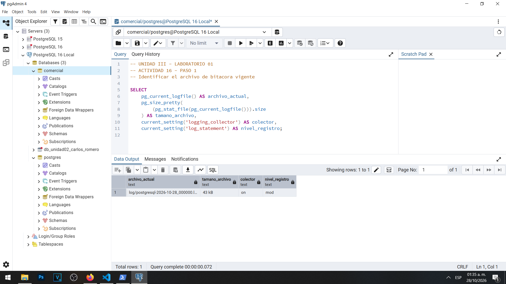
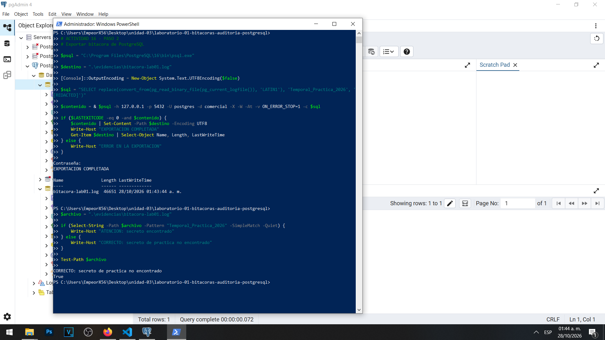
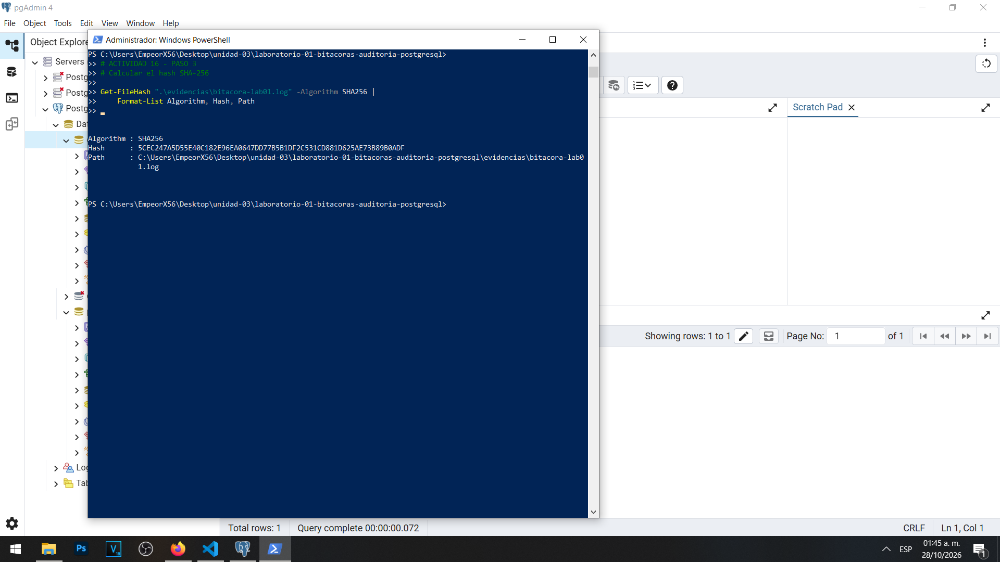
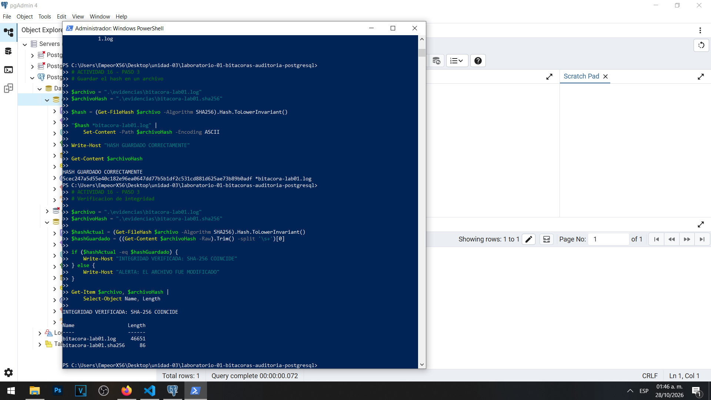

# Actividad 16 — Exportación, integridad y conservación de bitácoras

**Materia:** Gestión de Seguridad y Desempeño de Bases de Datos  
**Unidad:** III — Auditoría, trazabilidad y gobierno práctico de datos  
**Laboratorio:** 01 — Bitácoras y auditoría del dato en PostgreSQL  
**Estudiante:** Carlos Romero  
**Motor:** PostgreSQL 16  
**Sistema operativo:** Windows  
**Fecha:** 28 de octubre de 2026

---

## 1. Objetivo

Exportar una copia de la bitácora del servidor PostgreSQL, sustituir una contraseña utilizada durante las prácticas y aplicar un mecanismo de verificación de integridad mediante el algoritmo SHA-256.

Esta actividad busca demostrar la importancia de conservar las evidencias de auditoría fuera del servidor que las genera, evitando alteraciones no detectadas y la exposición innecesaria de información sensible.

## 2. Identificación del archivo de registro

Mediante pgAdmin 4 se identificó el archivo de bitácora vigente del servidor PostgreSQL.

Se comprobó que el colector de registros se encontraba activado (`on`) y que el parámetro `log_statement` estaba configurado como `mod`.

Al momento de la consulta, el archivo de registro tenía un tamaño aproximado de 43 kB.

### Evidencia 16A — Identificación de la bitácora

## 3. Exportación de la bitácora

Desde Windows PowerShell se exportó una copia de la bitácora utilizando `psql`, conectado a la base de datos `comercial` mediante el usuario `postgres`.

Para evitar problemas de codificación se utilizó `pg_read_binary_file()` junto con una conversión mediante `LATIN1`.

Durante el proceso se sustituyó la cadena `Temporal_Practica_2026` por `[REDACTED]`.

**Resultado de la exportación:**

| Concepto | Resultado |
|---|---|
| Archivo generado | bitacora-lab01.log |
| Tamaño | 46,651 bytes |
| Exportación | Completada |
| Contraseña de prueba | No encontrada después de la sustitución |
| Existencia del archivo | Confirmada |

La sustitución de la contraseña conocida no garantiza por sí sola que no existan otros secretos o datos sensibles. Por ello, la copia requiere una revisión adicional antes de compartirse públicamente.

### Evidencia 16B — Exportación de la bitácora

## 4. Cálculo del resumen SHA-256

Se utilizó el comando `Get-FileHash` de PowerShell para calcular la huella criptográfica del archivo exportado.

El algoritmo empleado fue SHA-256, que genera un resumen hexadecimal de 256 bits.

El resultado se guardó en el archivo `bitacora-lab01.sha256`, asociado a la copia exportada.

### Evidencia 16C — Cálculo del SHA-256

## 5. Verificación de integridad

Posteriormente, se calculó nuevamente el hash SHA-256 y se comparó con el valor almacenado anteriormente.

La verificación devolvió el mensaje:

**INTEGRIDAD VERIFICADA: SHA-256 COINCIDE**

Se confirmó la existencia de los siguientes archivos:

| Archivo | Tamaño |
|---|---:|
| bitacora-lab01.log | 46,651 bytes |
| bitacora-lab01.sha256 | 86 bytes |

El resultado indica que el contenido del archivo permaneció sin modificaciones entre ambas verificaciones.

### Evidencia 16D — Verificación de integridad

## 6. Preguntas de reflexión

### 6.1. Un resumen SHA-256, ¿impide que alguien modifique la bitácora? ¿Qué permite demostrar?

El algoritmo SHA-256 no impide que un archivo sea modificado o eliminado. Su función consiste en generar una huella digital que permite detectar cambios en su contenido.

Si una bitácora es modificada después de calcular su hash, el nuevo resumen será diferente al valor original, con una probabilidad extremadamente alta.

Por lo tanto, SHA-256 permite comprobar la integridad del archivo respecto a una copia confiable del hash original, pero no garantiza por sí mismo la autenticidad ni protege contra un atacante que pueda modificar tanto la bitácora como el hash almacenado.

### 6.2. ¿Dónde debería guardarse el hash para que sea útil como control de integridad?

El hash debería conservarse en un almacenamiento independiente y protegido, separado de la bitácora original.

Una alternativa consiste en utilizar un repositorio institucional de evidencias con acceso restringido, control de versiones y respaldos.

También puede almacenarse mediante un sistema de administración de evidencias que registre la fecha de generación y las personas responsables.

La separación de ambos archivos permite reducir el riesgo de que una modificación no autorizada pase inadvertida.

### 6.3. ¿Qué riesgos tiene conservar la bitácora únicamente en el servidor que la produce?

Conservar la bitácora exclusivamente en el servidor de PostgreSQL representa diferentes riesgos.

Si el servidor presenta fallas de hardware, corrupción de archivos o pérdida de almacenamiento, los registros pueden desaparecer.

Asimismo, un atacante que obtenga privilegios administrativos podría modificar o eliminar información relacionada con sus propias actividades.

Otro riesgo es la rotación automática de registros, que puede eliminar archivos antiguos si no existe una política de conservación adecuada.

Por estas razones, resulta conveniente almacenar copias protegidas en ubicaciones independientes, controlar los permisos de acceso y realizar verificaciones periódicas de integridad.

### 6.4. ¿Durante cuánto tiempo conservarías esta bitácora y por qué?

Para el escenario de práctica de Comercializadora Norte S.A. de C.V., se propone una política inicial de conservación de 12 meses.

Durante los primeros 90 días, los registros podrían mantenerse disponibles en un sistema centralizado de consulta con acceso restringido.

Posteriormente, se conservarían en un almacenamiento protegido hasta completar el periodo de 12 meses, con controles de integridad y respaldos.

Este criterio permitiría disponer de información histórica para investigar incidentes, identificar comportamientos anómalos y revisar modificaciones realizadas sobre los datos.

El periodo propuesto es orientativo y deberá ajustarse a las obligaciones legales, las políticas institucionales y las necesidades reales de seguridad de la organización.

En caso de investigaciones activas, las evidencias relacionadas deberán preservarse durante el tiempo necesario y no eliminarse mediante procedimientos automáticos.

## 7. Conclusión

La Actividad 16 permitió comprobar que la conservación de bitácoras es una parte fundamental del proceso de auditoría de bases de datos.

Mediante PowerShell se exportó correctamente el archivo de registro de PostgreSQL y se sustituyó una contraseña de prueba para reducir el riesgo de exposición de credenciales.

Posteriormente, se calculó el resumen SHA-256 y se verificó que coincidiera con el valor almacenado, demostrando que la copia no había sufrido modificaciones entre ambas operaciones.

Sin embargo, el cálculo de un hash no reemplaza los controles de acceso, la protección del almacenamiento ni las políticas de conservación.

Se concluye que una estrategia adecuada de auditoría debe combinar registros completos, protección de información sensible, respaldos independientes, verificaciones de integridad y procedimientos definidos para conservar y depurar evidencias.

