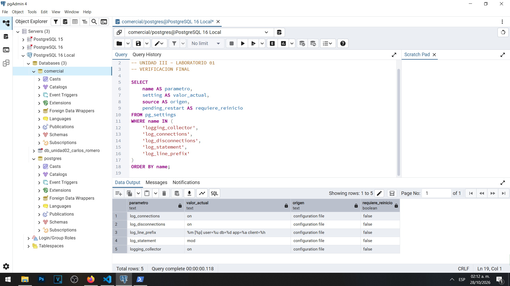
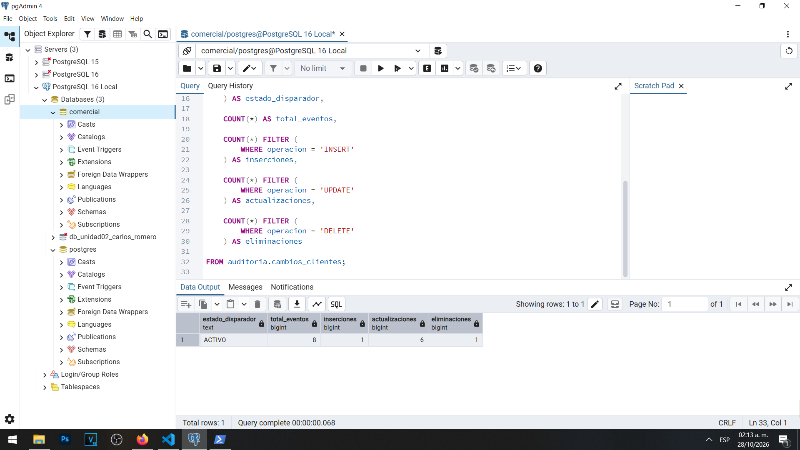
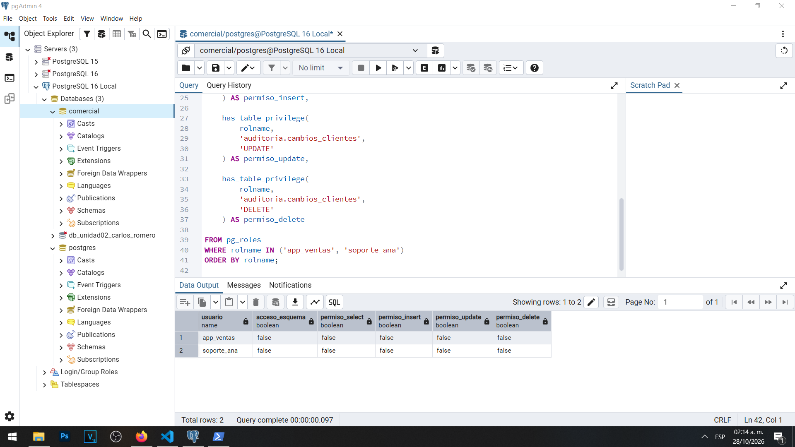

# Informe final — Laboratorio 01

**Materia:** Gestión de Seguridad y Desempeño de Bases de Datos  
**Unidad:** III — Auditoría, trazabilidad y gobierno práctico de datos  
**Laboratorio:** 01 — Bitácoras y auditoría del dato en PostgreSQL  
**Estudiante:** Carlos Romero  
**Motor:** PostgreSQL 16  
**Sistema operativo:** Windows  
**Herramientas:** pgAdmin 4, PowerShell, psql y Visual Studio Code  
**Fecha:** 28 de octubre de 2026

## 1. Despliegue y situación inicial

El laboratorio se desarrolló en una instalación local de PostgreSQL 16 sobre Windows, utilizando la base de datos `comercial`. Se empleó pgAdmin 4 para administrar el servidor y ejecutar instrucciones SQL, mientras que PowerShell y psql permitieron realizar pruebas con distintos usuarios.

El escenario consistió en investigar modificaciones realizadas sobre información sensible de la tabla `public.clientes`, especialmente el RFC de una clienta.

Inicialmente, los parámetros `log_connections` y `log_disconnections` estaban desactivados, mientras que `log_statement` tenía el valor `none`. Esta configuración limitaba la capacidad de reconstruir los acontecimientos, identificar quién ejecutó determinadas operaciones y conocer cuándo sucedieron.

Se comprobó que los permisos de acceso por sí solos no constituyen evidencia suficiente para investigar cambios en los datos.

## 2. Configuración aplicada

Se configuró el sistema de bitácoras para registrar conexiones, desconexiones y modificaciones.

| Parámetro | Configuración final |
|---|---|
| `logging_collector` | `on` |
| `log_connections` | `on` |
| `log_disconnections` | `on` |
| `log_statement` | `mod` |
| `log_line_prefix` | `%m [%p] user=%u db=%d app=%a client=%h ` |

El colector requirió reiniciar PostgreSQL para aplicar su configuración. Los demás parámetros pudieron actualizarse mediante recarga de configuración.

La verificación final mostró que todos los parámetros procedían del archivo de configuración y que ninguno tenía un reinicio pendiente.

El prefijo establecido permite identificar la fecha, hora, PID, usuario, base de datos, aplicación y dirección del cliente.

## 3. Eventos observados

Durante las prácticas se generaron y analizaron distintos eventos:

**Accesos exitosos:** Se verificó que el usuario `app_ventas` consiguió autenticarse y conectarse a la base de datos `comercial` desde `127.0.0.1`.

**Accesos fallidos:** Se realizaron pruebas con contraseñas incorrectas y con el usuario inexistente `usuario_inexistente`. PostgreSQL registró los errores de autenticación.

**Cambios de privilegios:** Las instrucciones `REVOKE UPDATE` y `GRANT UPDATE` permitieron observar modificaciones en los permisos de los usuarios.

**Cambios estructurales:** Se registró la instrucción `ALTER TABLE public.clientes` para agregar la columna `segmento`.

**Modificaciones de datos:** Se identificaron operaciones `UPDATE`, incluyendo una modificación del número telefónico realizada mediante `app_ventas`.

**Errores y operaciones rechazadas:** El intento de ejecutar `DELETE` mediante `soporte_ana` produjo un error de permisos, registrado en la bitácora.

**Sesiones activas:** Mediante `pg_stat_activity` se identificaron sesiones, aplicaciones, direcciones IP, estados de conexión y consultas en ejecución.

Estos resultados demostraron que los registros del servidor permiten interpretar acontecimientos y relacionarlos con los usuarios y aplicaciones participantes.

## 4. Auditoría a nivel de dato

Se creó el esquema `auditoria` y la tabla `auditoria.cambios_clientes`, diseñada para almacenar diez campos de información sobre las modificaciones realizadas.

Entre los datos registrados se encuentran:

- Identificador y momento del evento.
- Usuario de sesión y usuario efectivo.
- Aplicación y dirección IP.
- Operación realizada e identificador del cliente.
- Valores anteriores y posteriores, almacenados en formato JSONB.

También se implementó la función `auditoria.registrar_cambio_cliente`, utilizando `SECURITY DEFINER`, y el disparador `trg_auditoria_clientes`.

El uso de `SECURITY DEFINER` permite ejecutar la función con los privilegios de su propietario. Por ello, resulta importante conservar tanto `session_user`, que identifica la cuenta que inició la sesión, como `current_user`, que identifica el usuario efectivo durante la ejecución.

En una de las pruebas se registró una actualización con `usuario_sesion = app_ventas` y `usuario_efectivo = postgres`, demostrando esta diferencia.

La auditoría permitió identificar el RFC anterior y el nuevo valor de la clienta con identificador 3.

La comprobación final produjo estos resultados:

| Operación | Eventos |
|---|---:|
| INSERT | 1 |
| UPDATE | 6 |
| DELETE | 1 |
| **Total** | **8** |

El disparador permaneció activo al finalizar el laboratorio.

## 5. Limitaciones identificadas

Se identificaron tres limitaciones principales.

**Auditoría de lecturas:** La configuración `log_statement = mod` no registra consultas `SELECT` ordinarias. Asimismo, los disparadores de modificación no permiten registrar directamente las lecturas de una tabla.

**Volumen de información:** Una operación masiva puede generar una sola sentencia en la bitácora del servidor, pero múltiples registros en la tabla de auditoría. Durante la práctica, una actualización masiva de cinco clientes generó cinco eventos adicionales de auditoría.

**Control administrativo:** Un usuario con privilegios suficientes puede desactivar mecanismos de auditoría o modificar la configuración del servidor. Por ello, el registro local no constituye una protección absoluta contra administradores con control total.

## 6. Riesgos y protección de la bitácora

Los archivos de registro pueden contener información sensible, como sentencias SQL, datos personales, parámetros de conexión y secretos expuestos accidentalmente.

Para reducir estos riesgos se exportó una copia de la bitácora mediante PowerShell y psql, sustituyendo un secreto de práctica antes de guardar el archivo.

La exportación se almacenó como `evidencias/bitacora-lab01.log`.

Posteriormente se calculó su hash SHA-256 y se guardó en `evidencias/bitacora-lab01.sha256`.

La comparación realizada confirmó que el contenido exportado coincidía con el hash registrado.

Este mecanismo permite detectar alteraciones posteriores, siempre que el hash de referencia se conserve de forma confiable. No evita por sí mismo que alguien modifique o elimine los archivos.

Se recomienda custodiar las bitácoras en un almacenamiento separado, restringir el acceso y establecer políticas de retención y respaldo.

## 7. Cronología y conclusiones

La reconstrucción de los acontecimientos se desarrolló mediante la bitácora del servidor y los registros de `auditoria.cambios_clientes`.

Se identificaron cambios de configuración, conexiones exitosas y rechazadas, operaciones sobre privilegios, modificaciones estructurales, actualizaciones de datos y acciones sobre mecanismos de auditoría.

Se comprobó que, cuando la auditoría estaba habilitada, podía identificarse el usuario de sesión, la operación y los valores anteriores y posteriores del registro modificado.

Sin embargo, también se observó que una modificación realizada durante la desactivación del disparador podía no generar una nueva fila de auditoría. Esto representa una limitación importante para la reconstrucción completa de los acontecimientos.

**Conclusión general:** El laboratorio permitió comprobar que la seguridad de una base de datos no depende únicamente de los permisos asignados a sus usuarios. También requiere mecanismos de registro, trazabilidad, conservación e interpretación de evidencias.

La combinación de bitácoras y disparadores ofrece información complementaria para investigar incidentes, aunque debe acompañarse de controles administrativos y custodia independiente de registros.

## 8. Preguntas de reflexión

### 1. ¿Por qué la auditoría no puede configurarse después de un incidente para investigarlo?

Porque los mecanismos de auditoría deben encontrarse activos antes del acontecimiento. Su configuración posterior solo permite registrar operaciones futuras y no reconstruye automáticamente los eventos anteriores.

### 2. ¿Por qué conviene que la bitácora la administre el propio servidor y no el mecanismo de despliegue?

Porque facilita disponer de una configuración de registros controlada directamente por PostgreSQL, con independencia de la terminal, la herramienta administrativa o el mecanismo utilizado para iniciar el servicio. Sin embargo, la conservación de la evidencia debe realizarse también fuera del servidor.

### 3. ¿Por qué el prefijo de línea es tan importante como el nivel de `log_statement`?

Porque `log_statement` determina qué sentencias se registran, mientras que `log_line_prefix` aporta el contexto necesario para interpretarlas, como usuario, PID, fecha, base de datos, aplicación y dirección del cliente.

### 4. ¿Qué diferencia práctica hay entre registrar la sentencia y registrar el cambio en el dato?

La bitácora registra la instrucción ejecutada y su contexto, mientras que la auditoría del dato puede conservar los valores anteriores y posteriores de cada fila afectada. Ambos mecanismos se complementan para reconstruir acontecimientos.

### 5. ¿Qué evidencia ofrece `pg_stat_activity` que no ofrece la bitácora, y viceversa?

`pg_stat_activity` muestra el estado actual de las sesiones y las consultas que están en ejecución o que permanecen asociadas a una conexión. La bitácora conserva acontecimientos históricos registrados, incluso después de finalizar las sesiones.

### 6. Si el administrador puede cambiar `log_statement` a `none` y desactivar el disparador, ¿quién audita al administrador?

Se requiere una separación de funciones y un mecanismo independiente de custodia. Una organización puede enviar los registros a un sistema externo administrado por un equipo de seguridad distinto, limitar las facultades administrativas y establecer revisiones periódicas de los cambios de configuración. Un administrador con control total sobre el servidor no puede ser auditado de manera completamente confiable únicamente mediante controles alojados en ese mismo servidor.

## 9. Resultado de las verificaciones finales

Se verificaron satisfactoriamente:

- Los cinco parámetros principales de registro.
- El disparador de auditoría activo.
- Los ocho eventos de modificación registrados.
- La ausencia de permisos directos o heredados comprobados para los usuarios `app_ventas` y `soporte_ana` sobre la tabla de auditoría.

Los resultados respaldan el funcionamiento de los mecanismos implementados en las partes obligatorias del laboratorio.
